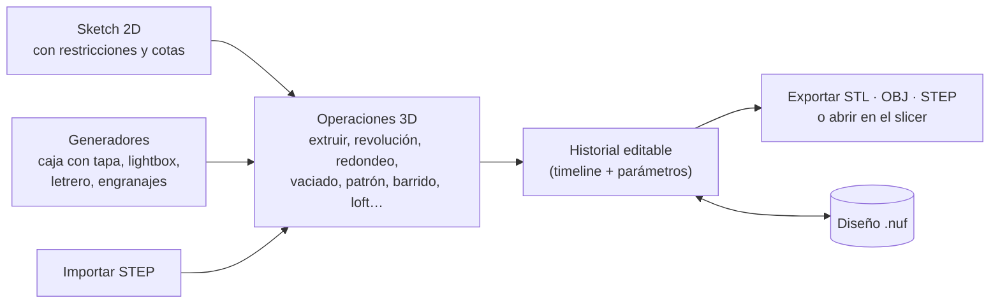

# NufioCAD

CAD paramétrico de escritorio para **Windows y Linux**: **offline**, con **archivos locales privados** y la facilidad de
uso de **Fusion 360** como meta. Pensado para diseñar piezas e imprimirlas en 3D.

> **NufioCAD** es el nombre de trabajo. En el código se usa el prefijo `nuf` (espacio de nombres `nuf::`, bibliotecas
> `nuf::<módulo>`), igual que la extensión de los diseños, `.nuf`.

## Qué hace



- **Sketch:** líneas, rectángulos, círculos, arcos, polígonos, ranuras, elipses, splines, cónicas, texto, imagen de
  referencia y DXF; restricciones automáticas al dibujar con líneas guía al estilo Onshape; cotas sobre el lienzo.
- **Modelado paramétrico:** cada operación guarda sus parámetros (pueden ser expresiones como `alto*2`) y al cambiar una
  se recalcula lo que sigue. Las caras se citan por nombre estable, así que editar el pasado no rompe el resto.
- **Más:** planos y ejes de construcción, mover y girar cuerpos con el ratón, uniones, medir, sección, revisión para
  imprimir, roscas, engranajes, unidades mm/cm/m/in, temas claro y oscuro, copia de recuperación.

**Estado:** versión **0.2.0** (24 nov. 2026). Instalador y ZIP para Windows en las [Releases](https://github.com/GeoNufio1404/NufioCAD/releases); Fedora por probar; el trabajo sigue en la rama `develop`. Lo
hecho y lo que falta: [hoja de ruta](docs/hoja-de-ruta.md).

## Con qué está hecho

| Pieza | Tecnología |
|---|---|
| Lenguaje | C++20 |
| Kernel geométrico | [OpenCASCADE](https://dev.opencascade.org) |
| Interfaz y visor 3D | [Qt 6](https://www.qt.io) Widgets + visor AIS de OpenCASCADE |
| Solver de restricciones 2D | PlaneGCS (de [FreeCAD](https://www.freecad.org)) + Eigen |
| Archivo `.nuf` | SQLite con parámetros en JSON ([nlohmann/json](https://github.com/nlohmann/json)) |
| Build, pruebas y CI | CMake + vcpkg, Catch2, GitHub Actions (Windows y Ubuntu) |

Por qué cada una: [docs/decisiones.md](docs/decisiones.md).

## Compilar rápido

```bash
cmake --preset linux-debug          # o windows-debug
cmake --build --preset linux-debug
ctest --preset linux-debug
./build/linux-debug/src/app/NufioCAD
```

Requisitos, Windows paso a paso y opciones: [docs/desarrollo.md](docs/desarrollo.md).

## Estructura del repositorio

```
NufioCAD/
├── src/                     código, un módulo por carpeta (ver docs/arquitectura.md)
│   ├── sketch/              sketch 2D, restricciones y herramientas de dibujo (sin Qt ni OCCT)
│   ├── geometry/            operaciones sólidas sobre OpenCASCADE, nombres de caras, mallas
│   ├── document/            historial de operaciones, parámetros, recálculo, generadores
│   ├── commands/            deshacer y rehacer
│   ├── io/                  archivo .nuf (SQLite + JSON)
│   ├── render/              visor 3D (Qt + OpenCASCADE)
│   └── app/                 ventana, herramientas, diálogos y ejecutable
├── tests/                   pruebas del núcleo (Catch2, sin Qt) y tests/data/v1.nuf de referencia
├── third_party/planegcs/    solver PlaneGCS copiado de FreeCAD (LGPL-2.1+, ver su README)
├── cmake/                   funciones comunes de CMake (advertencias, bibliotecas)
├── packaging/linux/         lanzador .desktop, tipo MIME e instalación local
├── docs/                    documentación (índice en docs/README.md)
├── .github/workflows/       CI en Windows y Linux
├── CMakeLists.txt · CMakePresets.json · vcpkg.json
└── .clang-format · .editorconfig · .gitattributes
```

## Documentación

Empieza por el [índice de `docs/`](docs/README.md). Los diagramas están en [Mermaid](https://mermaid.js.org) y GitHub
los dibuja solos.

## Licencia

NufioCAD es de código abierto, con licencia [MIT](LICENSE).

## Licencias de terceros

- **PlaneGCS:** LGPL-2.1 o posterior, enlazado estáticamente (`third_party/planegcs/LICENSE`).
- **Iconos de [Lucide](https://lucide.dev):** ISC.
- OpenCASCADE, Qt, SQLite, Eigen, nlohmann/json y Catch2 se usan como bibliotecas externas, cada una con su licencia.
