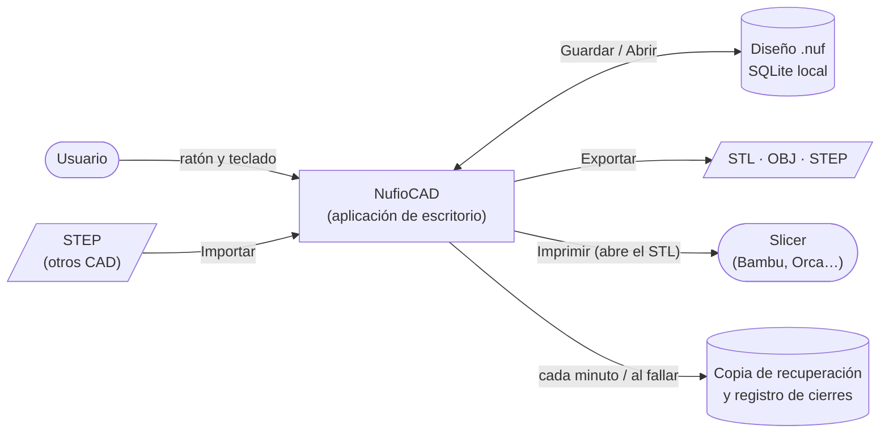
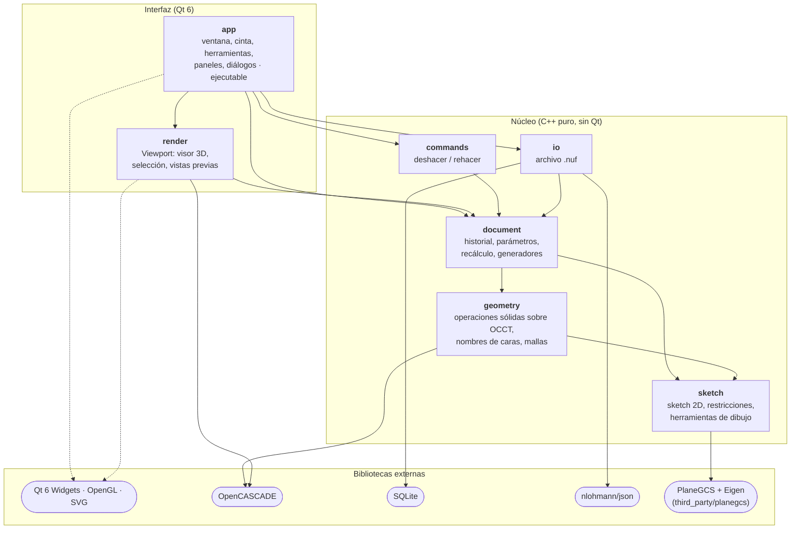
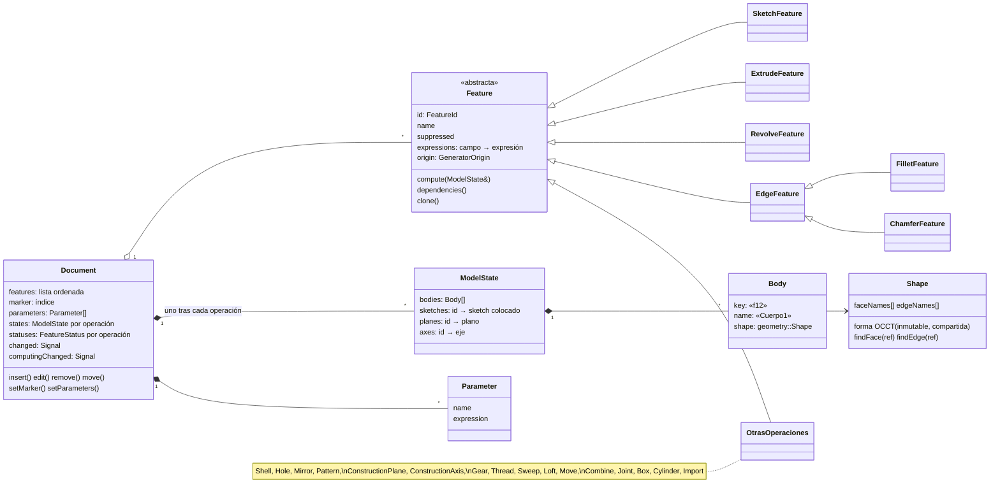
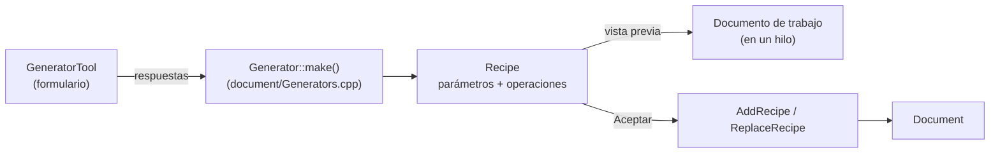
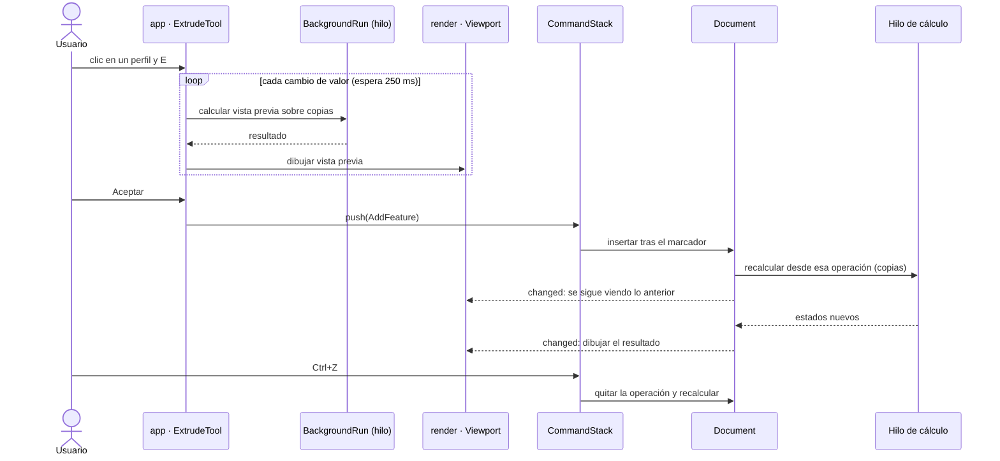
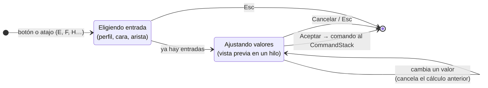
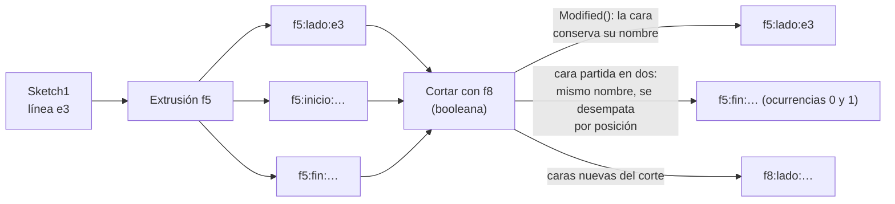
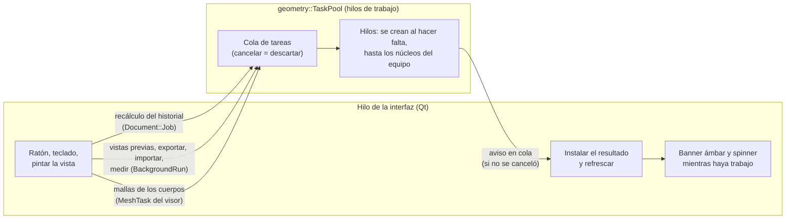
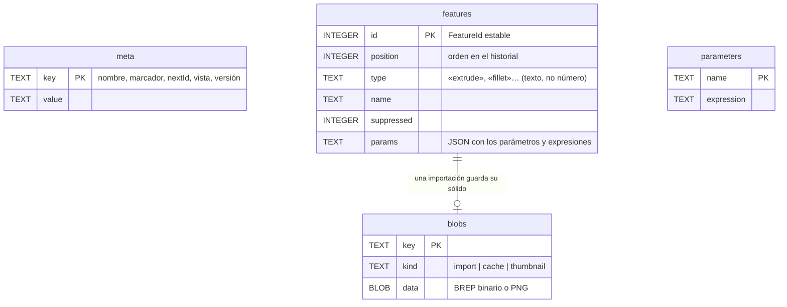

# Arquitectura de NufioCAD

Cómo está hecho el programa **hoy** (noviembre de 2026, versión 0.1.x): qué piezas tiene, qué hace cada una, dónde
está en el código y cómo se hablan entre sí. El **porqué** de cada elección está en [`decisiones.md`](decisiones.md);
cómo compilar y probar, en [`desarrollo.md`](desarrollo.md).

Los diagramas están en [Mermaid](https://mermaid.js.org): GitHub y la mayoría de los editores los dibujan solos.

---

## 1. Visión general

NufioCAD es un CAD paramétrico de escritorio: el usuario dibuja sketches 2D, los convierte en sólidos con operaciones
(extruir, revolución, redondeo…) y el programa **guarda la lista de operaciones con sus parámetros**, no la pieza. La
pieza se recalcula cada vez que algo cambia. Todo es local: no hay servidor ni cuenta.

### Principios que lo ordenan todo

1. **El documento guarda parámetros, no geometría.** La forma 3D es un resultado que se puede tirar y recalcular.
2. **Núcleo sin Qt.** Sketch, geometría, documento, comandos y archivos son C++20 puro: se prueban sin abrir ventanas.
3. **OpenCASCADE (OCCT) encerrado.** Solo `geometry/` y `render/` incluyen cabeceras de OCCT; el resto usa tipos propios.
4. **Todo cambio pasa por un comando**, así deshacer y rehacer funcionan siempre igual.
5. **Las caras y aristas se citan por nombre**, nunca por número («nombrado topológico», sección 6).
6. **La interfaz nunca espera a la geometría**: lo pesado va en hilos de trabajo sobre copias (sección 7).

---

## 2. Módulos y dependencias

El código está en `src/`, un módulo por carpeta. Cada uno publica sus cabeceras en `src/<módulo>/include/nuf/<módulo>/`
y se enlaza en CMake como `nuf::<módulo>`. Las flechas van de quien usa a lo usado; **no hay ciclos**.

> `geometry` depende de `sketch` y no al revés: `sketch` define los tipos 2D (`Vec2`, `Plane`, curvas) y `geometry` los
> convierte en caras de OCCT. Así el sketch se prueba sin OpenCASCADE.

| Módulo | Qué hace | Archivos principales |
|---|---|---|
| `sketch` | Modelo del sketch (entidades, restricciones, cotas), solver detrás de `ISolver`, perfiles cerrados, ajuste (*snap*) e inferencias, herramientas de dibujo y edición como máquinas de estados, colocación de cotas, DXF | `Sketch.hpp`, `Solver.hpp` + `PlaneGcsSolver.cpp`, `Profiles.hpp`, `Snap.hpp`, `Tools.hpp` (+ `ShapeTools`, `CircleTools`, `CurveTools`, `EditTools`), `Annotations.hpp`, `Dxf.hpp` |
| `geometry` | Único traductor a OCCT para el núcleo: `Shape` (forma + nombres de caras y aristas), extruir, revolución, booleanas, redondeo, vaciado, patrón, espejo, engranaje, rosca, barrido, loft; medir; revisión para imprimir; mallas para la vista; STL/OBJ/STEP; cancelación y el grupo de hilos de trabajo (`TaskPool`) | `Shape.hpp`, `Modeling.hpp` (`Modeling.cpp`), `Naming.hpp`, `SketchFaces.cpp`, `Exchange.hpp`, `Measure.hpp`, `Printability.hpp`, `DisplayMesh.hpp`, `Cancel.hpp` |
| `document` | `Document` (historial, marcador, parámetros, estados calculados, cálculo en segundo plano), las 21 operaciones (`Feature`), expresiones, generadores (recetas), `Signal<>` propio | `Document.hpp`, `Feature.hpp`, `Features.hpp` (`Features.cpp`, `FeaturesMore.cpp`), `Expression.hpp`, `Generators.hpp`, `Signal.hpp` |
| `commands` | Cambios reversibles: agregar, editar, borrar, suprimir, mover, marcador, parámetros, nombres de cuerpos, recetas de generadores | `Command.hpp`, `CommandStack.hpp`, `FeatureCommands.hpp`, `AddRecipe.hpp`, `ReplaceRecipe.hpp`, `SetParameters.hpp` |
| `io` | El `.nuf`: esquema SQLite, serialización JSON de cada operación, guardado atómico, miniatura, `--dump` | `NufFile.hpp`, `DocumentFile.hpp` |
| `render` | `Viewport` (un `QOpenGLWidget` con el visor V3d/AIS de OCCT): cuerpos, sketch, selección, gizmos, flechas de medida, sección, ViewCube, mallas en segundo plano | `Viewport.hpp`, `ViewportImpl.hpp` (privado), `ViewportDrawing.hpp` |
| `app` | El ejecutable: ventana, cinta, navegador y timeline, herramientas de modelado y generadores, sesión de sketch, diálogos, temas, unidades, recuperación, informe de cierres, prueba automática de la interfaz | ver la tabla de abajo |

### Dentro de `app/`

| Archivo | Responsabilidad |
|---|---|
| `main.cpp` | Arranque y opciones de línea de comandos (`--dump`, `--self-check`, `--prueba-interfaz`…) |
| `MainWindow.*` (`Menus`, `View`, `Files`) | Ventana principal: acciones y cinta, refresco del modelo, abrir/guardar/importar/exportar |
| `Ribbon`, `NavBar`, `ModelPanels` (navegador y timeline), `StartScreen`, `Icons`, `Theme` | Piezas de la interfaz estilo Fusion 360 |
| `SketchSession` | Edición de un sketch: traduce el ratón a las herramientas de `sketch/`, resuelve y dibuja |
| `FeatureTools*` | Una herramienta por operación (Extruir, Redondeo, Patrón, Mover…) con panel y vista previa |
| `GeneratorTool` | Formulario de un generador con vista previa en vivo |
| `BackgroundRun` | Ejecuta un cálculo en un hilo y avisa al terminar (vistas previas) |
| `ExpressionSpinBox`, `ValueInput`, `Units` | Cuadros numéricos con expresiones y unidades; valores junto al cursor |
| `ExportDialog`, `ParametersDialog`, `BodiesDialog`, `SettingsDialog` | Diálogos |
| `Recovery`, `CrashHandler` | Copia de recuperación cada minuto; informe y volcado si el programa se cierra por un fallo (Windows) |
| `InterfaceCheck`, `SelfCheck` | Prueba automática de la interfaz (`--prueba-interfaz`) y autoprueba del stack (`--self-check`) |

---

## 3. Modelo del documento

- **Historial:** `Document` guarda las operaciones en orden y un **marcador**; lo que queda después del marcador no se
  calcula (como arrastrar el marcador del timeline de Fusion 360).
- **Estados en caché:** tras cada operación se guarda el `ModelState` resultante. Al editar la operación *k* se parte del
  estado de *k − 1* y solo se recalcula de *k* en adelante. Los cuerpos que no cambian comparten la misma forma (las
  formas son inmutables y se comparten con `shared_ptr`), así que guardar un estado por operación es barato.
- **Errores sin perder nada:** si una operación falla queda en error con el motivo (`FeatureStatus`), las siguientes se
  calculan sobre el último estado bueno, y el archivo se guarda igual.
- **Parámetros y expresiones:** cada campo numérico de una operación puede ser una expresión (`alto*2`, `10 mm`); se
  evalúan con `Expression.hpp` justo antes de calcular, sobre una copia.
- **Señales sin Qt:** `Signal<>` (`Signal.hpp`) es una plantilla mínima propia; la interfaz se suscribe a `changed` y
  `computingChanged`.

### Generadores

Un generador (Lightbox, Caja con tapa, Letrero, Par de engranajes, Engranaje interno, Cremallera) **no es un tipo de
operación**: hace unas preguntas y produce una **receta** (`Recipe`): parámetros con nombre más operaciones normales
ligadas a ellos. Después todo se edita como cualquier otra operación. Las operaciones recuerdan de qué generador
salieron (`GeneratorOrigin`), por eso se puede «Reabrir» el formulario. Medidas de cada uno en
[`generadores.md`](generadores.md).

---

## 4. Comandos y deshacer

Cada cambio del usuario es un `Command` con `execute` y `undo` que se apila en el `CommandStack`. Los comandos usan el
patrón **memento**: guardan una copia de la operación (sus parámetros, nunca geometría) antes y después; deshacer es
volver a poner la copia y recalcular. `CommandStack` recuerda el punto guardado, así que deshacer hasta ahí quita el
«*» del título.

| Comando | Qué hace |
|---|---|
| `AddFeature`, `EditFeature`, `DeleteFeature`, `SuppressFeature`, `MoveFeature`, `SetMarker` | Historial |
| `SetParameters` | Tabla de parámetros (y renombrar en todas las expresiones) |
| `SetBodyInfo`, `RenameDocument` | Nombres de cuerpos, componentes y del diseño |
| `AddRecipe`, `ReplaceRecipe` | Aplicar o reabrir un generador como un solo paso |

---

## 5. Flujo de una operación: extruir

Cada herramienta de modelado (`app/src/FeatureTools*.cpp`) es una pequeña máquina de estados; Cancelar no deja rastro
en el historial:

Las herramientas de **dibujo del sketch** son la excepción: su lógica (estados, vista previa, restricciones
automáticas) vive en `sketch/Tools.hpp` sin Qt, para probarla sin ventana; `app/SketchSession` solo les pasa el cursor
y dibuja lo que devuelven. Al terminar el sketch, todo lo editado entra como **un solo** `EditFeature`.

---

## 6. Nombrado topológico (caras y aristas estables)

Una operación que necesita una cara (un sketch sobre ella, «hasta una cara», un redondeo en una arista) **no guarda
«cara 7»**: guarda un nombre que describe su origen (`ElementRef`). Cada operación nombra lo que crea y las booleanas
pasan los nombres al resultado con el historial de OCCT (`Modified()` / `Generated()`).

- Formato: `f<id de la operación>:<papel>[:<origen>]`, por ejemplo `f5:lado:e3`, `f5:fin:<perfil>`, `f9:redondeo:<arista>`,
  `f12:patron2:<nombre original>`. Las aristas se nombran por las dos caras que separan.
- Si un nombre aparece en varias caras (una cara partida por un corte), se ordenan por su centro y la referencia guarda
  cuál es (`occurrence`).
- Implementación: `geometry/src/Naming.hpp` (`Namer`) y `Shape::findFace` / `findEdge`.

---

## 7. Hilos: cómo se evita que la ventana se congele

Todo lo de Qt y de la vista 3D ocurre en el **hilo de la interfaz**. Los cálculos pesados se hacen en **hilos de
trabajo sobre copias** (las formas son inmutables, así que copiarlas es copiar un puntero) y el resultado vuelve al
hilo de la interfaz con una llamada en cola (`QMetaObject::invokeMethod`). Los hilos de trabajo viven en **un solo
grupo** (`geometry::TaskPool`, sin Qt): se crean cuando hacen falta, se reutilizan y se recogen al cerrar. Un cambio
nuevo **cancela** el cálculo en curso: una tarea que aún esperaba en la cola se descarta sin ejecutarse, y una que ya
corre ve la petición con `geometry::cancelRequested()`, que miran las booleanas, el mallado y las construcciones largas
(loft, redondeo, vaciado, barrido, rosca y engranaje helicoidal).

| Quién encarga | Qué se calcula aparte |
|---|---|
| `Document::startBackground` (`document/src/Document.cpp`) | El historial desde la primera operación que cambió |
| `BackgroundRun` (`app/src/BackgroundRun.cpp`) | Vista previa de cada herramienta y generador, exportar, importar STEP, medir, miniaturas de recientes |
| `ViewportImpl::startMeshTask` (`render/src/ViewportImpl.hpp`) | La malla de cada cuerpo nuevo y del sólido de la vista previa |
| `Recovery::writeAsync` (`app/src/Recovery.cpp`) | La copia de recuperación (su propio hilo, para poder esperarla al descartarla) |

Mientras haya algo cargando, la barra de estado pasa a **ámbar** y gira un **spinner** (en la barra y sobre la vista):
no mide porcentaje, solo dice que hay trabajo en marcha (`MainWindow::anythingBusy`).

Lo que **todavía** se hace en el hilo de la interfaz y puede tardar está en
[`auditorias/auditoria-3-fluidez.md`](auditorias/auditoria-3-fluidez.md) y en la Oleada 6 de la
[hoja de ruta](hoja-de-ruta.md).

---

## 8. El archivo `.nuf`

Un `.nuf` es una base de datos **SQLite** de un solo archivo; los parámetros de cada operación van en JSON. La
geometría no se guarda (se recalcula al abrir), salvo los sólidos importados, que no tienen historial.

- `PRAGMA application_id` identifica el archivo como `.nuf` y `PRAGMA user_version` es la versión del esquema (para
  migraciones). `tests/data/v1.nuf` es un archivo de referencia: si un cambio rompe el formato, una prueba falla.
- **Guardado atómico:** se escribe en `<archivo>.guardando` y se reemplaza el original (con reintentos si OneDrive o
  un antivirus lo bloquean un instante); el original nunca se borra antes.
- Código: `io/src/NufFile.cpp` (esquema y SQLite) y `io/src/DocumentFile.cpp` (JSON de cada tipo de operación).
- `NufioCAD --dump archivo.nuf` imprime el contenido como JSON legible.

---

## 9. Dónde buscar

| Si quieres… | Mira en |
|---|---|
| Añadir una operación nueva | `document/Features.hpp` (clase), `geometry/Modeling.hpp` (la geometría con nombres), `io/DocumentFile.cpp` (guardarla), `app/FeatureTools*.cpp` (herramienta), `tests/` |
| Añadir un generador | `document/src/Generators.cpp` (clase `Generator` y su receta) y [`generadores.md`](generadores.md) |
| Cambiar cómo se dibuja algo | `render/src/ViewportImpl.hpp` |
| Una herramienta de dibujo del sketch | `sketch/include/nuf/sketch/Tools.hpp` y `sketch/src/*Tools.cpp` |
| El solver de restricciones | `sketch/src/PlaneGcsSolver.cpp` y `third_party/planegcs/` |
| El formato del archivo | `io/src/DocumentFile.cpp` y `io/src/NufFile.cpp` |
| La cinta, los menús y los atajos | `app/src/MainWindowMenus.cpp` |
| Por qué se eligió algo | [`decisiones.md`](decisiones.md) |
