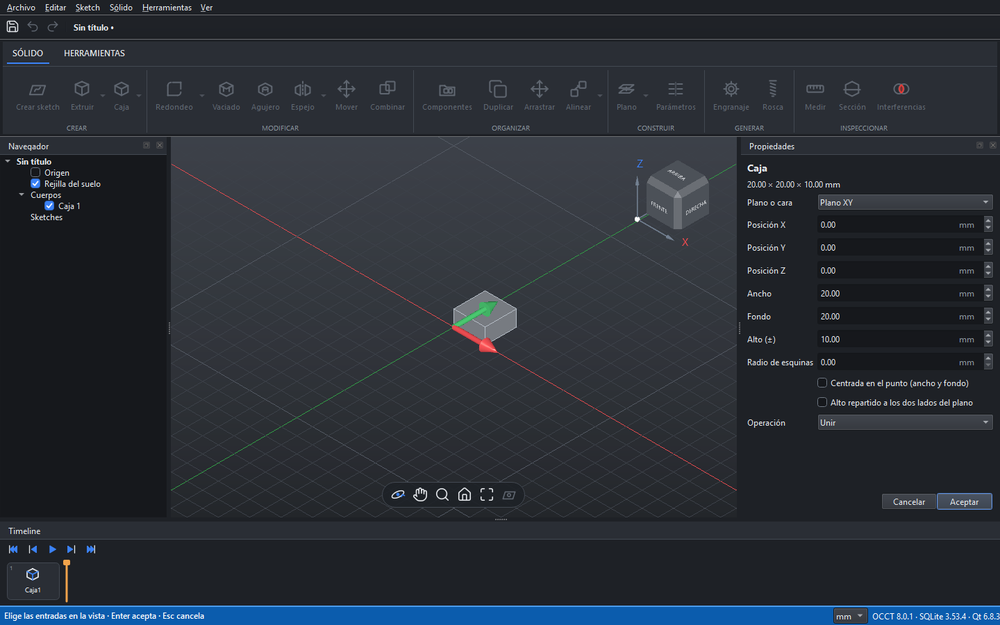
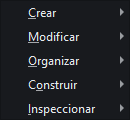
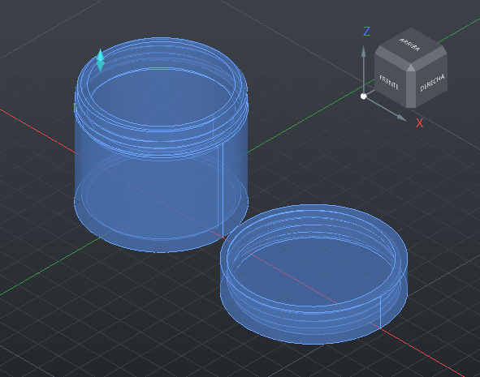
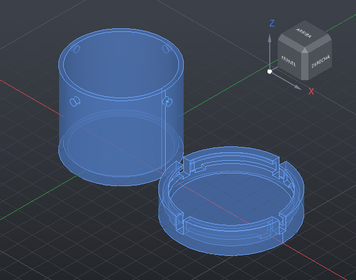
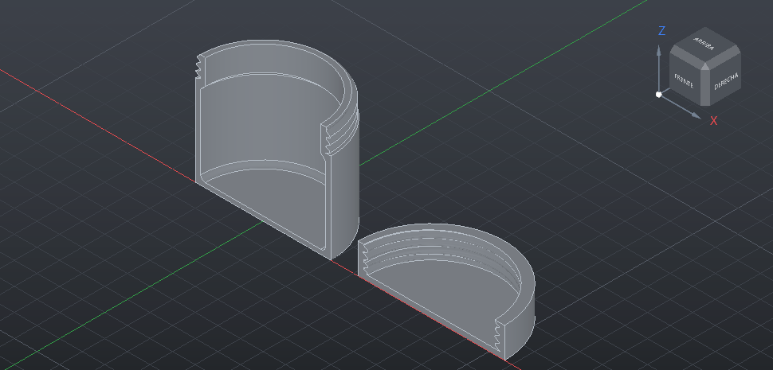

# Capturas de la interfaz

Salen del propio programa (`NufioCAD --captura-temas <carpeta>`, ver [`desarrollo.md`](../desarrollo.md)), en tema oscuro y
con la ventana a su tamaño de prueba. Se rehacen cuando cambia la interfaz.

## Ventana con la herramienta Caja

Las flechas **roja (X)** y **verde (Y)** colocan el cuerpo nuevo sobre el plano XY; al arrastrar una queda una sombra
translúcida que sigue al cursor y, al soltar, el cuerpo se calcula en su sitio. A la derecha, el panel de propiedades; abajo,
la timeline con sus botones de reproducción.

## Menú Sólido

Cinco submenús por familia de herramientas: Crear, Modificar, Organizar, Construir e Inspeccionar.

## Bote con tapa

Las flechas turquesa señalan la medida que se edita. De rosca (alto de la rosca), de bayoneta (los pines, las entradas y las
gradas de la tapa) y el de rosca cortado por la mitad: el hueco, el hombro a 45° y la rosca de la tapa.

