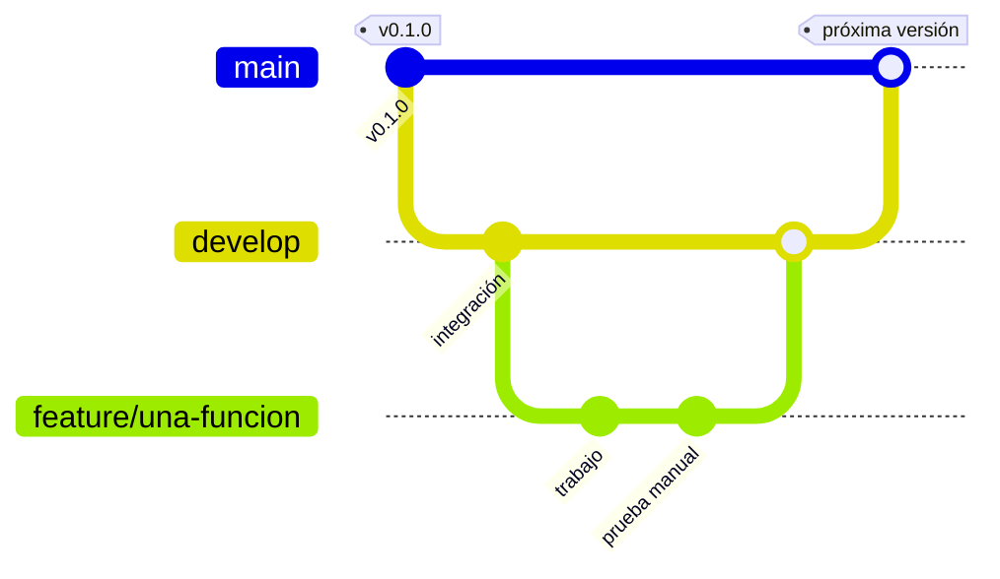

# Desarrollo: compilar, probar y contribuir

Todo lo necesario para trabajar en el código de NufioCAD. Qué es cada módulo: [`arquitectura.md`](arquitectura.md).

## Requisitos

| Herramienta | Windows | Linux (Fedora) | Linux (Ubuntu 24.04) |
|---|---|---|---|
| Compilador C++20 | Visual Studio 2022 («Desarrollo para el escritorio con C++», trae CMake y Ninja) | `gcc-c++ cmake ninja-build` | `build-essential cmake ninja-build` |
| Qt 6 (Widgets, OpenGL, SVG) | Instalador oficial, componente *MSVC 2022 64-bit* | `qt6-qtbase-devel qt6-qtsvg-devel` | `qt6-base-dev libqt6svg6-dev` |
| OpenCASCADE, SQLite, Eigen, nlohmann/json, Catch2 | Por **vcpkg** (automático al configurar) | `opencascade-devel sqlite-devel eigen3-devel json-devel catch-devel` (y `tbb-devel` si CMake lo pide) | ver los paquetes en `.github/workflows/ci.yml` |

### Windows, una sola vez

```powershell
git clone https://github.com/microsoft/vcpkg C:\dev\vcpkg
C:\dev\vcpkg\bootstrap-vcpkg.bat
setx VCPKG_ROOT C:\dev\vcpkg
setx QT_ROOT C:\Qt\6.8.3\msvc2022_64
setx VSLANG 1033
```

- Ajusta `QT_ROOT` a la versión de Qt instalada.
- **`VSLANG=1033` es importante con Visual Studio en español:** MSVC escribe «Nota: inclusión del archivo», ninja no lo
  reconoce y deja de detectar cambios en cabeceras (síntoma: fallos absurdos en pruebas que antes pasaban). Si ya
  compilaste sin ella tras tocar un `.hpp`, recompila con `--clean-first`.
- El clon de vcpkg debe ser **completo** (no `--depth 1`) y estar al día: `vcpkg.json` fija las versiones con una
  `builtin-baseline` (al fijarla: OpenCASCADE 8.0.1, SQLite 3.53.4, Catch2 3.16.0). Para actualizarlas:
  `vcpkg x-update-baseline`.

## Compilar, probar y ejecutar

Hay un preset por sistema y configuración (`CMakePresets.json`):

| Preset | Uso |
|---|---|
| `windows-debug`, `windows-release` | MSVC + vcpkg (desde *x64 Native Tools Command Prompt for VS 2022*, o abriendo la carpeta en Visual Studio) |
| `linux-debug`, `linux-release` | GCC + paquetes del sistema |
| `linux-vcpkg-release` | GCC + las mismas versiones fijadas que Windows (necesita `VCPKG_ROOT`) |

```bash
cmake --preset linux-debug
cmake --build --preset linux-debug
ctest --preset linux-debug
./build/linux-debug/src/app/NufioCAD
```

En Windows, los mismos comandos con `windows-debug`, y para ejecutar:

```powershell
$env:PATH = "$env:QT_ROOT\bin;$env:PATH"
.\build\windows-debug\src\app\NufioCAD.exe
```

La primera configuración en Windows tarda (vcpkg compila OpenCASCADE); las siguientes reutilizan lo compilado.

Opciones de CMake: `NUF_BUILD_APP` (la interfaz; `OFF` compila solo el núcleo y las pruebas), `NUF_BUILD_TESTS` y
`NUF_WARNINGS_AS_ERRORS` (por defecto `ON`).

### Release en Windows

```powershell
$env:VCPKG_ROOT = "C:\dev\vcpkg"; $env:QT_ROOT = "C:\Qt\6.8.3\msvc2022_64"; $env:VSLANG = "1033"
cmake --preset windows-release
cmake --build --preset windows-release
```

vcpkg compila OpenCASCADE solo para Release (triplete `x64-windows-release`) la primera vez, y tarda. **Con Smart App Control activo en Windows 11, el `.exe` no se puede ejecutar** (los binarios sin firmar no cumplen el nivel de firma): hay que probar en otra máquina o en una máquina virtual, o apagarlo (es irreversible en esa instalación de Windows). Ver la Oleada 7 de la [hoja de ruta](hoja-de-ruta.md) y [`decisiones.md`](decisiones.md#distribución-y-firma-de-código-windows).

## Pruebas

| Qué | Cómo | Cubre |
|---|---|---|
| Pruebas del núcleo (Catch2, ~250 casos) | `ctest --preset <preset>` o `nuf_tests` | Sketch, solver, geometría, historial, archivo, comandos, generadores. Sin Qt |
| Medidas de tiempo (ocultas) | `nuf_tests "[.bench]"`, `nuf_tests "[.perf]"` | Banco del sketch grande, rosca, engranaje, historial largo |
| Prueba automática de la interfaz | `NufioCAD --prueba-interfaz [--informe archivo.txt] [--umbral-ms N]` | Abre la ventana real, recorre ~36 pasos y mide la **parada máxima de la interfaz** de cada uno (un vigilante anota la pila si se pasa del umbral) |
| Pruebas manuales | [`guia-de-pruebas.md`](guia-de-pruebas.md) | Lo que no ve una prueba automática: claridad, fluidez, aspecto |
| Archivo de referencia | `tests/data/v1.nuf` | Si un cambio rompe el formato `.nuf`, falla una prueba. Se regenera **solo a propósito** con `NUF_WRITE_REFERENCE=1` |

Cómo medir el rendimiento de forma comparable: [`rendimiento/mediciones.md`](rendimiento/mediciones.md).

## Opciones de la línea de comandos

| Opción | Qué hace |
|---|---|
| `NufioCAD archivo.nuf` | Abre ese diseño (también se puede arrastrar un `.nuf` o un `.step` a la ventana) |
| `--dump archivo.nuf` | Imprime el diseño como JSON legible y sale |
| `--self-check` | Comprueba Qt, OpenCASCADE y SQLite sin abrir ventanas; lo usa el CI |
| `--prueba-interfaz` | Prueba automática de la interfaz (ver arriba) |
| `--captura-temas <carpeta>` | Guarda capturas de la ventana, menús y diálogos en tema claro y oscuro |
| `--probar-cierre` | Provoca un fallo para comprobar el informe de cierres |

### Variables de entorno

| Variable | Para qué |
|---|---|
| `NUF_RECOVERY_SECONDS` | Cada cuántos segundos se guarda la copia de recuperación (por defecto 60) |
| `NUF_WRITE_REFERENCE=1` | Regenera `tests/data/v1.nuf` |
| `NUF_VIGILANTE=1` (o ms) | Anota en `cierres/paradas.txt` cada parada de la interfaz con su pila (Windows) |
| `NUF_PRUEBA_SOLO=<texto>` | Con `--prueba-interfaz`, solo los pasos cuyo nombre contiene el texto |
| `NUF_PRUEBA_PILA_MS=<ms>` | Con `--prueba-interfaz`, umbral de parada para anotar la pila (por defecto 1000) |
| `NUF_PRUEBA_CAPTURAS=<carpeta>` | Con `--prueba-interfaz`, guarda la captura de la vista previa translúcida |
| `NUF_SAMPLE_STEP=<ruta>` | Con `nuf_tests "[sample]"`, escribe un STEP de muestra |
| `QT_QPA_PLATFORM` | En Linux con Wayland la app usa XWayland (`xcb`) salvo que esta variable diga otra cosa |

### Dónde guarda cosas la aplicación

| Qué | Dónde (Windows; en Linux, el equivalente de `QStandardPaths`) |
|---|---|
| Copias de recuperación | `%APPDATA%\NufioCAD\NufioCAD\recuperacion\` |
| Informes de cierres inesperados (`.txt` con la pila y `.dmp`) | `%APPDATA%\NufioCAD\NufioCAD\cierres\` |
| Preferencias (unidades, tema, recientes, respuestas de los generadores) | `QSettings` (registro de Windows / `~/.config/NufioCAD/`) |

## Reglas de código

- **Núcleo sin Qt** (`sketch`, `geometry`, `document`, `commands`, `io`). Qt solo en `render` y `app`.
- **OpenCASCADE solo en `geometry` y `render`.** El resto usa `geometry::Shape` y los tipos de `sketch`.
- Rutas siempre con `std::filesystem::path`; nunca armadas a mano con `/` o `\`. Abrir archivos con `path` (no
  `char*`) para que funcionen los acentos en Windows.
- Texto en UTF-8 en el núcleo; conversión a `QString` solo en la interfaz.
- Nada de APIs de un solo sistema en el núcleo (`unistd.h`, `windows.h`). Lo que dependa del sistema va en `app/` y
  usa Qt (`QStandardPaths`…). Lo que difiere entre sistemas va con `#if` o CMake en el mismo código, **nunca en ramas**.
- Las advertencias son errores (MSVC `/W4 /permissive- /WX`; GCC/Clang `-Wall -Wextra -Wpedantic -Wshadow -Werror`; se desactiva con `NUF_WARNINGS_AS_ERRORS=OFF`).
- Formato con `.clang-format`; fin de línea LF (`.gitattributes`).
- Lo pesado (geometría, mallas, archivos grandes) no se hace en el hilo de la interfaz: ver
  [`arquitectura.md`](arquitectura.md) §7.

## Ramas y versiones



- `main` solo guarda versiones estables, cada una con su etiqueta (la primera: `v0.1.0`, 9 nov. 2026).
- `develop` es la rama de integración.
- Cada cambio va en `feature/<nombre>`, que sale de `develop` y vuelve a ella **después de la prueba manual**.
- `estable-windows` y `estable-fedora` no son copias del código: marcan el último commit de `develop` probado a mano en
  cada sistema y no reciben commits propios. Se avanzan con `git switch estable-<sistema>` y
  `git merge --ff-only develop` tras probar. `git log estable-fedora..estable-windows` lista lo que falta probar en
  Fedora. `main` recibe `develop` solo cuando los dos marcadores apuntan al mismo commit.
- El CI (`.github/workflows/ci.yml`) compila y prueba en Ubuntu y Windows en `main`, `develop`, `feature/**` y los pull
  requests.

## Cómo se documenta cada cambio

Cada entrega deja:

1. Su línea **«Pendiente de …»** en la [hoja de ruta](hoja-de-ruta.md): lo que no se hizo, lo que no se probó a mano y
   los límites conocidos.
2. Sus pasos en la [guía de pruebas](guia-de-pruebas.md), con un ID único.
3. Su entrada en el [registro de cambios](registro-de-cambios.md): qué cambió, en qué archivos y cómo volver atrás.
4. Si cambia la estructura del código, el diagrama correspondiente en [`arquitectura.md`](arquitectura.md).
