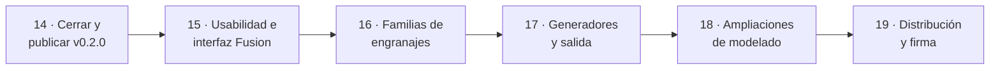
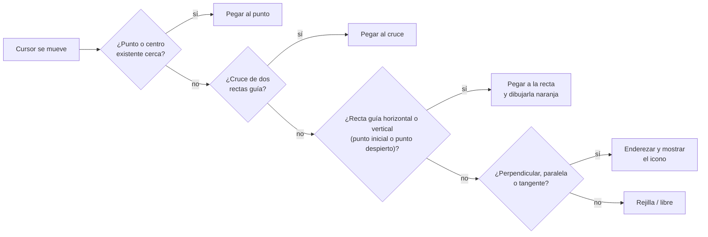

# Hoja de ruta — NufioCAD (CAD paramétrico de escritorio en C++)

> **Cómo leer este documento.** Todo el trabajo se ordena en **fases** numeradas. Las **0–13 están hechas** y las
> **14–19 son lo que sigue, en el orden en que se harán**. Arriba está [dónde estamos](#dónde-estamos-16-nov-2026);
> después, [lo que sigue](#lo-que-sigue-en-orden); al final, el [historial de las fases hechas](#fases-hechas) y los
> [fundamentos](#fundamentos-decisiones-de-partida). Cada punto pendiente lleva un identificador (P1, U3, E2…) para
> nombrarlo en ramas, commits y la guía de pruebas. **Convención:** cada bloque termina con su «**Pendiente de …**»
> (lo que no se hizo, lo que no se probó a mano, límites conocidos); lo que salga después se anota ahí y, si es trabajo
> aparte, en la fase pendiente que toque. Cómo está hecho el código: [`arquitectura.md`](arquitectura.md); por qué cada
> tecnología: [`decisiones.md`](decisiones.md); compilar y ramas: [`desarrollo.md`](desarrollo.md).

## Visión

Un CAD paramétrico de escritorio para **Windows y Linux**, **offline y con archivos locales privados**, con la facilidad de uso de **Fusion 360** como meta. El flujo principal: hacer un sketch 2D sobre un plano o una cara, extruirlo y construir la pieza en 3D con un historial editable, para luego exportarla a STL, OBJ o STEP e imprimirla en 3D.

**Motivación:**
- FreeCAD: mismo tipo de kernel, pero su UX no resulta intuitiva (workbenches separados, flujo confuso).
- Onshape: requiere internet y, en el plan gratuito, los modelos son públicos.
- Fusion 360: es la referencia de UX a alcanzar.

---

## Dónde estamos (16 nov. 2026)

`main` está en la **v0.1.0** (9 nov. 2026). `develop` (subido a GitHub) tiene además las Fases 11, 12 y 13 y la parte nueva de la 10; compila en Windows (Debug y Release) y pasan los 269 casos de pruebas unitarias y los 44 pasos de la prueba de interfaz. Casi todo lo nuevo espera la prueba manual: es la Fase 14.

| Fase | Estado |
|---|---|
| 0 — Diseño y fundamentos | ✅ Mockups, formatos de archivo, arquitectura, entorno (CMake, vcpkg, pruebas y CI) y nombre |
| 1 — Visor y navegación | ✅ Probada en Fedora y Windows |
| 2 — Sketcher 2D | ✅ 2a–2d; faltan pruebas manuales (P1) y algunas limitaciones (U9) |
| 3 — Modelado básico y timeline | ✅ 3a–3c; faltan pruebas manuales (P1); «hasta una cara» sin conos ni superficies libres (U9) |
| 4 — Archivos y exportación | ✅ 4a–4f; faltan pruebas manuales (P1) |
| 5 — Operaciones de acabado | ✅ 5a–5e; sus variantes, en la Fase 18 |
| 6 — Geometría de referencia y parámetros | ✅ 6a–6c |
| 7 — Generadores de piezas | ✅ 7a–7d |
| 8 — Multi-cuerpo y ensambles | ✅ 8a–8c, con flechas y anillos para mover y girar |
| 9 — Pulido para impresión 3D | ✅ 9a–9d; voladizos y control de malla, en las Fases 17 y 18 |
| 10 — Herramientas generadoras | ✅ 10a–10e, engranaje interno, cremallera con largo en mm y herramientas por familia ([`generadores.md`](generadores.md)) |
| 11 — Cimientos, robustez y pedidos de las pruebas | ✅ Falta la prueba manual |
| 12 — Sketch al estilo Onshape | ✅ Falta la prueba manual; restos en P2 |
| 13 — Fluidez | ✅ F1–F6 (parada máxima en Release: 133 ms); M1 y M6 aplazadas, M8 a medias; falta la prueba manual |
| **14 — Cerrar lo hecho y publicar la v0.2.0** | ⏳ **La siguiente** |
| 15 — Usabilidad e interfaz estilo Fusion 360 | 📋 Planificada |
| 16 — Familias de engranajes | 📋 Planificada (E1–E7) |
| 17 — Generadores y salida | 📋 Planificada |
| 18 — Ampliaciones de modelado | 📋 Planificada |
| 19 — Distribución y firma de código | 📋 Planificada; D2 (Release en Windows) ya hecho |

**Fuera de las fases:** Windows y Linux (Fedora 44 y Ubuntu 24.04 del CI) compilan y pasan las pruebas; documentación reorganizada el 16 nov. 2026 (índice en [`README.md`](README.md)); auditorías de código en [`auditorias/`](auditorias/).

**Equivalencias con los nombres anteriores.** Hasta el 16 nov. 2026 lo pendiente se agrupaba en «oleadas» (los commits y algunas ramas de esas fechas usan ese nombre):

| Antes | Ahora |
|---|---|
| Oleada 1 — Cimientos | Fase 11 |
| Oleada 2 — Robustez | Lo hecho, Fase 11; lo pendiente, Fase 14 (P3) y Fase 15 (U9) |
| Oleada 3 — Usabilidad | Lo hecho, Fase 11; lo pendiente, Fase 15 |
| Oleada 4 — Ampliaciones de modelado | Fase 18 |
| Oleada 5 — Generadores y salida | Fase 17 (engranaje interno y cremallera, en la Fase 10; pocos dientes, E7 de la Fase 16) |
| Oleada 6 — Fluidez | Fase 13 |
| Oleada 7 — Distribución | Fase 19 |
| Oleada 8 — Familias de engranajes | Fase 16 (familias y largo de la cremallera, en la Fase 10) |
| Plan «Sketch al estilo Onshape» | Fase 12 |

## Lo que sigue, en orden

**Por qué este orden:** primero se asegura lo hecho (14) y se publica; luego lo que más se nota al usar la app cada día (15); después los engranajes que se pidieron (16), que son independientes y empiezan por puntos pequeños; luego los generadores y los formatos de salida (17); la ampliación del modelado (18) es la más grande y cada punto es independiente, así que uno suelto se puede adelantar si una pieza real lo pide; y la distribución (19) cuando haya una versión que compartir. Si alguien más va a probar NufioCAD antes, el instalador (D1) puede adelantarse sin depender de lo demás.

Cada fase se hace en ramas `feature/…` desde `develop`, una por punto o por grupo pequeño, con su prueba manual antes de fusionar.

### Fase 14 — Cerrar lo hecho y publicar la v0.2.0 (la siguiente)

**Por qué va primero:** `develop` lleva las Fases 11, 12 y 13 (y la parte nueva de la 10) sin prueba manual, y `main` sigue en la v0.1.0. Antes de ampliar se prueba lo hecho, se corrige lo que salga y se publica una versión estable sobre la que construir.
- [ ] **P1 — Pruebas manuales** de [`guia-de-pruebas.md`](guia-de-pruebas.md), todas las filas sin marcar. Primero lo más reciente y lo que más riesgo tiene: 5.4–5.9 (vigilante y fluidez: `VIG`, `FLU`), 4.6 (familias y largo de la cremallera: `CRE`), 2.2–2.5 (figuras abiertas, inferencias, cotas, restricciones), 1.2–1.6 (ayudas, temas, unidades, cálculo en segundo plano, vista previa, errores), 3.3–3.4 (flechas, mover y girar), 4.1–4.5 (generadores) y después lo que quede de las secciones 1–3. Lo que falle se anota en el «Pendiente de…» de su bloque y se arregla aquí.
- [ ] **P2 — Restos del sketch (Fase 12):** ~~tangente con una referencia lejana (I5)~~ ✅; ~~fondo opaco de los iconos y de los textos (I6, S5)~~ ✅ 17 nov. 2026 (falta probarlo a ojo); ~~campos para corregir la elipse recién dibujada (F1)~~ ✅ 17 nov. 2026; ~~⊥ y ∥ con arcos (I4); despertar los puntos medios (I3); la caja de la línea de cota y correr el texto a lo largo de ella (S1, S2)~~ ✅ 17 nov. 2026. **P2 hecho; falta la prueba manual SKF.9–SKF.12 y la de cómo se leen los iconos.**
- [ ] **P3 — Robustez:** prueba de interfaz en el CI con una pantalla virtual (Xvfb) y que compruebe también cómo se ve (hoy el CI solo corre `--self-check`); el filtro `*.exe` al elegir el slicer en Linux ✅ (`ExportDialog.cpp`, solo se filtra en Windows); medir la Fase 13 en Linux (Debug y Release); partir `ViewportImpl.hpp` por responsabilidades (sketch, selección, vista previa).
- [ ] **P4 — Publicar la v0.2.0:** fusionar `develop` en `main` con la etiqueta `v0.2.0` y sus notas (resumen del [registro de cambios](registro-de-cambios.md)), y mover `estable-windows` / `estable-fedora` cuando se pruebe en cada sistema. Ver [`desarrollo.md`](desarrollo.md#ramas-y-versiones).

### Fase 15 — Usabilidad e interfaz estilo Fusion 360

Lo que más se nota al usar la aplicación cada día. Lo ya hecho está en «Interfaz estilo Fusion 360» y en la Fase 11.
- [ ] **U1** — Selector de unidad en la barra de estado; atajos para Caja, Cilindro y generadores. Hoy solo tienen atajo los archivos, Extruir (E), Redondeo (F), Agujero (H) y las herramientas del sketch.
- [ ] **U2** — Ocultar la pestaña HERRAMIENTAS dentro de un sketch; aviso de recuperación menos molesto. Hoy la recuperación es un diálogo al abrir.
- [ ] **U3** — Unidades restantes: Medir (hoy en mm fijos), avisos de impresión, lista de parámetros, área y volumen, rejilla del sketch, unidad por documento y las ayudas de los generadores con «mm» fijo.
- [ ] **U4** — Paleta flotante del sketch sobre el lienzo (casillas: medidas, restricciones, puntos, rejilla), como la de Fusion; evitar que los textos se tapen entre sí.
- [ ] **U5** — Barra de aplicación superior (Guardar, Deshacer, Rehacer y pestaña del documento) y selector de espacio de trabajo, como en Fusion; el navegador con el nombre del documento como raíz; controles de reproducción en el timeline; los comandos como diálogo flotante sobre el lienzo en vez de un panel acoplado.
- [ ] **U6** — Menú radial con clic derecho y atajos de una tecla para todo (hoy hay atajos de sketch, E y Mayús+P).
- [ ] **U7** — Valores editables junto al cursor también en Extruir/Revolución (hoy solo en el sketch y en el panel).
- [ ] **U8** — Pulido de lo hecho (de los «Pendiente de…» de las Fases 8, 11 y 13): barra de progreso o botón «Cancelar» en los cálculos largos; vista previa translúcida que siga el tema y también en Caja, Rosca y demás herramientas; errores con sugerencias según la causa concreta y el detalle técnico en español; flechas que faltan (holgura y cable de los generadores, presión y hélice del par, tamaño del texto del Letrero, cabeza del Agujero); mover arrastrando con ajuste a la rejilla y a otros cuerpos, gizmo de tamaño constante y gizmo también para Patrón, Espejo y Unión; campos de los generadores agrupados en secciones plegables.
- [ ] **U9** — Limitaciones de las Fases 2 y 3: el texto del sketch queda como curvas (no se vuelve a editar como texto); recortar/extender/desfase solo con líneas, arcos y círculos (elipses y splines no); «hasta una cara» con conos y superficies libres. (Ya están: lo proyectado se vuelve a proyectar cuando cambia la pieza, elegir cuerpos en unir/cortar y la flecha de la revolución.)

### Fase 16 — Familias de engranajes (pedido del usuario)

Idea: que el **generador de engranajes** cubra los perfiles que más se piden y que la herramienta suelta **Sólido › Engranaje** tenga un **selector de tipo** para elegir cualquiera de ellos. Algunas ideas valen solo para el generador (los conjuntos con su pareja); otras también para la herramienta. Como paso previo ya se hizo (Fase 10): las herramientas agrupadas por familia y el largo de la cremallera en milímetros.
- [ ] **E1 — Engranaje doble helicoidal (espina de pescado):** dos mitades con la hélice contraria que cancelan el empuje axial. En geometría, `GearSpec::herringbone` (dos lofts espejados, cada uno la mitad del ancho, unidos en un solo sólido, con un surco opcional en el centro); en el generador «Par de engranajes», una pregunta «Dientes» con rectos, helicoidales y espina de pescado; en la herramienta, el mismo selector. **Tamaño: mediano** (la hélice sencilla ya existe).
- [ ] **E2 — Chaflán en la base («pata de elefante»):** `GearSpec::baseChamfer` (mm) que achaflana el borde de la primera capa para compensar la expansión de la primera capa en FDM; pregunta en todos los generadores de engranajes y en la herramienta. **Tamaño: pequeño a mediano** (chaflán sobre las aristas de la cara inicial por nombre).
- [ ] **E3 — Juego entre dientes (holgura) como adelgazamiento del diente:** hoy el «Juego entre dientes» (0,15 mm por defecto, el rango de 0,15 a 0,25 que se recomienda para FDM) aleja los ejes o la barra; añadir también la opción de **afinar el diente** (`GearSpec::backlash`) para que una rueda suelta del generador o de la herramienta engrane con otra sin cambiar la distancia entre ejes. **Tamaño: pequeño.**
- [ ] **E4 — Tornillo sin fin y rueda (worm gear):** el tornillo (de 1 a 4 entradas, módulo, diámetro primitivo, largo y ángulo de presión) y la rueda helicoidal que engrana con él, a la distancia correcta y con el giro de fase; reducciones grandes con autobloqueo. Geometría: el tornillo es un barrido helicoidal del perfil de cremallera (parecido a la rosca, que ya existe), y la rueda es un engranaje helicoidal con el ángulo de hélice igual al de avance. Solo generador («Tornillo sin fin y rueda») y en la herramienta como tipo «Tornillo sin fin». **Tamaño: grande.**
- [ ] **E5 — Engranajes cónicos (bevel):** par de ruedas cónicas a 90° (o a otro ángulo): perfil de involuta aproximado por un diente que se escala a lo largo del cono (un loft entre el perfil exterior y el interior, recortado por los conos). Generador «Engranajes cónicos» (relación, módulo exterior, ancho de cara, ángulo entre ejes) y tipo «Cónico» en la herramienta. **Tamaño: grande, el más difícil de verificar** (el engrane se comprueba sin interferencia con la booleana, como el de la cremallera).
- [ ] **E6 — Selector de tipo en Sólido › Engranaje:** exterior, interno, cremallera (ya existen) y, según se vayan haciendo, espina de pescado, tornillo sin fin y cónico; el panel muestra solo los campos del tipo elegido.
- [ ] **E7 — Pocos dientes y aviso de compatibilidad:** la forma de las ruedas de menos de 10 dientes sale puntiaguda (falta el socavado o la corrección de perfil), y el panel del Engranaje suelto no avisa si su módulo, ángulo de presión o hélice no casan con otro engranaje cercano. **Tamaño: mediano.**
- **Orden propuesto:** E1 → E2 → E3 → E7 → E6 (a medida que salen tipos) → E4 → E5. Cada uno con su prueba de volumen/nombres y su prueba de engrane, y su «Pendiente de…».

### Fase 17 — Generadores y salida

Más variantes de los generadores y los formatos que piden (SVG para letreros y lightbox, 3MF para imprimir en varios colores). Los engranajes van aparte, en la Fase 16.
- [ ] **G1** — SVG como sketch (letrero y lightbox); 3MF multicuerpo con filamentos.
- [ ] **G2** — Lightbox: canal para tira LED. Caja con tapa: redonda, bisagra, ventilación, patas, divisiones, catálogo de tornillos M2–M6.
- [ ] **G3** — Letrero: varias líneas, alineación y cambio de texto sin rehacer.
- [ ] **G4** — Tarjeta «Herramientas» sobre el lienzo vacío; control de calidad de malla al exportar.

### Fase 18 — Ampliaciones de modelado

Todas las operaciones de esta lista **ya existen en su forma básica** (Fases 5, 7, 8 y 9: patrón y espejo de cuerpos, redondeo y chaflán, vaciado, agujeros, roscas, barrido, loft, mover, uniones, medir, sección, importar STEP). Lo que sigue son **variantes que aún no tienen**; se comprobó en el código el 16 nov. 2026.
- [ ] **O1** — Patrón y espejo: hoy copian **un cuerpo**. Falta repetir o reflejar **operaciones** (una extrusión, un agujero), el patrón a lo largo de una trayectoria y el espejo de varios cuerpos a la vez.
- [ ] **O2** — Redondeo y chaflán: hoy una sola medida sobre las aristas elegidas. Falta chaflán con dos distancias o distancia y ángulo, radio variable a lo largo de la arista y redondear todas las aristas de una cara con un clic.
- [ ] **O3** — Vaciado, agujeros y roscas: el vaciado exige quitar al menos una cara y usa un solo espesor; falta el vaciado **cerrado** (hueco por dentro, sin abrir) y espesores distintos por cara. Los agujeros se colocan con un sketch; falta ponerlos con un clic en una cara. La rosca se crea como sólido nuevo en un punto; falta aplicarla **sobre un cilindro o agujero que ya existe** (eligiendo su cara).
- [ ] **O4** — Barrido y loft: hoy el barrido solo elige si el perfil sigue la trayectoria y el loft si es recto o suave; faltan curvas guía, torsión y condiciones de tangencia. Mover: el gizmo ya está, falta arrastrar libre sobre un plano. Faltan también dividir un cuerpo con un plano o una cara, componentes con origen propio y la unión cilíndrica (hay rígida, giratoria y deslizante).
- [ ] **O5** — Medir y Sección: Medir muestra el valor en el panel; falta dibujar la línea de la medida y copiar el valor. La sección solo usa los planos XY, XZ y YZ; falta cortar por una cara o un plano de construcción. La revisión para imprimir no avisa de voladizos ni de soportes.
- [ ] **O6** — STEP y archivos: hoy se importa la geometría en mm. Falta leer pulgadas, colores, nombres y ensamblajes (XDE), volver a importar un STEP que cambió, guardar la cámara en el diseño y una calidad de malla «Personalizada» al exportar.

### Fase 19 — Distribución y firma de código (plan del 16 nov. 2026)

Para que otra persona pueda instalar NufioCAD en Windows sin que SmartScreen, Defender o Smart App Control lo traten como amenaza. **No hay una auditoría obligatoria de Microsoft** para programas de escritorio: decide la reputación (SmartScreen), el antivirus (Defender) y, en Windows 11, Smart App Control, que solo deja correr binarios firmados o con buena reputación y no ofrece «ejecutar de todas formas». Motivos y alternativas en [`decisiones.md`](decisiones.md#distribución-y-firma-de-código-windows).
- [ ] **D1 — Instalador:** Windows con CPack (NSIS o WiX) y `windeployqt` para reunir las DLL de Qt y de OpenCASCADE, con asociación de `.nuf`, entrada en el menú Inicio y desinstalador; Linux con AppImage (después Flatpak o RPM). El lanzador `.desktop`, el tipo MIME y `install-local.sh` de `packaging/linux/` ya existen.
- [x] **D2 — Probar Release en Windows ✅ (16 nov. 2026, con Smart App Control apagado):** el preset `windows-release` compila (vcpkg compila OpenCASCADE solo para Release; `VCPKG_ROOT`, `QT_ROOT` y `VSLANG=1033` puestos, ver [`desarrollo.md`](desarrollo.md)). Con Smart App Control activo (modo estricto) Windows **bloquea la ejecución** del `.exe` («did not meet the Enterprise signing level», eventos 3077 y 3118 de Code Integrity) y, desde ese día, también la de los binarios Debug recién compilados; el usuario lo apagó (irreversible en esa instalación de Windows) y desde entonces corre todo. Medido: las 265 pruebas unitarias tardan 16 s en Release y unos 130 s en Debug; la prueba de interfaz, 44/44. Esto es lo que firmar el código (D3) evitaría en otras máquinas.
- [ ] **D3 — Firmar:** elegir el firmante (firma en la nube de Azure, unos 10 USD al mes según país y tipo de cuenta; un certificado OV con clave en token o en la nube, de cientos de dólares al año; o SignPath Foundation, gratis para proyectos abiertos) y firmar con marca de tiempo el `.exe`, **todas las DLL** y el instalador. La firma va en el CI de GitHub con secretos del repositorio: la clave no vive en ningún PC.
- [ ] **D4 — Reputación de SmartScreen:** publicar siempre firmado con el mismo certificado (la reputación es del certificado, no de cada compilación), con el SHA-256 de cada descarga en las notas de la versión. Se espera ver la advertencia en las primeras descargas aunque esté firmado.
- [ ] **D5 — Falsos positivos:** compilar en el CI público, sin empaquetadores ni ofuscadores, y, si Defender marca un archivo, enviarlo a Microsoft (portal de envío de muestras de Defender; es gratis y es la única revisión a la que se puede recurrir). Dejar el procedimiento escrito.
- [ ] **D6 — Opcional:** winget (revisa el manifiesto y escanea el instalador) y Microsoft Store (MSIX, con certificación y firma de Microsoft, pago único pequeño).
- [ ] **D7 — Licencias en el instalador:** incluir los avisos de PlaneGCS (LGPL-2.1+, enlazado estáticamente: ofrecer el código y permitir reenlazar), Qt (LGPL-3), OpenCASCADE y los demás.

## Fases hechas

### Fase 0 — Diseño y fundamentos
- Principios de UX documentados.
- Mockups de la interfaz: modelado, sketch, inicio, importar y exportar.
- Arquitectura: kernel (OCCT) / modelo del documento (features) / sistema de comandos (deshacer/rehacer) / UI (Qt).
- Entorno: CMake + Qt + OCCT, estructura de carpetas, repositorio Git.
- Nombre de trabajo: **NufioCAD** (puede cambiar); extensión de archivo `.nuf`; prefijo `nuf` en el código.

### Fase 1 — Visor y navegación
- Viewport 3D.
- Órbita, pan y zoom estilo Fusion.
- ViewCube.
- Selección de caras y aristas con resaltado al pasar el cursor.
- Barra de navegación flotante sobre el visor (inicio, ajustar, mirar al sketch, y herramientas Orbitar, Desplazar y Zoom).

### Interfaz estilo Fusion 360 (transversal; lo que falta está en la Fase 15)

Hecho (probado en Windows; en Linux falta compilar con `qt6-qtsvg`):
- [x] Iconos SVG (Lucide, ISC) con nombre y tooltip en todas las acciones; se recolorean con el tema claro/oscuro en caliente.
- [x] Cinta (*ribbon*) con pestañas **Sólido** y **Sketch** (contextual, aparece al editar un sketch), grupos con título, desplegables por familia que recuerdan la última variante y botón verde «Terminar sketch».
- [x] Barra de navegación inferior flotante.
- [x] Flecha de extrusión: ya no se suelta tras el primer paso y el arrastre va fluido (un valor por cuadro, la flecha se reutiliza).
- [x] Como Fusion 360 (revisado contra su documentación): la aplicación abre **directo en un lienzo vacío**, sin pantalla de inicio; los recientes con miniatura están en Archivo › Recientes… (Ctrl+Mayús+O, se cierra con Esc) y en Abrir reciente. El panel de propiedades ya no está fijo y vacío: aparece solo mientras hay un comando activo, como los diálogos de Fusion.
- [x] Medidas visibles en el sketch: largo de cada línea y Ø/R de círculos y arcos, sin tener que acotar (lo que ya tiene cota propia, lo proyectado y la construcción no se rotulan). Se apagan en Ver › Mostrar medidas del sketch.
- [x] Sketch sin saturar (referencias: Fusion 360 para el flujo y la jerarquía, Onshape para mostrar lo secundario solo donde se mira): las **medidas y las restricciones solo se ven en lo que tiene el cursor encima o está seleccionado**; Ver › «Medidas/Restricciones de todo el sketch a la vez» las muestra todas. Tres niveles visuales: las cotas que pone el usuario, en azul y con sus líneas; las restricciones, como iconos pequeños y apagados; y las medidas automáticas, como texto simple sin recuadro.

### Fase 2 — Sketcher 2D

Las variantes de creación (rectángulo por centro, círculo tangente, polígono
circunscrito…) no son figuras nuevas: se descomponen en unas pocas entidades
(punto, línea, círculo, arco, elipse, spline) más restricciones que resuelve el
solver. Por eso la fase se divide así:

**2a — Núcleo** (lo mínimo para que la Fase 3 pueda extruir)
- Solver de restricciones (PlaneGCS) detrás de `ISolver`.
- Modelo del sketch: entidades, restricciones y cotas, sin Qt.
- Modo sketch sobre un plano de origen o una cara plana; la cámara se orienta al plano.
- Rejilla y ajuste (*snap*) a puntos, extremos, puntos medios, centros e intersecciones.
- Punto, línea (polilínea continua), rectángulo por 2 esquinas, círculo por centro y radio, arco por 3 puntos.
- Restricciones: coincidente, horizontal, vertical, paralela, perpendicular, tangente, igual, colineal, concéntrica, punto medio, simétrica y fija.
- Restricciones automáticas al dibujar, con indicador junto al cursor (y tecla para no aplicarlas).
- Cotas editables: lineal, alineada, horizontal/vertical, angular, radio y diámetro; cotas de referencia (no restringen). Valores introducidos junto al cursor mientras se dibuja.
- Estado de la restricción: color según esté sin restringir / totalmente restringido, grados de libertad restantes y aviso de restricciones redundantes o en conflicto.
- Arrastrar geometría no restringida (el solver la mueve respetando las restricciones).
- Geometría de construcción (alternar con una tecla).
- Detección de perfiles cerrados y regiones (incluidas islas), sombreadas en pantalla.
- Deshacer/rehacer dentro del sketch.

**2b — Variantes de creación**
- Línea con arco tangente al arrastrar desde el extremo (como Fusion).
- Rectángulo por 3 puntos (girado) y por centro.
- Círculo por 2 puntos, por 3 puntos, tangente a 2 entidades y tangente a 3 entidades.
- Arco por centro, arco tangente y arco por 3 puntos.
- Polígono inscrito, circunscrito y por lado.
- Ranura (*slot*): centro a centro, total, por punto central y en arco.
- Elipse y arco de elipse.
- Spline por puntos de paso y por puntos de control; restricción de curvatura (G2).
- Curva cónica.

**2c — Edición del sketch**
- Recortar, extender y partir (*break*).
- Empalme y chaflán 2D.
- Desfase (*offset*).
- Simetría (espejo) respecto a una línea.
- Patrones rectangular y circular dentro del sketch.
- Mover, copiar, rotar y escalar selecciones.
- Proyectar aristas y caras del modelo al sketch (con vínculo al original) e intersección del modelo con el plano del sketch.

**Pruebas manuales pendientes (2a y 2b)**

Abrir con `./build/linux-debug/src/app/NufioCAD` y comprobar:

1. **Crear sketch** → plano XY. La cámara mira el plano de frente y aparece la rejilla.
2. Familias con desplegable (Rectángulo, Círculo, Arco, Polígono, Ranura, Elipse, Spline): el botón recuerda la última variante usada.
3. **Polígono** (P): clic en el centro, mover, escribir `8`, Tab, `30`, Enter → octógono de 30 mm.
4. **Ranura en arco**: tres clics para el arco central y uno para el ancho.
5. **Elipse**: centro, extremo del eje mayor y ancho.
6. **Spline por puntos de paso**: varios clics y Enter; luego, sin herramienta, arrastrar uno de sus puntos.
7. **Arco tangente arrastrando**: L, dibujar una línea y arrastrar desde su extremo; la cadena sigue.
8. **Curvatura (G2)**: con una línea y una spline unidas, seleccionar los dos extremos y aplicar G2.
9. **Cónica**: inicio, fin; escribir `0.3` (rho) y clic para el vértice.
10. Rectángulo desde el origen con `40` Tab `25` Enter → queda en blanco (totalmente restringido); doble clic en una cota para cambiarla; Ctrl+Z / Ctrl+Y; Terminar sketch → queda visible en el modelo.

**Pruebas manuales pendientes (2c y 2d)**

11. **Recortar** (T): una línea cruzada por otras dos; clic en un tramo → desaparece y los extremos quedan sobre las que cortaban. **Extender** y **Partir** desde el mismo desplegable.
12. **Empalme**: escribir `5`, clic en la esquina de un rectángulo. **Chaflán** igual.
13. **Desfase** (O): clic en un lado de un rectángulo (se desfasa entero), mover el cursor dentro/fuera y clic (o escribir la distancia).
14. **Simetría**: seleccionar figuras (Shift+arrastrar = rectángulo de selección), Simetría y clic en el eje Y.
15. **Mover / Copiar / Girar / Escalar** y **Patrón rectangular / circular** sobre la selección (los valores se escriben junto al cursor; Enter).
16. **Proyectar aristas** (Mayús+P) en un sketch sobre XY: clic en el borde de la torre → círculo violeta (bloqueado; K lo desbloquea). **Intersección con la pieza** en un sketch sobre XZ.
17. **Texto**: clic, escribir el texto y la altura → letras violetas que forman perfiles. **Imagen de referencia**: clic, elegir un PNG/JPG y el ancho.
18. **Importar DXF…** (menú Sketch) con un dibujo de otro programa.
19. **Sketch terminado en la vista 3D**: tras Terminar sketch, clic dentro de una región (p. ej. un círculo dentro de un rectángulo) → se selecciona ese perfil («1 perfil de Sketch 1»); clic en una línea → esa curva. Doble clic → se reabre para editarlo.

**2d — Extras**
- Texto (con fuentes del sistema), para grabados y relieves.
- Imagen de referencia (*canvas*) para calcar.
- Importar DXF a un sketch.

### Fase 3 — Modelado básico + timeline

El modelo pasa a ser un historial de operaciones que se recalcula: el
documento guarda los parámetros (sketch, distancia, perfiles elegidos…) y la
pieza es solo el resultado. Se divide así:

**3a — Núcleo paramétrico** (sin interfaz, con pruebas)
- `Feature`, `Timeline` con marcador (lo que queda después no se calcula) y recálculo desde la operación editada, reutilizando el resultado en caché de la anterior.
- Cuerpos del modelo envueltos en `geometry/` (el resto del código no ve OCCT).
- Operación **Sketch**: plano de origen o cara de un cuerpo (sigue a la cara si la pieza cambia).
- Operación **Extruir**: uno o varios perfiles; extensión por distancia, simétrica, dos lados, hasta una cara y «a través de todo»; ángulo de inclinación (*taper*); desfase de inicio; resultado unir, cortar, intersecar o cuerpo nuevo (con elección automática como en Fusion).
- Operación **Revolución**: eje = línea del sketch, eje de origen o arista recta; ángulo, completa, simétrica o dos lados; mismos resultados que extruir.
- **Nombrado topológico** con un resolvedor propio (decisión de la sección 6 de la arquitectura): cada cara y arista recibe un nombre que describe su origen (operación + curva del sketch + papel: lateral, tapa inicial, tapa final) y se propaga por las booleanas con el historial de OCCT. Las referencias se guardan como nombres, nunca como «cara 7».
- Errores sin perder datos: si una operación falla queda marcada y las siguientes en advertencia.
- Comandos con memento (copia de la operación antes/después): agregar, editar, borrar, suprimir, reordenar y mover el marcador.

**3b — Interfaz del modelado**
- Los sketches pasan a ser operaciones del documento (hoy se guardan en la ventana); editar un sketch es un solo paso de deshacer.
- **Navegador** (izquierda): origen (planos y ejes), cuerpos y sketches, con mostrar/ocultar.
- **Timeline** (abajo): un icono por operación en orden; doble clic para editar, clic derecho para suprimir/borrar.
- Herramienta **Extruir** (E): elegir perfiles (ya seleccionables en la vista 3D) o una cara plana de un cuerpo; panel de propiedades a la derecha, flecha en pantalla para arrastrar la distancia, valor junto al cursor y vista previa en vivo (naranja para cortar). Aceptar/Cancelar.
- Herramienta **Revolución**: perfil + eje (de origen, línea del sketch o arista recta), con ángulo, vuelta completa, simétrica o dos lados.
- Deshacer/rehacer de todo el modelado (Ctrl+Z / Ctrl+Y).
- La pieza de demostración desaparece: se empieza con el documento vacío.

**3c — Timeline editable y reconstrucción**
- Editar cualquier operación pasada: se recalcula lo que sigue y las referencias (caras de sketches, «hasta cara») se resuelven por nombre.
- Arrastrar operaciones para reordenarlas (si las dependencias lo permiten) y arrastrar el marcador para volver atrás en el historial (*rollback*).
- Suprimir/reactivar y borrar (avisando si otras dependen de ella).
- Lo proyectado en un sketch queda vinculado a la arista original y se actualiza con la pieza.
- Iconos de error/advertencia en el timeline y el navegador, con el motivo.

**Pruebas manuales pendientes (3a y 3b)**

20. **Extruir**: sketch en XY con un rectángulo → Terminar sketch → clic dentro del rectángulo → **E**. A la derecha aparece el panel; arrastrar la flecha naranja o escribir la distancia; Enter o Aceptar. Aparece «Cuerpo1» en el navegador y «Extrusión1» en el timeline; el sketch se oculta solo.
21. **Sketch en una cara**: Crear sketch → clic en la cara superior → círculo → Terminar. Clic dentro del círculo → E → distancia negativa: la operación cambia sola a **Cortar** (vista previa del agujero) → Aceptar.
22. **Editar**: doble clic en «Extrusión1» del timeline → el modelo vuelve a ese punto → cambiar la distancia → Aceptar: el agujero sube o baja con la cara.
23. **Deshacer/Rehacer** (Ctrl+Z / Ctrl+Y) de cada paso; editar un sketch completo es un solo paso.
24. **Variantes de extruir**: Simétrica, Dos lados, A través de todo, Hasta una cara (botón «Elegir cara de destino» y clic en la cara), Ángulo y Desfase inicial. Unir dos cuerpos separados con un puente.
25. **Empujar una cara**: sin sketch, clic en una cara plana de un cuerpo → E → distancia.
26. **Revolución**: sketch en XZ con un rectángulo a la derecha del eje → clic en él → Sólido › Revolución → Eje Z (o clic en una línea del sketch) → Vuelta completa.
27. **Timeline**: arrastrar el marcador naranja hacia atrás y adelante; clic derecho en una ficha → Suprimir / Reactivar / Renombrar / Borrar (avisa si otras dependen de ella) / Mover el marcador aquí; arrastrar una ficha a otro sitio (no deja poner una extrusión antes de su sketch).
28. **Navegador**: casillas para mostrar/ocultar cuerpos, sketches y el origen; doble clic en un sketch para editarlo.

**Pruebas manuales pendientes (3c)**

29. **Proyección vinculada**: extruir un rectángulo; nuevo sketch en XY → Proyectar aristas (Mayús+P) → clic en un borde del cuerpo → Terminar. Editar Sketch1 y agrandar el rectángulo: al terminar, la línea proyectada en el segundo sketch se alarga sola. Desbloquearla (K) rompe el vínculo.
30. **Avisos**: suprimir la extrusión de la que salen un sketch en cara o una proyección → las fichas afectadas muestran «!» (motivo en el tooltip) y la barra de estado indica la primera con problemas.

### Fase 4 — Archivos y exportación

Parece mucho, pero son seis bloques que se pueden hacer y probar por separado. La parte realmente difícil es una sola: **4b, convertir el historial a JSON y volver a reconstruirlo igual**. El resto es sobre todo conectar piezas que OCCT, SQLite y Qt ya traen.

| Bloque | Qué se obtiene | Tamaño | Necesita |
|---|---|---|---|
| **4a** Exportar | STL, OBJ y STEP desde Archivo › Exportar | Pequeño | Nada |
| **4b** Serialización | Documento ↔ `.nuf` con pruebas, sin interfaz | **Grande** | Nada |
| **4c** Guardar y abrir | Nuevo, Abrir, Guardar, Guardar como, avisos de cambios | Mediano | 4b |
| **4d** Importar STEP | Sólidos de otros programas en el timeline | Mediano | 4b |
| **4e** Pantalla de inicio | Recientes con miniatura | Mediano | 4c |
| **4f** Recuperación | Autoguardado y restaurar tras un cierre inesperado | Pequeño | 4c |

> Hitos: con **4a** ya se puede diseñar una pieza simple, exportarla e imprimirla (pero se pierde al cerrar). Con **4c** el flujo ya es de uso real. **4d–4f** son mejoras y pueden esperar a otras fases si hace falta.

**Decisiones**

| Tema | Decisión | Por qué |
|---|---|---|
| Biblioteca JSON | nlohmann/json (vcpkg `nlohmann-json`, Fedora `json-devel`, Ubuntu `nlohmann-json3-dev`) | Solo cabeceras, disponible en todos los entornos. Ver [`decisiones.md`](decisiones.md) |
| Dónde vive la serialización | En `io/`, con funciones por tipo de operación; no como `save()`/`load()` en `Feature` | `document/` sigue sin depender de JSON. Cambió lo que esbozaba el diseño inicial |
| Enumeraciones en el JSON | Como texto (`"Cut"`), nunca como número | Reordenar un `enum` en el código no debe cambiar el significado de archivos viejos |
| Cuándo se escribe en el archivo | Solo al guardar, en una transacción. El archivo se abre para leer o guardar y se cierra enseguida | «No guardar» tiene que seguir funcionando. Además, un archivo abierto todo el rato choca con los bloqueos de Windows y OneDrive. Cambió el «cada cambio se escribe» del diseño inicial: ese papel pasa a la copia de recuperación (4f) |
| Geometría en el archivo | No se guarda: al abrir se recalcula el historial. Sin caché BREP en esta fase | Los parámetros son la fuente de verdad. La caché se agrega solo si abrir resulta lento |
| Documentos abiertos | Uno por ventana: Nuevo y Abrir reemplazan el actual tras avisar | Las pestañas de varios diseños serían un trabajo aparte |

**4a — Exportar** ✅ implementado (falta probarlo a mano y en Fedora/CI; ver notas al final del bloque)
- Módulo `geometry/Exchange` (es el único que puede hablar con OCCT): `writeStl`, `writeObj`, `writeStep`, con enlace condicional a las bibliotecas de intercambio, porque se llaman distinto según la versión de OCCT (`TKDESTEP`/`TKDESTL` desde 7.8, `TKSTEP`/`TKSTL` antes). Hay que comprobarlo con el OCCT de Fedora y del CI de Ubuntu.
- **Cuidado:** `BRepMesh` guarda la malla dentro de la forma, y esa forma la comparte con el visor. Se malla sobre una copia para que exportar no altere lo que se ve.
- STL binario por defecto. OBJ con un escritor propio a partir de la triangulación (el de OCCT exige un documento XCAF, no vale la pena). STEP en mm con todos los cuerpos elegidos.
- Diálogo **Exportar**: formato, cuerpos (por defecto los visibles), calidad de malla Baja/Media/Alta/Personalizada, número de triángulos antes de guardar y opción de un archivo por cuerpo. Se exporta el modelo en el punto donde está el marcador.
- Desactivado mientras se edita un sketch o si no hay cuerpos.
- Pruebas: el volumen de la malla coincide con el del sólido (dentro de la tolerancia); la malla es cerrada; STEP exportado y releído mantiene el volumen; rutas con acentos; el visor no cambia tras exportar.
- **Hecho:** `geometry/Exchange` (`writeStl` binario y `writeObj` propios sobre la malla, `writeStep` con `STEPControl_Writer::WriteStream`, `countTriangles`, `meshVolume`), diálogo `ExportDialog` (formato, cuerpos, calidad Baja/Media/Alta, triángulos estimados, un archivo por cuerpo) y Archivo › Exportar activado cuando hay cuerpos y no se edita un sketch o herramienta. 7 pruebas nuevas (`tests/test_exchange.cpp`) pasan en Windows; el STEP solo se comprueba por su texto (no se relee).
- **Pendiente de 4a:** calidad «Personalizada»; compilar en Fedora y en el CI de Ubuntu (el enlace de STEP elige `TKDESTEP` o `TKSTEP` según la versión de OCCT, sin probar con la antigua); probar el diálogo a mano (pruebas 31–32).

**4b — Serialización** ✅ implementado (sin interfaz: se usa desde 4c)

Antes hay que preparar el modelo, porque hoy no se puede reconstruir desde fuera:
- `Sketch::restore(...)`: hoy los ids y sus contadores son privados y `addConstraint` siempre asigna un id nuevo. Los ids deben conservarse tal cual y los contadores guardarse, porque no se reutilizan y los perfiles, ejes y vínculos apuntan a ellos.
- `Document::restore(...)`: carga operaciones, marcador y `nextId_` de una vez, con un solo recálculo. Mantiene el mismo objeto, porque `MainWindow`, `CommandStack` y los paneles están conectados a él (además, insertar de una en una recalcularía de más).
- ~~Imagen de referencia~~ **Descartado:** la imagen solo se muestra mientras se edita el sketch y se quita al terminarlo (no forma parte del modelo), así que no se guarda. Si algún día debe persistir, irá en `blobs`.

Después, el formato:
- `io/DocumentFile`: `saveDocument(Document, ruta)` y `loadDocument(ruta, Document)`, sobre `features`, `meta` y `blobs`, que ya existen en el esquema.
- JSON por tipo: `Sketch` (las 7 geometrías, indicadores, `ModelLink`, restricciones), `SketchAttachment`, `ProfileRef`, `ExtrudeSpec`, `RevolveSpec`, `AxisRef`, `ElementRef`.
- `meta`: nombre, marcador, `nextId`, unidades, versión de la app y estado de vista (cuerpos y sketches ocultos, origen, rejilla, cámara).
- `Guardar` reescribe todas las filas en una transacción (atómica por SQLite). `Guardar como` sobre un archivo existente escribe en temporal y reemplaza, con reintentos si OneDrive lo tiene bloqueado, sin borrar nunca el original antes.
- Comando para ver un `.nuf` como JSON: `NufioCAD --dump archivo.nuf`.
- Pruebas:
  - **Ida y vuelta:** guardar, abrir y comprobar mismas operaciones, mismos volúmenes y **mismos nombres de caras y aristas**, con cada variante de extruir, revolución, sketch en cara y lo proyectado vinculado.
  - **Seguir editando tras abrir:** editar una operación pasada de un archivo reabierto y que las referencias se resuelvan; los ids nuevos no chocan con los viejos.
  - **Archivos dañados:** JSON roto, tipo desconocido, referencia a un id inexistente → mensaje claro, nunca un cierre de la app.
  - **Archivo de referencia** `tests/data/v1.nuf` en el repositorio: si un cambio futuro rompe el formato, la prueba falla. A partir de ahí, cambiar el esquema exige subir `user_version` y escribir una migración.

**4c — Guardar y abrir** ✅ implementado (probado en Windows; falta Fedora y la asociación de `.nuf`)
- Activar Nuevo, Abrir, Guardar y Guardar como (Ctrl+N, Ctrl+O, Ctrl+S, Ctrl+Mayús+S), que hoy existen desactivados.
- Cambios sin guardar: `*` en el título; aviso Guardar / No guardar / Cancelar al cerrar, abrir o crear otro. `CommandStack` recuerda el punto guardado, para que deshacer hasta ahí vuelva a «sin cambios». Ocultar o mostrar cuerpos también cuenta como cambio.
- Si hay un sketch o herramienta abiertos al guardar: ofrecer terminar y guardar, o cancelar. Lo que se está editando sin confirmar no se guarda a medias.
- Al abrir: limpiar la pila de deshacer, reiniciar el estado de vista, recalcular con cursor de espera y mostrar la lista de operaciones con error. Un archivo con errores **se abre igual** (como en Fusion) y las operaciones quedan marcadas en el timeline.
- `NufioCAD archivo.nuf` desde la línea de comandos y arrastrar un `.nuf` a la ventana.
- **Hecho:** Archivo › Nuevo, Abrir, Guardar y Guardar como (con sus atajos), `*` en el título, aviso Guardar / No guardar / Cancelar al cerrar, abrir o crear otro; `CommandStack::markSaved/isClean` (deshacer hasta el punto guardado vuelve a «sin cambios»; ocultar/mostrar también cuenta); abrir con errores se hace igual y avisa en la barra de estado; abrir por argumento y arrastrando. Comprobado a mano en Windows: abrir por línea de comandos, `*` al cambiar la visibilidad, Ctrl+S lo quita y el aviso al cerrar. Nuevo prueba de la pila de comandos.
- **Decisión:** si hay un sketch o herramienta sin terminar, guardar guarda solo lo confirmado y lo avisa; al cerrar o abrir otro, el aviso dice que esa edición no se guardará (no se «termina y guarda» sola).
- **Pendiente de 4c:** Guardar como con el diálogo y Nuevo no se han probado a mano; el diálogo de Abrir tampoco (solo el argumento de línea de comandos); no se recuerda ni se restaura la cámara.

**4d — Importar STEP ✅**
- `geometry::readStep` con reparación (`ShapeFix`). Las caras se nombran `f<id>:?<n>` con el `Namer` que ya existe.
- Nueva operación `ImportFeature`: una ficha más en el timeline, sin historial propio. Cada sólido es un cuerpo; con varios, la clave de cuerpo es `f<id>:c<n>` (y las caras `f<id>:c<n>:?<k>`, para que no se repitan entre cuerpos y `featuresIn` siga reconociendo la operación).
- La forma se guarda en `blobs` como BREP binario (`BinTools`), no como STEP: el archivo se analiza una sola vez y abrir es rápido. El STEP original se puede mover o borrar sin afectar al diseño.
- Un cuerpo importado se usa como cualquier otro: sketches sobre sus caras, extruir, cortar y unir.
- **Hecho:** Archivo › Importar STEP… (Ctrl+I) y arrastrar un `.step`/`.stp` a la ventana; se puede deshacer; solo se importan sólidos (las superficies sueltas se ignoran y se avisa); el error de un archivo ilegible se explica sin tocar el diseño. 4 pruebas nuevas: ida y vuelta de STEP (volumen y 6 caras nombradas igual cada vez), varios sólidos sin nombres repetidos, archivos inservibles, y diseño completo (importar → sketch en cara → corte → guardar → borrar el STEP → abrir: mismo modelo). El STEP exportado en 4a ya se relee con el mismo volumen.
- **Pendiente de 4d:** unidades distintas de mm (se confía en la conversión de OCCT, sin probar con un STEP en pulgadas); ensamblajes, colores y nombres del STEP (requiere XDE); no se puede reimportar/actualizar desde el archivo original; probado a mano solo con la pieza de muestra de las pruebas (`NUF_SAMPLE_STEP=ruta nuf_tests "[sample]"` la genera), no con STEP de otros programas reales.

**4e — Pantalla de inicio ✅**
- Panel superpuesto al visor vacío al arrancar (mismo mecanismo que la barra de navegación, para no recrear el contexto OpenGL), que desaparece con la primera acción.
- Recientes con miniatura, nombre y fecha; también en Archivo › Abrir reciente. Lista en `QSettings` (máximo 10); los archivos que ya no existen aparecen marcados y se pueden quitar (clic derecho › Quitar de la lista, o se quitan solos al intentar abrirlos).
- Miniatura: `Viewport` renderiza una imagen al guardar y va en `blobs`. Se lee sin recalcular el modelo, así que la lista carga al instante.
- **Hecho:** pantalla con Nuevo diseño / Abrir / Importar STEP y la lista de recientes; se oculta con cualquier primera acción (Nuevo, abrir, importar, crear sketch…) y no vuelve a salir sola; `io::readThumbnail`; la miniatura (400×250 PNG) se guarda en cada Guardar si hay cuerpos. Comprobado a mano en Windows: importar, guardar, reiniciar → el reciente aparece con su miniatura, nombre y fecha; abrirlo desde la lista; Nuevo y Crear sketch ocultan la pantalla; menú Abrir reciente. Prueba nueva de la miniatura en el archivo.
- **Pendiente de 4e:** no se han probado a mano «Quitar de la lista», «Borrar la lista» ni un reciente cuyo archivo ya no existe; el nombre del diseño no cambia al guardar con otro nombre (el recientes muestra el nombre del archivo); la miniatura es una captura del visor tal cual está (con el cubo de vista), no una vista limpia; sin tema claro comprobado.

**4f — Recuperación ✅**
- Cada minuto, si hay cambios, una copia en `QStandardPaths::AppDataLocation/recuperacion/`. Nunca se toca el archivo del usuario.
- Se borra al guardar o cerrar bien. Si al arrancar queda alguna: ofrecer Restaurar / Descartar.
- **Hecho:** cada ventana tiene su copia (`rec-<id>.nuf` + `.origen` con la ruta y el nombre) y un archivo de bloqueo (`QLockFile`): una copia cuyo bloqueo ya no tiene dueño es de una sesión muerta, y una ventana viva de otra instancia no se toca. Cada minuto (`NUF_RECOVERY_SECONDS` lo cambia, para probar) se guarda si hay cambios y se borra si no los hay; también al guardar, abrir, Nuevo y cerrar bien. Al arrancar sale «Restaurar / Descartar / Decidir después» con la más reciente; restaurar abre el diseño con `*` (sigue sin guardar) y a nombre del archivo original, sin añadirlo a recientes. Comprobado a mano en Windows: importar, esperar, matar el proceso, reabrir → aviso → restaurar; cierre normal no deja nada; se limpian los bloqueos sueltos.
- **Registro de cierres inesperados (Windows):** si el programa se cierra por un fallo, guarda en la carpeta `cierres` de los datos de la aplicación (`%APPDATA%/NufioCAD/NufioCAD/cierres`) un informe `.txt` con la pila de llamadas (archivo y línea de nuestro código) y un volcado `.dmp`. `NufioCAD --probar-cierre` lo comprueba. Primer cierre real (4 nov. 2026, dentro de `Qt6Widgetsd.dll`, con la herramienta Extruir abierta sobre un sketch de 20 curvas y 43 restricciones): no se pudo reproducir al azar ni extruyendo ese sketch. **Causa encontrada después** (el propio informe la mostró al reproducir con el polígono: escribir lados, Tab, diámetro y Enter): `ValueInput::setFields` destruía los campos de texto al cambiar de paso mientras uno de ellos aún procesaba el Enter que terminaba la figura. Ahora se retiran y se destruyen después (`deleteLater`). Además, los campos nuevos nacían ocultos y el recuadro quedaba diminuto e impedía escribir; ahora se muestran, y un entero (lados) se ve sin decimales.
- **Pendiente de 4f:** si hay varias copias huérfanas solo se ofrece la más reciente (las otras esperan al siguiente arranque); lo que está a medias en un sketch o herramienta no entra en la copia (como al guardar); sin prueba automática (el módulo vive en la app, que no tiene pruebas); Linux sin probar.

**Fuera de esta fase:** caché de geometría, pestañas con varios documentos, nombres de cuerpos en el STEP (requiere XDE), importar STL/OBJ, y asociar `.nuf` al sistema (va con el instalador).

- **Hecho en 4b:** `Sketch::restore` y `Document::restore`; `io/DocumentFile` (`saveDocument`, `loadDocument`, `dumpDocument`); `NufFile` con transacciones y filas de operaciones; nlohmann-json en vcpkg, CI y README; archivo de referencia `tests/data/v1.nuf` (se regenera solo a propósito con `NUF_WRITE_REFERENCE=1`). 11 pruebas nuevas: ida y vuelta con nombres de caras/aristas idénticos, seguir editando tras abrir, operación que falla al abrir, 8 tipos de archivo dañado, guardado atómico y volcado.
- **Pendiente de 4b:** la cámara no se guarda (solo qué está oculto o visible); compilar en Fedora y el CI de Ubuntu (nlohmann-json es nueva ahí); el reemplazo del archivo al guardar (con reintentos) solo se ha probado en Windows, sin OneDrive bloqueándolo.

**Pruebas manuales al terminar (Fase 4)**

31. **Exportar STL**: pieza con un agujero → Archivo › Exportar → calidad Alta → abrir en el slicer: cerrada y en mm.
32. **Exportar STEP y reimportar**: el mismo volumen, y aparece una ficha «Importación» en el timeline.
33. **Guardar y reabrir**: pieza con sketch en cara, corte y proyección → Ctrl+S → cerrar → abrir: mismo modelo, mismo timeline, y doble clic en una operación pasada sigue editándola.
34. **Cambios sin guardar**: editar → aparece `*` y avisa al cerrar; Ctrl+Z hasta el punto guardado → desaparece.
35. **Archivo entre sistemas**: un `.nuf` guardado en Windows abre igual en Fedora, y al revés.
36. **Recuperación**: editar, esperar más de un minuto, matar el proceso, abrir → ofrece restaurar.
37. **Importar un STEP real**: uno de otro programa (con varios sólidos y en pulgadas, si se puede) → Ctrl+I: aparece la ficha «Importación», cada sólido es un cuerpo, y se puede hacer un sketch en una cara y cortar. Guardar, mover el STEP, abrir: igual.
38. **Recientes**: guardar varios diseños → cerrar → la pantalla de inicio los lista con miniatura; borrar uno desde el explorador → aparece «ya no existe» y se quita; clic derecho › Quitar de la lista.

### Fase 5 — Operaciones de acabado

Todas siguen el patrón de las operaciones actuales: una clase en `document/Features`, su función en `geometry/Modeling` con nombres de cara estables, serialización en `io/DocumentFile`, una herramienta con vista previa en `app/FeatureTools`, y pruebas.

| Bloque | Qué se obtiene | Tamaño | Estado |
|---|---|---|---|
| **5a** Redondeo y chaflán | Aristas elegidas en el visor, radio/distancia, vista previa | Mediano | ✅ |
| **5b** Shell | Vaciar un cuerpo quitando caras, con espesor | Mediano | ✅ |
| **5c** Agujeros | Sketch de puntos + diámetro, profundidad, avellanado/abocardado | Mediano | ✅ |
| **5d** Patrones | Lineal y circular de una operación o cuerpo | **Grande** | ✅ (cuerpos) |
| **5e** Espejo | Reflejar un cuerpo o una operación sobre un plano | Pequeño | ✅ (cuerpos) |

**5d — Patrones ✅ (de cuerpos)**
- `geometry::pattern`: devuelve las copias del cuerpo (sin el original); la copia k tiene las caras `f<id>:patron<k>:<nombre original>`. Lineal (a lo largo de X/Y/Z, distancia negativa = hacia atrás) o circular (alrededor de X/Y/Z; vuelta completa reparte `count` partes iguales, un ángulo menor va del original a la última copia).
- `PatternFeature`: clave del cuerpo + tipo + eje + cantidad (con el original, 2–200) + distancia o ángulo + operación. **Unir** funde las copias con el cuerpo una a una (si se solapan se unen en una pieza; si no, quedan como piezas del mismo cuerpo); **Cuerpo nuevo** las junta en un cuerpo aparte. Se guarda como `pattern`.
- Herramienta `PatternTool`: Sólido › Patrón en la cinta, con vista previa en vivo.
- **Hecho:** 3 pruebas nuevas (lineal separado, solapado y como cuerpo nuevo hacia atrás; circular 4×90° y medio giro; seguir a la pieza, errores y guardar/abrir). Comprobado a mano: botón, panel y vista previa.
- **Pendiente de 5d:** repetir **operaciones** (no solo cuerpos) y patrón por trayectoria. (Los ejes propios ya llegaron con 6b.)

**5e — Espejo ✅ (de cuerpos)**
- `geometry::mirror`: copia del cuerpo reflejada sobre un plano; se reorienta el sólido (un espejo lo deja «del revés») y las caras se llaman `f<id>:espejo:<nombre original>`.
- `MirrorFeature`: clave del cuerpo + plano (de origen XY/XZ/YZ o una cara plana, con la misma estructura que el sitio de un sketch, que sigue a la cara si la pieza cambia) + operación. **Unir** lo junta con lo que toca (el propio cuerpo si toca el plano; las caras coplanares se funden) y **Cuerpo nuevo** deja la copia aparte. Se guarda como `mirror`.
- Herramienta `MirrorTool`: Sólido › Espejo en la cinta; elige cuerpo, plano (o una cara plana en la vista) y operación, con vista previa en vivo.
- **Hecho:** 3 pruebas nuevas (unir → caja de 40×10×5 con 6 caras y el doble de volumen; cuerpo nuevo; cara como plano; seguir a la pieza al hacerla más alta; error si el cuerpo no existe; guardar y abrir). Comprobado a mano: el botón, el panel y la vista previa.
- **Pendiente de 5e:** reflejar **operaciones** (no solo cuerpos) y varios cuerpos a la vez; planos de construcción (llegan en la Fase 6).

**5c — Agujeros ✅**
- `geometry::holeTool`: un cilindro por centro, hacia dentro del material, que empieza 1 mm fuera de la superficie para un corte limpio; **simple**, **abocardado** (cabeza cilíndrica) y **avellanado** (cono con ángulo), con profundidad o «atravesar todo». Las paredes se llaman `f<id>:pared`.
- `HoleFeature`: un sketch cuyos **círculos** (su centro) y puntos marcan dónde van los agujeros, más el tipo y las medidas; se resta con la misma lógica que un corte (avisa si no toca nada). Se guarda como `hole`.
- Herramienta `HoleTool`: Sólido › Agujero (H): elige el sketch (por defecto el último con círculos), tipo, diámetro, profundidad o atravesar, cabeza y «al otro lado del plano»; vista previa en rojo.
- **Hecho:** 3 pruebas nuevas con volúmenes exactos (simple, atravesado, dos agujeros, abocardado; avellanado válido y mayor), errores claros (sin círculos, cabeza menor que el agujero) y ida y vuelta por el archivo. El botón aparece en la cinta.
- **Pendiente de 5c:** no hay herramienta de **punto** en el sketch (hoy se usan círculos); colocar agujeros haciendo clic directo en una cara; roscas; la herramienta no se probó a mano en la ventana (solo que abre y aparece en la cinta).

**5b — Vaciado (shell) ✅**
- `geometry::shell` con `BRepOffsetAPI_MakeThickSolid`: las caras elegidas quedan abiertas y el resto se vuelve pared del espesor dado, hacia dentro o hacia fuera. Las paredes nuevas se llaman `f<id>:interior:<cara de origen>`; las demás caras, incluida la que queda como borde de la abertura, conservan su nombre.
- El kernel devuelve el cuerpo intacto, sin error, cuando el espesor es imposible; se detecta y se informa («prueba con un espesor menor»).
- `ShellFeature` (caras por nombre, espesor, dirección), como `shell` en el `.nuf`; si una cara ya no existe se avisa y se hace con las demás.
- Herramienta `ShellTool`: Sólido › Vaciado (cinta, grupo MODIFICAR). Los clics en caras agregan o quitan, las elegidas se resaltan en azul translúcido (nuevo `Viewport::showToolFaces`) y el resultado se ve en vivo.
- **Hecho:** 3 pruebas nuevas (copa de 20×10×5 con paredes de 1: volumen exacto, 5 caras interiores nuevas y las exteriores con su nombre; hacia fuera; espesor demasiado grande, sin caras y espesor cero; seguir a la pieza al hacerla más alta, guardar y abrir). Comprobado a mano en Windows: elegir la cara de arriba, espesor 2, vista previa.
- **Pendiente de 5b:** vaciar sin abrir ninguna cara (hueco cerrado); espesores distintos por cara; el vaciado hacia fuera solo se probó con la caja; aceptar con el botón se probó en 5a (mismo código) pero no en esta ronda; Linux sin probar.

**5a — Redondeo y chaflán ✅**
- `geometry::fillet` y `geometry::chamfer` sobre `BRepFilletAPI` con las aristas por índice; las cadenas de aristas tangentes se siguen solas. Las caras nuevas se llaman `f<id>:redondeo:<arista>` / `f<id>:chaflan:<arista>` (esquinas: `f<id>:esquina:?<n>`) y las demás conservan su nombre, así que un sketch sobre una cara anterior sigue funcionando.
- `FilletFeature` y `ChamferFeature` (base `EdgeFeature`): aristas por nombre + medida. Si una arista ya no existe se avisa y se hace con las demás; si ninguna, error. Se guardan como `fillet`/`chamfer` en el `.nuf`.
- Herramienta `EdgeTool`: Sólido › Redondeo (F) y Chaflán. Cada clic en una arista la agrega o la quita; las elegidas se resaltan en azul sobre el cuerpo y el visor muestra el resultado en vivo; «Quitar selección». Editar la operación (doble clic en la ficha) conserva sus aristas.
- **Hecho:** 6 pruebas nuevas (volúmenes exactos de redondeo y chaflán, nombres de las caras nuevas, radio imposible, seguir a la pieza al editar la altura, arista desaparecida con aviso, guardar y abrir). Comprobado a mano en Windows: elegir 3 aristas, cambiar el radio, vista previa y aceptar.
- **Pendiente de 5a:** chaflán con dos distancias o distancia y ángulo; radio variable; elegir una cara para redondear todas sus aristas; en edición las aristas no se marcan en el visor hasta que se cambian (solo se resaltan en azul); sin probar en Linux; la prueba con un STEP real aún no.

### Fase 6 — Geometría de referencia y parámetros
- **6a Planos de construcción ✅:** `ConstructionPlaneFeature` (plano base —de origen, una cara plana u otro plano de construcción—, giro alrededor del eje X o Y del plano y desfase a lo largo de su normal; se publica en `ModelState::planes`). Un sitio (`SketchAttachment`) puede apuntar a un plano de construcción (`reference`), así que sirven para sketches y para el plano de simetría del espejo, y siguen al plano si se edita. Se ven como cuadrados translúcidos turquesa (tamaño según la pieza), con carpeta «Planos de construcción» en el navegador (casilla para ocultar) y se eligen en «Crear sketch». Herramienta Sólido › Plano (grupo CONSTRUIR). Se guarda como `plane`. 3 pruebas nuevas.
- **6b Ejes de construcción ✅:** `ConstructionAxisFeature` (intersección de dos planos —de origen, cara o de construcción— o, con uno solo, la perpendicular a él por su origen; planos paralelos dan error). Se publica en `ModelState::axes`, se ve como una línea turquesa y se usa como eje de **Revolución** (`AxisRef::Kind::Construction`) y de **Patrón** (lineal: su dirección; circular: eje de giro, ya sin limitarse al origen). Herramienta Sólido › Eje; carpeta «Ejes de construcción» en el navegador. Se guarda como `axis`. 2 pruebas nuevas. Con esto el patrón y la revolución ya aceptan ejes propios.
- **6c Parámetros y expresiones ✅:** tabla de parámetros del documento (`Document::parameters`, se guarda en la tabla `parameters` del `.nuf`; cambios por el comando `SetParameters`, con deshacer). Evaluador propio (`Expression.hpp`): números con punto o coma, `+ - * / ^`, paréntesis, otros parámetros, funciones (`sin cos tan asin acos atan sqrt abs round floor ceil min max pow`; argumentos con `;`; trigonometría en grados), constantes `pi` y `e`, unidades tras un número (`mm cm m in deg rad`), referencias circulares detectadas. Las operaciones guardan una expresión por campo (`Feature::expressions`, campos declarados en `numericFields()`): extrusión (distancias y desfase), revolución (ángulos), redondeo/chaflán (tamaño), vaciado (espesor), agujeros (diámetros, profundidades, ángulo), patrón (distancia, ángulo, cantidad) y plano de construcción (distancia, ángulo). Al calcular se evalúan sobre una copia, así que al cambiar un parámetro todo lo ligado se recalcula; si falta o falla un parámetro la operación queda en error con un mensaje. En la interfaz, los cuadros numéricos de las herramientas aceptan expresiones (`ExpressionSpinBox`: «alto*2» muestra el valor en el tooltip y la expresión se conserva al editar); botón Sólido › Parámetros (grupo CONSTRUIR) con la tabla, valores en vivo y avisos. 3 pruebas nuevas.
- **Renombrar parámetros ✅ (Fase 11):** al cambiar el nombre de una fila en Sólido › Parámetros, las expresiones de las demás filas se reescriben al instante y, al aceptar, también las de las operaciones (`renameInExpression`, `Document::setParameters(tabla, renombrados)`; el comando `SetParameters` guarda las expresiones anteriores y se deshace entero). Funciona token a token (no toca `grosor_2` al renombrar `grosor`, ni funciones ni unidades). 1 prueba nueva ([params]). Probado solo con pruebas automáticas (pasos 6.17–6.19 de la guía, sin hacer a mano).
- **Cotas del sketch ligadas a parámetros ✅ (Fase 11):** el cuadro de una cota (doble clic) acepta un número o una expresión (`radio`, `grosor*2`; longitudes en la unidad elegida, ángulos en grados). Mientras se edita, la expresión vive en `Constraint::expression`; al terminar el sketch pasa a las expresiones de la operación (clave `c<id>`, como cualquier otro campo ligado), así que se guarda en el `.nuf`, se renombra con el parámetro y se deshace igual. `SketchFeature::numericFields` expone las cotas con valor; al calcular, la operación evalúa las expresiones y **vuelve a resolver el sketch** (si el solver no converge o hay conflicto, la operación queda en error con el motivo; radios, diámetros y longitudes deben ser > 0; se conserva el signo de las distancias en X/Y). Al reabrir el sketch se parte del ya calculado con las expresiones puestas en sus cotas. 1 prueba nueva (círculo con radio ligado: cambio de volumen, renombrado, guardar y abrir, error y recuperación).
- **Aviso de compilación (Windows en español):** MSVC escribe «Nota: inclusión del archivo» y ninja no la reconoce, así que **no detecta cambios en cabeceras** y deja objetos viejos enlazados con nuevos (síntoma: caídas absurdas en pruebas que antes pasaban). Compilar siempre con `VSLANG=1033` (salida de MSVC en inglés) y, si hubo cambios de cabecera sin esa variable, reconstruir con `--clean-first`.
- **Pendiente de 6c:** la cota ligada no se distingue a simple vista en el sketch (falta una marca, p. ej. «ƒ»); editar una cota ligada con un número suelto quita la expresión sin avisar; el diálogo no permite intercambiar dos nombres a la vez (a↔b se bloquea por «repetido»); solo cotas con valor (no restricciones como la curvatura); no probado a mano en la ventana.

### Fase 7 — Generadores
- **7a Engranajes ✅:** `geometry::gear` (perfil de involuta con splines por flanco, cabeza y raíz en arcos, tramo radial si la base queda sobre la raíz; recto por prisma, helicoidal por secciones giradas en un solo sólido; agujero central) y `GearFeature` (plano de origen o de construcción, módulo, dientes 6–300, ángulo de presión 5–35°, ancho, agujero, ángulo de hélice hasta 45°, operación nuevo cuerpo/unir; todos ligables a parámetros). Caras con nombre estable: `f<id>:lado:d<i>:flanco_d|flanco_i|cabeza|raiz|rad_d|rad_i`, `…:lado:agujero`, `…:inicio`, `…:fin`. Herramienta Sólido › Engranaje (grupo GENERAR). Errores claros (dientes puntiagudos o solapados, agujero demasiado grande). 3 pruebas nuevas.
- **Pendiente de 7a:** engranajes internos y cremallera, redondeo de raíz, perfil de cicloide, juego/corrección de dentado.
- **7b Roscas ✅:** `geometry::thread` (varilla roscada métrica ISO aproximada: cresta P/8, fondo P/4, profundidad 0,6134 P; derecha o izquierda; el corte transversal es una curva cerrada que se gira a lo largo del eje y se une en una superficie spline suave, 8 secciones por vuelta; ver la optimización más abajo) y `ThreadFeature` (plano, diámetro, paso, largo, operación nuevo cuerpo/unir/cortar; con «Cortar» sobre un agujero del diámetro menor da una rosca interior; ligable a parámetros). Herramienta Sólido › Rosca con medidas estándar M3–M24 o propias; avisa del diámetro menor para el agujero. Caras `f<id>:rosca`, `:inicio`, `:fin`. 2 pruebas nuevas.
- **Optimización de la rosca ✅ (auditoría de rendimiento):** causa principal: `BRepLib::OrientClosedSolid` lanzaba rayos contra cientos de superficies spline y tardaba segundos (más que construir la rosca); además la rosca era un loft con 130–400 caras (cada una con su curva de 64 puntos). Ahora la rosca es **una superficie spline suave (cúbica en el eje, 8 secciones por vuelta, 32 puntos por sección, esquinas del perfil suavizadas) más dos tapas = 3 caras**, y la orientación hacia fuera se decide con una normal en un punto. Resultado en Debug: de 1,6–7,7 s a **0,03–0,06 s** por rosca, sin depender del largo. La vista previa de Rosca y Engranaje espera 250 ms tras el último cambio (no recalcula a cada tecla). (`Shape::bounds` se probó con el ajuste exacto de la caja, pero tardaba decenas de segundos con una rosca: se volvió a la caja rápida, que incluye los puntos de control y sale hasta un 10 % mayor en una rosca.)
- **Optimización del engranaje helicoidal ✅:** el agujero ya no se hace con una booleana contra la superficie lateral (casi la mitad del tiempo): el engranaje helicoidal se arma con la superficie lateral del loft, las dos tapas con su agujero y la pared del agujero, cosidas en un sólido; la orientación se decide con la normal de una cara de la cabeza de un diente. En Debug, 20 dientes con hélice y agujero: de 2,7 s a ~1,5 s; 40 dientes: de 7,2 s a ~3,7 s (las mediciones varían con la carga del equipo). El engranaje recto (prisma) ya iba bien: 0,2–0,8 s. 1 prueba nueva ([gear]: sentido del ancho, hueco del agujero).
- **Pendiente del engranaje:** lo que queda es el loft suave de todas las aristas del perfil (≈ 3/4 del tiempo con muchos dientes); se podría hacer cada diente por separado y repetirlo girado, o dejar la vista previa en un perfil más simple mientras se teclea.
- **Congelamiento al calcular la rosca (causa real) ✅:** no era la geometría sino el **mallado para dibujarla**: una rosca M8×10 con la desviación relativa por defecto del visor (0,001 del tamaño) daba ~106 000 triángulos y 18 s en Debug (la de 40 mm: 680 000 triángulos, 279 s ≈ 4,5 min; la versión anterior de 130 caras daba 375 000 triángulos y 7 s). El visor ahora malla con desviación absoluta de 0,1 mm los cuerpos con alguna superficie spline de más de 1500 puntos de control (≈ 10 000 triángulos, ~2 s en Debug, y se ve lisa por el sombreado).
- **Medido dentro de la app (cronómetro temporal, ya quitado):** al abrir Rosca la interfaz se paraba **28 s**: 27 s eran de `Shape::bounds`, que yo había cambiado a `AddOptimal` (muy lento con la superficie spline de la rosca) y que el visor llama al refrescar; se revirtió (la caja de una rosca vuelve a incluir los puntos de control, ≈ 10 % mayor). Después, el dibujo del cuerpo: la rosca se parte en tramos de 1,5 vueltas (el mallado crece más que linealmente con el tamaño de cada cara: 17 s en una cara de 8 vueltas → 3 s en tramos). Resultado en Debug: abrir Rosca o cambiar un valor ≈ **3 s** (antes 28 s), largo 30 ≈ 4 s, largo 60 ≈ 7 s.
- **Dibujo de cuerpos pesados en segundo plano ✅:** `geometry::DisplayMesh` (`prepareMesh` en un hilo de trabajo sobre una copia: mallado en paralelo con desviación absoluta de 0,1 mm y normales de cada nodo; `applyMesh` en el hilo de la interfaz solo pasa punteros a las caras del cuerpo original; `hasHeavySurface` = más de 2000 puntos de control en caras spline). El visor, ante un cuerpo pesado sin malla, la prepara en segundo plano, sigue mostrando lo anterior (barra de estado: «Preparando el dibujo de la pieza…») y lo pinta al terminar; si llega otra petición, cancela la anterior; al cerrar espera a los hilos. Medido en la app (Debug, cronómetro y vigilante del bucle de eventos temporales): **sin pausas de la interfaz** al abrir Rosca y al cambiar diámetro o largo (10, 30, 60; tres cambios seguidos); el dibujo nuevo aparece a los 0,3–1,3 s. Cerrar la app durante el cálculo sale limpio (código 0). 1 prueba nueva ([thread]).
- **Pendiente del segundo plano (dibujo):** el dibujo antiguo se ve unos instantes mientras se prepara el nuevo; el borde de las caras de una rosca se dibuja sin la malla de aristas (lo discretiza el visor). (Los cálculos de geometría, rosca y booleanas, ya van en segundo plano: ver «Cálculo del historial y vistas previas en segundo plano».)
- **Cálculo del historial y vistas previas en segundo plano ✅ (pedido en las pruebas: cilindro Ø10 con una rosca cortante encima; al cambiar el diámetro a 20 y volver a 10 la app se quedaba colgada):** `Document::enableBackgroundCompute` (la ventana lo activa; las pruebas y los documentos de trabajo siguen calculando en el acto): cada cambio del historial copia lo que hace falta (operaciones desde la primera afectada, el estado anterior y los valores de los parámetros) y recalcula en un hilo aparte; la interfaz sigue viva viendo el resultado anterior (barra de estado: «Calculando el modelo…»), un cambio nuevo **cancela** el cálculo en curso (`geometry::CancelScope`: las booleanas se interrumpen a media operación) y al acabar se instala el resultado y se avisa con `changed` (`computingChanged` al empezar y al terminar). Mientras se calcula no se abren herramientas, sketches ni exportación (avisa «El modelo todavía se está calculando»); deshacer, rehacer, mover el marcador y editar siguen disponibles. Abrir un archivo e importar un STEP también calculan en segundo plano (el encuadre y el resumen salen al terminar). Las **vistas previas** de las herramientas y de los generadores (`BackgroundRun`) también: se arma la operación con los valores de los cuadros, se calcula en un hilo sobre copias y se dibuja al terminar; «Aceptar» queda deshabilitado mientras tanto y aparece «Calculando…» si pasa de 300 ms. En la prueba de interfaz, cambiar el diámetro del cilindro con la rosca encima paró la ventana **60 ms** (antes, lo que tardaba la rosca). 3 pruebas nuevas ([background]) y 1 paso nuevo de la prueba de interfaz.
- **Pendiente del cálculo en segundo plano:** el cálculo en curso solo se interrumpe dentro de las booleanas (la construcción de la rosca, un engranaje helicoidal o un redondeo grande terminan antes de poder cancelarse, aunque su resultado se descarta); no hay barra de progreso ni botón «Cancelar» (solo se cancela cambiando algo); el hilo de cálculo y el visor comparten los cuerpos ya dibujados (solo lectura): se comprobó en las pruebas, pero no con piezas muy grandes ni en Release; el dibujo en pantalla del resultado (mallado de cuerpos que no son «pesados») sigue en el hilo de la interfaz y en generadores grandes todavía da paradas de 1–2 s; el cálculo corre en un solo hilo por documento (las operaciones independientes del historial no se reparten); los generadores calculan en su propio documento de trabajo, así que al aceptar se vuelve a calcular dentro del documento. (Se trabajó en la **Fase 13 — Fluidez**.)
- **(Resuelto con el dibujo en segundo plano)** El tiempo que quedaba al abrir la herramienta Rosca (~3 s en Debug, casi todo el visor calculando normales) ya no para la interfaz.
- **(Resuelto)** El mallado dejó el hilo de la interfaz (ver «Dibujo de cuerpos pesados en segundo plano»); queda medir en Release.
- **Pendiente de 7b:** Unir/Cortar con un cuerpo sigue costando ~2 s en Debug (todo en la booleana de OpenCASCADE: intersección de planos con la superficie spline); probar en Release y, si hace falta, hacer la rosca en 4 caras (cresta, flancos, fondo) para simplificar la intersección; el engranaje helicoidal usa el mismo tipo de loft y puede tener el mismo problema; rosca sobre una cara cilíndrica existente, perfiles no métricos (trapezoidal, UNC) y chaflán de entrada.
- **7c Barrido (sweep) ✅:** `geometry::sweep` (contornos del perfil con `BRepOffsetAPI_MakePipeShell`; trayectoria = curvas de otro sketch que formen un camino continuo; esquinas redondeadas; orientación que sigue la trayectoria o fija; huecos del perfil restados) y `SweepFeature` (perfiles + sketch y curvas de la trayectoria + operación). Caras `f<id>:lado:<origen>`, `:inicio:<perfil>`, `:fin:<perfil>`. Herramienta Sólido › Barrido (grupo CREAR): se eligen en la vista las regiones del perfil y las curvas de la trayectoria. Errores claros si el camino está roto. 2 pruebas nuevas (recto, en L, camino roto, guardar).
- **Pendiente de 7c:** guías/secciones intermedias, torsión y escala a lo largo del camino, trayectoria con aristas de un cuerpo; probado a mano solo que el botón aparece (el flujo completo con dos sketches está cubierto por las pruebas).
- **7d Loft ✅:** `geometry::loft` (`BRepOffsetAPI_ThruSections` por el contorno exterior de cada perfil, en orden; superficie suave o recta entre perfiles) y `LoftFeature` (lista ordenada de perfiles + tipo + operación). Caras `f<id>:lado:<origen en el primer perfil>`, `:inicio`, `:fin`. Herramienta Sólido › Loft (grupo CREAR): el orden es el de elección en la vista. Pide al menos dos perfiles. 2 pruebas nuevas (tronco de pirámide con volumen exacto, tres perfiles, guardar).
- **Pendiente de 7d:** guías y curvas centrales, condiciones de tangencia en los extremos, perfiles con huecos, elegir el vértice de arranque; sin probar a mano el flujo completo en la interfaz.

### Fase 8 — Multi-cuerpo y ensambles
- **8a Mover, copiar y combinar cuerpos ✅:** `geometry::moveBody` (giro alrededor de un eje + desplazamiento; al mover conserva el nombre de las caras, al copiar las llama `f<id>:copia:<nombre>`), `MoveFeature` (cuerpo, X/Y/Z, eje de origen o de construcción, el eje pasa por el centro del cuerpo o por el origen, ángulo, copia sí/no) y `CombineFeature` (cuerpo destino + cuerpos herramienta + unir/cortar/intersecar + conservar herramientas). Herramientas Sólido › Mover cuerpo (un clic en una cara elige su cuerpo) y Combinar cuerpos (grupo MODIFICAR); valores ligables a parámetros. 2 pruebas nuevas.
- **Mover y girar con el ratón, estilo Orca Slicer (en `develop` desde el 9 nov. 2026, commits `4944e2e`…`79ecb4a`; falta la prueba manual O.1–O.18):** Sólido › Mover cuerpo ahora tiene botones **Mover / Girar** y, sobre el cuerpo, tres flechas (X rojo, Y verde, Z azul) o tres anillos con marcas cada 45° (más largas en 0, 90, 180 y 270°). Arrastrar una flecha o un anillo mueve una **sombra azul translúcida** (`Viewport::showGhost/setGhostMotion`) y no recalcula nada; los cuadros numéricos siguen al arrastre; al soltar se calcula (en segundo plano). El giro se pega a la marca si se pasa a menos de 3° de ella (el estado dice «(marca)»), y fuera de las marcas es libre. Los demás cuerpos siguen a la vista. `MoveFeature` gana `rotation` (giros en X, Y, Z del mundo, en ese orden, por el centro del cuerpo o el origen; se guarda en `params.rotation`, los archivos viejos se abren con 0); un giro antiguo sobre X/Y/Z se muestra en el anillo de ese eje; el giro sobre un eje de construcción solo aparece si el diseño ya lo usaba. `Viewport::showGizmo/hideGizmo` y las señales `gizmoPressed/Dragged/Released`. 1 prueba nueva ([move]) y 1 paso de la prueba de interfaz (simula agarrar, arrastrar y soltar, comprueba el pegado a 45° y que se ven flechas y anillos).
- **Corrección tras la primera prueba del usuario (anillos):** al arrastrar un anillo después de haber girado con otro, la pieza giraba sobre el eje de la pieza (los tres giros se aplican en orden X, Y, Z) y no sobre el del anillo. Ahora cada arrastre compone el giro sobre el eje del MUNDO que dibuja el anillo con la orientación anterior (matrices 3×3 en `FeatureToolsCommon.hpp`: `fromTurns`, `toTurns`, `rotationAbout`) y la vuelve a escribir como los tres giros de la operación; el pegado a las marcas se aplica al giro de ese arrastre. La prueba de interfaz comprueba Rx(30°)·Rz(60°). Consecuencia: los cuadros X/Y/Z pueden cambiar los tres a la vez tras un arrastre (son los tres giros equivalentes).
- **Corrección tras la segunda prueba (zoom a 1 imagen por segundo):** las flechas y los anillos se rehacían (decenas de sólidos) en cada cuadro mientras cambiaba el zoom, para conservar su tamaño en pantalla. Ahora, al cambiar el zoom se quitan y se vuelven a dibujar cuando la vista lleva 300 ms quieta (`Impl::updateGizmoForZoom`); durante un arrastre no se tocan. La prueba de interfaz hace 12 pasos de zoom con la rueda con los anillos puestos y exige que ninguno pase de 700 ms (medido: 70 ms con el paso de dibujo incluido) y que el zoom cambie de verdad. **Pendiente:** mientras se hace zoom no hay flechas ni anillos (reaparecen al parar); una solución sin parpadeo sería `Graphic3d_TransformPers` (tamaño constante en pantalla sin rehacer), sin probar.
- **Marcas de los anillos con el ángulo absoluto, como Orca Slicer (en `develop`, `80e9690`):** antes el giro era relativo al punto donde se agarraba el anillo y las marcas están en posiciones fijas, así que si no se agarraba en el 0° el cursor pasaba sobre una marca y el giro no coincidía (las marcas «a veces no funcionaban»). Ahora el giro es el **ángulo del cursor sobre el anillo, medido desde su marca 0** (donde hay una **perilla**), y se pega a las marcas (cada 45°, a menos de 3°): con el cursor sobre una marca el giro es exactamente ese ángulo. Mientras se arrastra se dibuja un **arco** desde la perilla hasta el ángulo, y el panel dice «(marca)» al pegarse. Consecuencia: si se agarra el anillo lejos de la perilla, la pieza salta a ese ángulo al mover (como en Orca). **Pendiente:** sin probar con el ratón real; el salto al agarrar lejos de la perilla puede sorprender (alternativa: partir del punto agarrado y dibujar las marcas relativas a él); el 0° del anillo es una dirección fija del mundo (Y para el anillo X, Z para el Y, X para el Z), no la orientación actual de la pieza.
- **Sombra otra vez visible, «softblock» y recta de alineación ✅:** (1) Al optimizar el giro se quitó el redibujado síncrono (`UpdateCurrentViewer`) de la sombra y, sin él, la vista no se enteraba de que había cambiado (`SetLocation` y `Display` sin actualizar no marcan la vista como cambiada): 771 píxeles azulados durante el arrastre (solo las flechas) contra 137 373 con la sombra. Ahora todas las funciones del visor que muestran, mueven u ocultan sombra, arco, gizmo y guía llaman a `view->Invalidate()` (barato: solo marca; se dibuja una vez por cuadro). La prueba de interfaz comprueba por píxeles que la sombra se ve durante el arrastre. (2) **Softblock:** al acercarse a una marca (a menos de 4°) el giro se pega a ella y **se queda pegado hasta que el cursor se aleja más de 9°** (antes se despegaba a los 3°); la prueba comprueba que a 6° de la marca sigue en ella y a 15° se suelta. (3) **Recta de alineación:** mientras está pegado a una marca se dibuja una recta amarilla gruesa por el centro del anillo, en su plano y en la dirección de esa marca (`Viewport::showAlignmentLine`), que confirma «alineado con 45°, 90°, 180°…»; sin marca no hay recta (solo la recta, sin texto; la barra de estado sigue diciendo «(marca)»). **Pendiente:** la recta es la misma para una marca y la opuesta (90° y 270°, 0° y 180°: es una recta por el centro); sin texto del ángulo sobre la recta; el softblock es el mismo en todas las marcas (±4° para pegarse, ±9° para soltarse) y no se puede configurar; la sombra se superpone a la pieza original con dientes de sierra (las dos caras coinciden) cuando solo se mueve poco.
- **Vista limpia al arrastrar (en `develop`, `79ecb4a`):** mientras se arrastra una flecha o un anillo se quitan los otros dos (`Viewport::isolateGizmo`, llamado por `MoveTool` al agarrar y al soltar) para ver cómo quedaría el movimiento o el giro sin estorbos; al soltar vuelven. Vale para mover (flechas) y para girar (anillos). La prueba de interfaz comprueba por píxeles que al arrastrar el anillo Z desaparecen los anillos rojo y verde (rojo 1517→300, verde 1305→0; lo que queda es el eje del origen) y que vuelven al soltar. **Pendiente:** sin probar con el ratón real; no hay opción para dejar los tres visibles; la prueba solo cubre el giro (el mover usa el mismo código).
- **Giro más eficiente ✅:** medido en la prueba de interfaz, un paso de arrastre de anillo costaba ~277 ms de gestión + ~118 ms de dibujo. Causas y arreglos: (1) el **arco** del ángulo se rehacía con ~70 cilindros y 2 conos a cada paso → ahora una sola arista gruesa (`Viewport::showAngleSweep`); (2) la sombra forzaba un redibujado síncrono (`UpdateCurrentViewer`) → quitado; (3) los seis cuadros se reescribían aunque no cambiaran → solo los que cambian; (4) los eventos del ratón (más rápidos que el dibujo) se **agrupan a ~40 por segundo** y vale el último (`Viewport::flushGizmoDrag`); (5) al girar el centro no se mueve, así que ya no se recoloca el gizmo; (6) el texto del ángulo va a la **barra de estado** en vez de a la etiqueta del panel (cambiar su texto recalculaba todo el layout del panel a cada paso: ~34 ms). **Causa de fondo, común a todas las herramientas:** la etiqueta de unidad de los cuadros numéricos (`ExpressionSpinBox`, `UnitLabel::place`) llamaba a `setTextMargins` en cada evento de layout, y eso pide otro layout aunque el margen sea el mismo: un **bucle infinito** que repintaba el panel unas 600 veces por segundo y dejaba el cuadro de la vista en ~110 ms (en vez de 15) con cualquier herramienta abierta. Ahora solo se toca lo que cambia: el panel quieto no se repinta (0 pinturas por segundo) y el cuadro cuesta 14 ms. Resultado en Debug: paso de arrastre 277 + 118 ms → 2 + 30 ms. La prueba de interfaz vigila ambas cosas (pinturas del panel en reposo < 200 por segundo, cuadro < 60 ms, paso de arrastre < 200 ms). **Pendiente:** en Release no se ha medido; el redibujado del anillo tras el zoom sigue siendo de ~230 ms (se espera 900 ms quieto); el ancho de banda del ratón se limita a ~40 pasos por segundo.
- **Anillos tras el zoom, tercera vuelta:** con zoom a ráfagas, los anillos reaparecían entre una y otra y cada reaparición costaba ~890 ms (medido, Debug). Ahora esperan **900 ms** quietos (antes 300) y el mallado de flechas y anillos es más grueso (`SetOwnDeviationCoefficient(0.05)`, ángulo 0,6): redibujarlos cuesta ~230 ms y se ven igual. La prueba de interfaz mide ese tiempo y falla si pasa de 400 ms.
- **Mover varios cuerpos a la vez ✅ (en `develop`, `4944e2e`; pedido tras probar un llavero: la placa se movía y el texto se quedaba):** `MoveFeature::alsoMove` (cuerpos que se mueven y giran con el principal; en el archivo `params.alsoMove`, los antiguos mueven uno). Todos se mueven como un solo bloque: el giro es por el centro de la caja de todos juntos y, si uno falta o falla, no se mueve ninguno. En la herramienta, «Cuerpos» es ahora una lista con casillas; un clic en una cara elige su cuerpo y **Shift + clic en caras de varios cuerpos** los elige todos (también al abrir Mover con ellos ya seleccionados). La sombra, las flechas y los anillos usan el bloque entero. 1 prueba nueva ([move]) y 1 paso de la prueba de interfaz (letrero: placa y texto se mueven 15 mm los dos). **Pendiente:** copiar varios cuerpos a la vez avisa de que todavía no se puede (la casilla de copia se desactiva con más de uno); elegir un componente entero desde el navegador; el giro de un bloque siempre es por el centro de todos.
- **Restablecer valores de los generadores ✅:** botón «Restablecer valores» al final de cada formulario de generador: vuelve las respuestas a las de fábrica y olvida las recordadas (`QSettings` `generator/<id>`). La prueba de interfaz ya no arrastra valores entre pasos (cada paso acepta valores cambiados a propósito): borra sus ajustes al empezar y los de los generadores tras cada paso, y por eso ya no deforma las cajas, el Lightbox y los letreros de los pasos siguientes. (Tus ajustes reales no se tocan: la prueba usa su propia carpeta en `%TEMP%`.)
- **Pendiente de mover/girar con el ratón:** el arrastre real con el ratón no está comprobado (la prueba automática simula las señales del visor, no el clic); sin arrastre en el plano (solo ejes); sin ajuste a la rejilla ni a otros cuerpos; la sombra de un cuerpo con rosca es su caja; la sombra y el gizmo no se ven bien con el corte de sección; no hay deshacer a mitad de arrastre (Esc cancela toda la herramienta); el ángulo se muestra en la barra de la herramienta, no junto al cursor; los giros se aplican X, Y, Z por el centro del cuerpo (no hay giro libre en la pantalla); no hay gizmo para Patrón, Espejo ni Unión.
- **Pendiente de 8a:** mover con un gizmo/flechas arrastrables en la vista (hecho para ejes, ver arriba); mover por la distancia entre dos puntos o caras; combinar eligiendo los cuerpos en la vista; dividir un cuerpo en piezas; sin probar a mano el flujo completo (solo que los paneles abren).
- **8b Nombres y componentes ✅:** `Document::bodyInfo` (nombre propio y componente por clave de cuerpo; los nombres sustituyen a «Cuerpo1»… en todos los estados sin recalcular y sobreviven a cambios del historial), comando `SetBodyInfo` (con deshacer), guardado en el archivo (meta `cuerpos`) y diálogo Sólido › Componentes (grupo ORGANIZAR) con la tabla Cuerpo / Nombre / Componente. En el navegador cada componente es una carpeta con casilla que muestra u oculta todos sus cuerpos. 1 prueba nueva (más un error real encontrado y corregido: iterar `items()` de un JSON temporal).
- **Pendiente de 8b:** los componentes son solo una agrupación (nombre y visibilidad): no tienen origen propio ni se pueden mover o instanciar varias veces como en Fusion; crear un componente desde el navegador (clic derecho) o arrastrando cuerpos; exportar «un archivo por componente»; la carpeta «Cuerpos» queda vacía cuando todos están en componentes.
- **8c Uniones ✅:** `JointFeature` (cara fija + cara móvil de dos cuerpos distintos; el cuerpo de la cara móvil se coloca con su cara enfrentada a la fija, centro con centro; tipos **Rígida** (distancia), **Giratoria** (distancia y ángulo alrededor de la normal) y **Deslizante** (distancia y desplazamiento en X de la cara fija); opción «mismo lado»; valores ligables a parámetros) con `geometry::placeBody` (conserva los nombres de las caras, así que se rehace sola si cambian las piezas). Herramienta Sólido › Unión (grupo ORGANIZAR): un clic elige la cara fija, el siguiente la móvil (otro clic en una elegida la quita) y hay botón para intercambiarlas. Error claro si las dos caras son del mismo cuerpo o no son planas. 2 pruebas nuevas (apoyar, separar, girar 90°, deslizar, seguir a la pieza, error, guardar).
- **Pendiente de 8c:** uniones con caras **cilíndricas** (eje de un perno en un agujero) y con aristas o puntos; resaltar en la vista las dos caras elegidas; las uniones colocan una vez (no hay movimiento/animación ni límites de giro); dos o más uniones en cadena están cubiertas solo por la lógica, no por pruebas; sin probar a mano el flujo completo de elegir caras.

### Fase 9 — Pulido para impresión 3D
- **9a Revisión para imprimir ✅ (antes de exportar):** `geometry::checkPrintable` y, en el diálogo Archivo › Exportar (STL/OBJ), un resumen automático de los cuerpos marcados que se recalcula al cambiar la elección o tu impresora: ✓ todo en orden, o avisos ⛔/⚠/ℹ con el motivo. Revisa: sólido sin volumen, inválido o con aristas abiertas (no hermético); **paredes más finas que la boquilla** (no se imprimen) o de menos de dos líneas (salen débiles), entre caras planas paralelas; **cuerpos que se solapan**; y que la pieza **quepa en la cama** (pudiendo girarla). Sección «Mi impresora» en el mismo diálogo (boquilla y cama X×Y×Z, por defecto 0,4 mm y 256³) que se recuerda entre sesiones. No corrige nada: el aviso no bloquea exportar. 2 pruebas nuevas.
- **Pendiente de 9a:** las paredes solo se detectan entre caras **planas** paralelas (no entre cilindros ni superficies curvas, y a veces avisa de más en esquinas); no revisa voladizos/soportes, orientación de impresión ni detalles muy pequeños; con más de 1500 caras no revisa paredes; se salta para STEP (no es malla); el aviso no señala dónde está el problema en la vista 3D; solapes de cuerpos con una booleana, que en piezas complejas puede tardar.
- **9b Imprimir ✅ (abrir el slicer):** Archivo › **Imprimir…** (Ctrl+P): el mismo diálogo que Exportar pero siempre STL, con la revisión de 9a y el campo «Slicer» (programa elegido con «Elegir…», se recuerda). Al aceptar escribe el STL en la carpeta temporal (`%TEMP%\NufioCAD\<diseño>.stl`) y abre el slicer con el archivo. «Imprimir» queda desactivado hasta elegir un programa que exista. Probado a mano de punta a punta (con el Bloc de notas como «slicer»).
- **Pendiente de 9b:** no manda el trabajo al laminador con perfil o filamento (solo abre el archivo); no hay formato 3MF; probado con el Bloc de notas, no con Bambu Studio u Orca reales; en Linux/Fedora la elección del programa usa el filtro `*.exe` (hay que escoger «Todos los archivos»).
- **9c Medir ✅:** botón **Medir** (grupo INSPECCIONAR). Con una cara o arista da área, longitud, radio, diámetro, centro o normal; con dos, distancia mínima, diferencia en X/Y/Z, ángulo, paralelismo y distancia entre ejes o centros de agujeros. El resultado sale en un panel sobre la vista; Esc termina.
- **Pendiente de 9c:** no dibuja la línea de la medida sobre el modelo; mide solo caras y aristas (no vértices ni puntos libres); con más de dos elementos usa los dos últimos de la lista, no por orden de clic; los números usan punto decimal; no copia el resultado al portapapeles.
- **9d Sección ✅:** botón **Sección** (INSPECCIONAR). Corta la vista de los cuerpos con un plano XY, XZ o YZ a la posición elegida, tapa el corte en azul y permite ver el otro lado. Solo cambia la vista: el modelo, el timeline y la exportación no se tocan. Esc termina.
- **Pendiente de 9d:** probado a ojo con una caja (los tres planos, tapa azul, «otro lado» y Esc); falta comprobar el rendimiento con piezas grandes y cómo se ve la tapa en piezas con huecos; solo planos de origen (no caras ni planos de construcción); un solo corte a la vez; no se guarda en el archivo; no hay análisis de calidad de malla (se deja para más adelante).
- **Sin hacer de la Fase 9:** control de calidad de malla al exportar (la revisión de 9a mira el sólido, no la malla). El envío al slicer ya está en 9b.

### Unidad como etiqueta en los cuadros numéricos ✅ (pedido en las pruebas)
La unidad («mm», «°») ya no forma parte del texto del cuadro: es una etiqueta fija a la derecha del número (`setUnit` en `ExpressionSpinBox.hpp`, sirve para cualquier cuadro numérico), así que al editar solo se selecciona y reescribe el número. Se aplica a las herramientas de operación (distancias, ángulos, diámetros, paso, largo…), la Sección, el diálogo de Exportar/Imprimir (medidas de la impresora) y la altura del texto del sketch. Si se escribe «10 mm» a mano, se sigue entendiendo.
- **Unidades configurables ✅:** Archivo › **Configuración…** → unidad de longitud (mm, cm, m, in; se recuerda). `Units` (singleton con señal `changed`): el modelo, el archivo y los cálculos siguen en mm; solo cambia lo que se ve y se escribe. Los cuadros de longitud (`ExpressionSpinBox::setLength`: el valor sigue en mm, el texto y la etiqueta cambian al instante; un número a secas se entiende en la unidad elegida, con unidad o parámetros ya viene en mm; los pasos de las flechas son de 1 unidad), la Sección, la impresora del diálogo Exportar/Imprimir, la altura del texto, los textos de estado de las herramientas, el cursor del sketch (X/Y), las **cotas del sketch** (`setDimensionLengthScale`), el cuadro de valor de una cota, el ancho de la imagen de referencia y los valores que se escriben junto al cursor al dibujar (por campo: longitudes sí; ángulos, lados, copias y factores no). 1 prueba nueva ([annotations]); comprobado a ojo en cm y en pulgadas.
- **Pendiente de las unidades:** siguen en mm el panel de Medir, la revisión para imprimir (avisos), la lista de parámetros y los mensajes de error de la geometría; las unidades de superficie y volumen; la rejilla del sketch; las unidades por documento (hoy es una preferencia de la aplicación, no del archivo). Escribir una expresión con parámetros en cm requiere poner la unidad (`grosor + 2 cm`).

- **Rosca interior y colocación de cuerpos generados ✅ (pedido en las pruebas):** la rosca y el engranaje ya no van solo en el origen del plano: «Plano o cara» (origen, plano de construcción o **cara plana elegida con un clic en la vista**, que la sigue si la pieza cambia) y **Posición X / Y** en ese plano (al elegir una cara se pone en el centro de la cara; editable, ligable a parámetros y se guarda en el archivo). El signo del largo (o del ancho del engranaje) da el sentido, como en Extruir: al elegir una cara, «Cortar» pone el signo negativo (hacia dentro de la pieza) y las demás operaciones el positivo; se puede cambiar a mano. Rosca: operación «Cortar (rosca interior)» y campo **Holgura** (radial, 0,15 mm por defecto: el agujero sale de Ø + 2·holgura, para que un tornillo impreso entre). Engranaje: se añade «Cortar». Cambios: `x`, `y` (y `clearance` en la rosca) en `GearFeature`/`ThreadFeature`, y un `Placement` común en `FeatureTool`; ningún cambio en la geometría ni en el resto de operaciones. Los archivos anteriores se abren (x, y y holgura valen 0). 2 pruebas nuevas.
- **Pendiente de la colocación:** no hay flecha para arrastrar el largo en la vista (como en Extruir); la posición se escribe o se toma del centro de la cara (falta elegir un punto con el ratón, o el centro de un agujero o círculo existente); las demás piezas generadas (planos, ejes, patrones) siguen sin posición propia; en un tornillo normal (Unir/Cuerpo nuevo) la holgura no se usa.

### Fase 10 — Herramientas generadoras (tipo MakerLab)
Asistentes que hacen preguntas («redonda o rectangular», grosor de paredes, grosor del frente, profundidad, alto, ancho…) y **generan un diseño normal** en el timeline, con las respuestas como parámetros con nombre: se puede seguir editando con el CAD después. Un solo motor, dos entradas: tarjeta «Herramientas» junto a «Diseñar desde cero» sobre el lienzo vacío, y pestaña HERRAMIENTAS en la cinta.
- **10a Base común:** formulario de preguntas con vista previa en vivo (esperando a que se deje de escribir) y generación del historial con parámetros; resultado agrupado en un componente.
- **10a Base común ✅:** `document::Generator` (preguntas `GeneratorField`: longitudes y opciones, con campos que solo se muestran según otra opción; y `make(valores, sufijo)` → `Recipe` con parámetros con nombre, operaciones del historial ligadas a ellos por expresiones, nombres de cuerpos y componente), `freeSuffix` (si el diseño ya tiene esos parámetros, usa `_2`, `_3`…), `applyRecipe` y el comando `AddRecipe` (todo en un solo paso de deshacer/rehacer). Interfaz: pestaña **HERRAMIENTAS** en la cinta y menú **Herramientas**; `GeneratorTool` (en el panel de propiedades, como las otras herramientas): formulario con los cuadros de longitud (unidad configurable), **vista previa en vivo** (espera 250 ms; el diseño se calcula en un documento aparte y se ve junto a lo que ya hay; avisa del error de la operación que falle) y, al aceptar, se aplica la receta. Para que lo generado sea de verdad paramétrico se añadieron las primitivas **Caja** y **Cilindro** (`BoxFeature`/`CylinderFeature`: ancho, fondo, alto con signo, posición X/Y/Z, centrada o simétrica, operación; ligables a parámetros; sobre un plano o una cara; con sus herramientas en CREAR y editables con doble clic en el historial). 4 pruebas nuevas.
- **Reabrir un generador ✅:** `Feature::origin` (`GeneratorOrigin`: id del generador, sufijo de parámetros, respuestas codificadas con `encodeValues` y `lead` = id de la primera operación del resultado) marca todas las operaciones que sacó una receta y se guarda en el `.nuf` (`params.origin`). Clic derecho en una de ellas › «Reabrir «…»…» abre el formulario con las respuestas de entonces (`GeneratorTool` con `lead`/valores iniciales; la vista previa oculta lo anterior) y al aceptar el comando `ReplaceRecipe` lo rehace en el mismo sitio del historial con un solo recálculo: si la receta nueva tiene las mismas operaciones se sustituyen una a una conservando ids; si no, se rehace el grupo entero, y eso solo se permite si ninguna operación de fuera depende de ellas (si no, aviso en la barra de estado). Los parámetros de la receta cambian de valor en su sitio. 2 pruebas nuevas.
- **Pendiente de reabrir un generador:** lo que el usuario edite a mano dentro del grupo (cambiar una operación del generador con su propio panel) se pierde al reabrir; no avisa de eso; los diseños hechos antes de este cambio no traen el origen (no se pueden reabrir); no hay icono ni marca visible en el historial que diga «viene de un generador».
- **10b Lightbox ✅ (rectangular y redonda):** forma, ancho/alto o diámetro, profundidad, pared, frente (el panel fino que difunde la luz), tapa trasera, labio y holgura de la tapa, agujero del cable. Genera 5–6 operaciones (caja, hueco, agujero del cable, tapa, labio) y dos cuerpos con nombre, **Caja** y **Tapa**, agrupados en el componente **Lightbox**; al cambiar un parámetro (Sólido › Parámetros) se recalcula todo. La tapa sale al lado de la caja para imprimirla. Comprobado en la app (vista previa rectangular y redonda; aceptar crea componente, cuerpos y 5 operaciones).
- **Salida del cable elegible ✅ (pedido en las pruebas):** pregunta «Salida del cable»: atrás (en la tapa, por defecto), pared de abajo, de arriba, izquierda o derecha; el agujero de la tapa atraviesa placa y labio. Todas las medidas y convenciones de los generadores están documentadas en [`generadores.md`](generadores.md). 1 prueba nueva.
- **Lightbox como la de MakerLab ✅ (según las referencias del usuario):** analizados los dos `.3mf` de ejemplo (medidas en [`generadores.md`](generadores.md)). Ahora la caja está **abierta por delante** (fondo cerrado en Z = 0, apoyado en la cama) y la **tapa va en el frente**, hecha de cuatro cuerpos con nombre: **Caja**, **Marco** (anillo de 2 mm y 0,8 de grueso), **Labio** (anillo de 1 mm que entra 5 mm, con holgura) y **Cara** (la zona de la imagen, aparte para darle su filamento o su SVG sin tocar el marco). Esquinas exteriores redondeadas (`BoxFeature.cornerRadius`, también en la herramienta Caja), fondo, frente, labio y esquina como preguntas; valores por defecto de la referencia (175 × 131 × 37, pared 2, frente 0,8). La salida del cable por defecto es el fondo. 3 pruebas cambiadas y 1 nueva.
- **Tapa en un solo cuerpo ✅ (rama `feature/tapa-un-solo-cuerpo`, fusionada en `develop` con `bd6cc45`; falta la prueba manual):** el Lightbox pasa de cuatro cuerpos (Caja, Marco, Labio, Cara) a dos (**Caja** y **Tapa**): la tapa es una placa con el labio unido (`Operation::Join`, 0,01 mm metido en la placa), 6 operaciones en vez de 8. El Letrero/Llavero gana el modo «En relieve (un solo cuerpo)» (el texto se une a la placa; es el de fábrica y va al final de la lista para no mover los índices de los diseños guardados) y conserva «En relieve (otro cuerpo)» para imprimir el texto en otro color (prueba LET.7). La Caja con tapa ya tenía la tapa en un solo cuerpo. **Pendiente:** el Lightbox ya no permite otro filamento para la cara central (si se necesita, añadir un modo parecido al del Letrero); la flecha de «Relieve» del Letrero no sale en el modo de un solo cuerpo (no hay segundo cuerpo en que medirla); probar a mano LIG.12–14, CAJ.6 y LET.7–10.
- **Pendiente de la lightbox:** poner el SVG del usuario sobre la cara central (relieve o corte; hace falta importar SVG como sketch o como piezas); exportar 3MF con varios cuerpos y filamentos por cuerpo (hoy: un archivo por cuerpo); el canal para la tira LED; la forma redonda no se comparó con ninguna referencia.
- **Pendiente de 10a/10b:** el **canal para la tira LED**; una tarjeta «Herramientas» sobre el lienzo vacío (hoy la app abre directo en un lienzo vacío y no hay tarjeta «Diseñar desde cero»); al editar después hay que tocar los parámetros o las operaciones sueltas (no se reabre el formulario del generador); la tapa no lleva muesca para el cable; los generadores trabajan en mm y los cuerpos salen alrededor del origen (si ya hay piezas ahí, el hueco de la caja puede cortarlas); sin miniatura ni dibujo explicativo en el formulario.
- **10c Caja con tapa ✅ (primera parte):** generador «Caja con tapa»: caja rectangular abierta por arriba (ancho, fondo, alto, pared, base, esquinas redondeadas) y tapa al lado, con cierre de **labio a presión** (alto, grosor y holgura) o de **tornillos en las esquinas** (cuatro postes con agujero para roscar y cuatro agujeros pasantes en la tapa, medidas M3 por defecto). Medidas y operaciones en [`generadores.md`](generadores.md). Icono propio por generador. 1 prueba nueva.
- **Pendiente de 10c:** caja redonda, bisagra, ventilación y ranuras, patas, divisiones interiores, soportes y carcasas con aberturas (USB, interruptor); los agujeros de la tapa y de los postes son de medida M3 fija (no hay catálogo de tornillos M2–M6).
- **10d Con texto ✅:** generador «Letrero o llavero»: placa con esquinas redondeadas del tamaño del texto más un margen, con el texto **en relieve** (cuerpo aparte, otro color), **grabado** o **suelto**, y anilla con agujero para llavero. El contorno de las letras lo da la vista (`Viewport::textOutline`, fuentes del sistema; los generadores lo piden con `setTextOutliner`) y se guarda como un sketch editable; el generador descarta las regiones que rellenan los huecos de las letras. Para esto, las recetas pueden incluir un sketch y operaciones que lo usan (`kRecipeSketch`, `instantiate`), y los formularios aceptan texto y fuente (`GeneratorField::Kind::Text/Font`, `GeneratorValues::texts`). Medidas en [`generadores.md`](generadores.md). 1 prueba nueva; comprobado en la app (llavero «Nufio» en Segoe UI).
- **Pendiente de 10d:** varias líneas de texto, alineación y espaciado; texto sobre una curva o un cilindro; cambiar el texto después sin rehacer el diseño (hay que editar el sketch y `placa_ancho`/`placa_alto`); SVG del usuario en lugar de texto (importar SVG como sketch); fuentes con letras que se solapan (usa la unión que ya hace el sketch de texto, no comprobada con todas); imagen o logotipo en relieve; 3MF multicolor.
- **10e Par de engranajes ✅:** generador «Par de engranajes»: dos ruedas (módulo, dientes de cada una, ángulo de presión, ancho, hélice, agujeros y juego) a la distancia entre ejes `módulo × (z1 + z2) / 2 + juego`, la segunda **girada** para que los dientes encajen (parámetro calculado `giro_rueda_2`) y, con hélice, de sentido contrario; el formulario muestra la relación de transmisión, la distancia y los diámetros primitivos. Para esto: el engranaje tiene **Giro inicial** (`GearFeature::rotation`, también en su herramienta), el número de dientes de su herramienta admite expresiones, y los formularios de los generadores aceptan cantidades y ángulos y un resumen (`Generator::summary`). Se comprobó con una booleana que las ruedas no se solapan con el giro y que sí se solapan sin él. Medidas y fórmulas en [`generadores.md`](generadores.md). 3 pruebas nuevas.
- **Corregido de paso:** las expresiones de campos en grados (ángulo de presión, hélice, ángulos de extrusiones…) se convertían dos veces a radianes al calcular; ahora valen lo que dicen (antes un ángulo ligado a un parámetro daba un valor casi nulo).
- **Pendiente de 10e:** el aviso de compatibilidad en el panel del engranaje suelto (módulo, ángulo de presión, hélice) cuando hay otro cerca no se hizo; la forma de las ruedas con pocos dientes (< 10) sale puntiaguda (ver 7a); con hélice no se comprobó el engrane con una booleana (solo se comprueba en dientes rectos); no hay opción de ruedas separadas para imprimir ni de rueda interior/cremallera.
- **Engranaje interno y cremallera ✅ (pedido del usuario):** `GearSpec::type` (Exterior, Interno, Cremallera) y `GearSpec::rim` (aro de la corona o base de la barra); generadores «Engranaje interno» (corona + piñón a `m·(z corona − z piñón)/2 − juego`, aviso con menos de 8 dientes de diferencia) y «Cremallera» (barra + rueda con un diente sobre un hueco). Ver [`generadores.md`](generadores.md). **Pendiente:** corona y cremallera helicoidales (ahora avisan y no se hacen); cremallera inclinada o con chaflán de punta; corona con aro no circular (brida, orejas); rueda y cremallera con corrección de dentado; el aviso de interferencia del engranaje interno es solo en el formulario del generador (la herramienta suelta del Engranaje no avisa); pruebas de engrane solo con la booleana en el punto de contacto inicial (no se simuló el giro completo); con muchos dientes en la corona (> 100) la vista previa en Debug no se midió; el campo «Aro o base» del panel del Engranaje se muestra siempre (solo cuenta en Interno y Cremallera).
- **Herramientas por familia ✅ (16 nov. 2026):** pestaña y menú Herramientas con **Cajas** (Lightbox y Caja con tapa), **Letreros** y **Engranajes** (`Generator::category`).
- **Largo de la cremallera ✅ (16 nov. 2026):** modo por dientes (como antes), **largo exacto** (el último diente se corta; `GearSpec::length`) y **largo con dientes completos**; ligado al parámetro `largo`.
- **Más adelante (aparte):** litofanías y relieves desde imagen (mallas, camino fuera de OpenCASCADE) y letreros multicolor (requiere exportar 3MF).

### Prueba automática de la interfaz ✅ (de la segunda auditoría)
`NufioCAD.exe --prueba-interfaz` (`InterfaceCheck`): con la ventana real recorre generadores y herramientas (abrir, cambiar un valor, aceptar, deshacer, cancelar), las unidades, la sección y la medición, y escribe un informe con la parada más larga de la interfaz por paso. Un **vigilante** en otro hilo, si la interfaz lleva más de un segundo sin dar señales, la detiene un instante, copia su pila y la descifra, así que el informe dice **dónde** estaba parada. Aisla ajustes y carpetas (`QStandardPaths::setTestModeEnabled`, ajustes en un `.ini` temporal). Cómo usarla: ver la guía de pruebas.
- **Encontró un fallo real:** al aceptar o cancelar una herramienta con vista previa, la vista previa pendiente (la que espera 250 ms) se calculaba y se dibujaba **después** de cerrarla (hasta 6 s de parada en Debug y un dibujo de más tras aceptar). Ahora `stopPreview()` la cancela al cerrar; las paradas de las herramientas pasaron de 5–6 s a 60–130 ms.
- **Pendiente de la prueba de interfaz:** no comprueba cómo se ve (solo que hay o no cuerpos, errores y paradas); no pulsa con el ratón sino con el código de los botones; solo Windows para el vigilante de pilas (en Linux no vigila); falta añadirla al CI cuando haya una pantalla virtual (Xvfb); los generadores con muchas operaciones en Debug aún paran la interfaz 1–2 s (el Letrero, al calcular las regiones de las letras, y el Par de engranajes).

### Fase 11 — Cimientos, robustez y pedidos de las pruebas ✅ (9–12 nov. 2026)

Lo que se hizo tras la v0.1.0 a partir de la revisión del 9 nov. 2026 (antes «Oleadas 1, 2 y 3»). Lo que quedó sin hacer pasó a las Fases 14 y 15.

**Cimientos**
- [x] Cotas del sketch ligadas a parámetros (6c). Falta probarlo a mano (guía 6.20–6.24).
- [x] Renombrar un parámetro actualiza las expresiones que lo usan (6c). Falta probarlo a mano (guía 6.17–6.19).
- [x] Cantidad del patrón ligable desde la interfaz (6c): el cuadro acepta expresiones y se redondea al entero (mínimo 2). Falta probarlo a mano (guía 5.12–5.14).
- [x] Generadores reabribles (10a): cada operación guarda de qué generador salió y, la primera, las respuestas; clic derecho › «Reabrir…». Falta probarlo a mano (guía G.12–G.16).
- [x] Completar la guía de pruebas: las fases 5–8, 9c, 9d, unidades y Fase 10 ya estaban; se ordenaron (las secciones sueltas tras la plantilla pasaron a su sitio), se quitó lo caducado y se añadieron 5.12–5.14 y G.12–G.16.

**Robustez**
- [x] Compilar y probar en Fedora/CI de Ubuntu: Fedora 44 (OCCT 7.9, GCC) y Ubuntu 24.04 del CI (OCCT 7.6) compilan y pasan las pruebas; en Fedora también los pasos de la prueba de interfaz (`4dbe602`, `9d5f009`, `66ccf04`). **Pendiente:** el filtro `*.exe` al elegir el slicer en Linux (`ExportDialog.cpp`).
- [x] Medir en Release: hecho en Fedora (parada máxima 899 ms → 150 ms) y, desde el 16 nov. 2026, en Windows (D2: Smart App Control apagado; parada máxima 133 ms tras F5). Ver [`rendimiento/mediciones.md`](rendimiento/mediciones.md). **Pendiente:** Linux (P3 de la Fase 14).
- [x] Partir `FeatureTools.cpp` (en 4 archivos más `FeatureToolsCommon.hpp`) y `Features.cpp` (en 2 más `FeaturesCommon.hpp`): solo se movió código, sin cambiar nada.
- [x] Partir `Viewport.cpp` (queda el widget, ~600 líneas; el `Impl` y los dibujos pasaron a `ViewportImpl.hpp` y `ViewportDrawing.hpp`, privadas) y `MainWindow.cpp` (en `MainWindowMenus.cpp`, `MainWindowView.cpp` y `MainWindowCommon.hpp`). Solo se movió código; pruebas y prueba de interfaz pasan. Pendiente: partir `ViewportImpl.hpp` (1700 líneas) por responsabilidades (sketch, selección, vista previa).
- [x] `hasHeavySurface`/`hasMesh` sin recorrer todas las caras en cada refresco: el resultado se guarda en la propia forma (`Shape::Impl`, inmutable): «pesada» se calcula una vez y «con malla» se recuerda cuando es cierta.
- [x] **Cálculo del historial y de las vistas previas en segundo plano** (pedido en las pruebas: una rosca cortante colgaba la app al cambiar el diámetro del cilindro): hilo aparte sobre copias, un cambio nuevo cancela el cálculo en curso, las booleanas se interrumpen a media operación, «Calculando…» sobre la vista. Falta probarlo a mano (guía B.1–B.8).
- [x] **Bucle de repintado en los cuadros numéricos** (la etiqueta de unidad pedía un layout sin parar y dejaba la vista a ~9 imágenes por segundo con cualquier herramienta abierta): corregido, el cuadro de la vista pasó de 110 ms a 14 ms (Debug).

**Usabilidad**
- [x] Generadores: la ayuda de cada campo sale como tooltip (se probó un texto fijo bajo el campo y no gustó) y las últimas respuestas se recuerdan por generador (`QSettings`, `generator/<id>/<clave>`; se guardan al aceptar un diseño nuevo). Falta probarlo a mano (guía G.17–G.18; la flecha de medida ya lo comprueba la prueba de interfaz). **Hecho después:** botón «Restablecer valores» (guía R.1–R.3). **Pendiente:** agrupar los campos por secciones (medidas, tapa, cable…) con títulos plegables.
- [x] Vista previa de generadores en azul translúcido y «⏳ Calculando…» sobre la vista: los cuerpos con clave `gen:` (la vista previa de un generador, que aún no está en el diseño) se dibujan en azul con 45 % de transparencia; el distintivo (abajo a la izquierda de la vista) sale mientras el historial se recalcula o se calcula la vista previa de una herramienta (`FeatureTool::computingChanged`, `MainWindow::updateBusyBadge`). La prueba de interfaz comprueba por píxeles que la vista previa de Lightbox es azulada y que el distintivo no queda al terminar. **Pendiente:** el azul es fijo (no sigue el tema), no hay opción para verla opaca, y el distintivo no dice cuánto falta ni deja cancelar; las vistas previas de las demás herramientas (Caja, Rosca…) siguen siendo opacas y grises; el «Preparando el dibujo de la pieza…» del visor sigue en la barra de estado.
- [x] Errores de geometría en lenguaje claro: los fallos del kernel de OpenCASCADE («Error del kernel al extruir: …») ahora dicen qué se intentaba, qué probar y, al final y entre paréntesis, el detalle técnico (`kernelFailure` en `Modeling.cpp`: extruir, revolucionar, combinar cuerpos, reflejar, repetir, engranaje, caja, cilindro, rosca, barrer, loft, mover, colocar, agujero); la booleana que falla explica que puede ser por cuerpos que solo se tocan en una arista o por caras casi coincidentes; el «Error inesperado» del documento sugiere probar otros valores o deshacer. Los mensajes que ya eran claros (validaciones de medidas, redondeo, vaciado) no cambian. **Pendiente:** las sugerencias son fijas por operación (no distinguen la causa concreta que dio el kernel); sin traducir el detalle técnico, que sigue en inglés; las ayudas con «mm» fijo en los textos de los generadores («M3: 2,5») no siguen la unidad elegida.
- [x] **Mover y girar con el ratón, estilo Orca Slicer** (pedido del usuario): sobre el cuerpo salen flechas X/Y/Z para mover y anillos con marcas cada 45° para girar; al arrastrar solo se mueve una **sombra azul translúcida** y el modelo se calcula al soltar; los anillos miden el ángulo absoluto desde su perilla (0°), se pegan a las marcas con **softblock** (se pegan a menos de 4° y se sueltan a más de 9°) y dibujan una **recta amarilla de alineación**; mientras se arrastra uno se quitan los otros dos; cada anillo gira sobre su eje del mundo; se pueden mover y girar **varios cuerpos a la vez** como un bloque (Shift + clic, o casillas; un llavero son placa y texto). Falta probarlo a mano (guía O.1–O.18). Detalle y pendientes en la Fase 8.
- [x] **Hecho y no anotado hasta ahora (11–12 nov. 2026, detalle en el [registro de cambios](registro-de-cambios.md)):** temas claro y oscuro con capas y contraste WCAG, colores de aviso por tema y `--captura-temas` (`4c081e4`, `7ee7df2`); banner de la barra de estado siempre presente, con parpadeo al cambiar el mensaje (`3d48051`); ayuda breve en todas las herramientas (`e9a47e1`); iconos de restricciones dibujados con líneas y fijos al aplicarlos (`04b30e0`, `f3eea6a`); guía de pruebas reorganizada con IDs únicos. **Pendiente:** cuadros estrechos de la cama en Exportar; fondo de los iconos sobre líneas; falta la prueba manual (TEM, AYU, SKR).
- [x] Flecha de doble punta en la vista para la medida que se edita (pedido del usuario): `FeatureTool::track/dimensionArrow/dimensionArc` + `Viewport::showDimensionArrow/Arc` (flecha recta o arco para ángulos, color turquesa). Hecha para Extruir (distancia, distancia 2, desfase), Caja, Cilindro, Plano (distancia y ángulo), Mover (X/Y/Z y ángulo), Patrón (distancia y ángulo circular), Rosca (diámetro, largo, paso), Engranaje (módulo/dientes, ancho, agujero), Redondeo/Chaflán (tamaño, aristas rectas), Vaciado (espesor), Agujero (diámetro, profundidad, cabeza), la posición X/Y de las colocaciones y los generadores (`Generator::arrows()`: Lightbox, Caja con tapa, Letrero, Par de engranajes, en las medidas que son una pieza). La prueba de interfaz comprueba por píxeles Caja, Cilindro, Rosca, Engranaje, Plano, Mover, Patrón, Lightbox y Caja con tapa. Falta probarla a mano (guía F.1–F.10).
- [x] **Flechas que faltaban ✅:** `document::axisOf` (la recta de un eje, para dibujar alrededor de ella) y `ArrowSpec::at/length` en los generadores (un punto concreto de la pieza y una medida calculada). Nuevas: Revolución (arco de «Ángulo» y «Ángulo 2» alrededor del eje, pasando por el centro del perfil; en simétrica empieza a −ángulo/2), conicidad de Extruir (arco entre la normal y la pared), Unión (distancia y desplazamiento en la cara fija, arco del ángulo alrededor de su normal), Engranaje (arcos del giro inicial, del ángulo de presión en el punto primitivo y del de hélice), radio de esquinas de la Caja, holgura de la Rosca (marca el diámetro del agujero resultante, porque 0,15 mm no se vería), y en generadores: radio de esquinas (Lightbox, Caja con tapa, Letrero), grosor del labio, postes, agujero del poste y de la tapa, grosor del labio de la tapa, margen, anilla y agujero de la anilla del Letrero, módulo y dientes del par (Ø primitivo) y los agujeros del par, que ahora se marcan en el centro de la rueda (antes salían en su borde). La prueba de interfaz encuadra la pieza antes de contar píxeles (una medida pequeña en una vista lejana son pocos píxeles) y guarda una captura en `%TEMP%\flecha-*.png` de cada flecha que falla; suma Caja (radio), Engranaje (presión, giro, hélice) y Par de engranajes (módulo).
- **Prueba de las flechas más robusta (10 nov. 2026):** en Windows, tras volver a ejecutarla, «Plano (ángulo)» y «Engranaje (ángulo de presión)» fallaban por 0–4 píxeles (también con la versión anterior): contar «cualquier turquesa» sobre un mínimo fijo era frágil (el plano ya es turquesa, y el arco de presión del engranaje medía solo 6 mm). Ahora la prueba cuenta los píxeles del **color exacto de la flecha** (3FD0E0, sin mezclar), que sin flecha son siempre 0, con un mínimo de 15; y el arco del ángulo de presión del engranaje mide **medio radio primitivo** (unos 10 mm en una rueda de 20 dientes y módulo 2) en vez de 6 mm. Todas las flechas suman entre 34 y 1286 píxeles de su color.
- **Pendiente de las flechas:** sin probar a mano ni en la prueba automática: Revolución, conicidad de Extruir, Unión, Rosca (holgura: la fila solo está con «Cortar») y los generadores con la caja con tapa (esquina, postes, agujeros) y el Letrero (anilla); la flecha del ángulo de presión es una guía, no mide sobre el diente real; sin flecha: holgura y agujero del cable de los generadores, ángulo de presión y de hélice del par de engranajes, tamaño del texto del Letrero, ángulo de la cabeza del Agujero. Redondeo, Vaciado y Agujero tampoco están en la prueba automática (necesitan elegir aristas, caras o un sketch).

### Fase 12 — Sketch al estilo Onshape ✅ (10–12 nov. 2026; lo que queda, en la Fase 14)

Pedido del usuario tras usar Onshape: medidas escritas después del clic (no antes), «softblocks» con líneas naranjas al alinear o al formar ángulos rectos, y cotas que nunca se pisen. Se hace por entregas, cada una en su rama `feature/…` desde `develop`, con su prueba manual antes de fusionar, y al final una auditoría de código del sketch para que siga siendo eficiente.

**Entrega 1 — Cotas sobre el lienzo ✅ (rama `feature/cotas-en-el-lienzo`, fusionada en `develop` con `7ae4c23`):** campo de valor junto al cursor en vez de diálogo, herramienta Cota de un clic, cotas de círculos concéntricos a ángulos distintos. detalle justo abajo; registro de cambios para volver atrás en [`registro-de-cambios.md`](registro-de-cambios.md); prueba manual C.1–C.16 en la guía.

- [x] **Cotas sobre el lienzo, al estilo Onshape (primera entrega; rama `feature/cotas-en-el-lienzo`, fusionada en `develop` con `7ae4c23`):** (1) el valor de una cota ya no se pide en un diálogo: sale un **campo pequeño sobre el lienzo, junto al cursor** («Ø 44.000 mm»; acepta números y expresiones con parámetros), Enter acepta y Esc o un clic fuera lo cancelan; (2) nueva herramienta **Cota de un clic** (tecla D sin nada elegido, o el botón Cota): un clic en un círculo, arco, elipse o línea crea su cota y abre el campo; dos clics para una distancia (punto con punto o con línea) o un ángulo (dos líneas); un clic en una cota existente la reabre; Esc quita lo elegido y, sin nada, sale del modo; con algo ya seleccionado, D funciona como antes; (3) las cotas de **círculos con el mismo centro** van a ángulos distintos (30° más cada una) y no se pisan. La prueba de interfaz abre un sketch, dibuja un círculo con clics, lo acota con un clic escribiendo un valor en el campo, lo reabre, cancela con Esc y comprueba tres círculos concéntricos; y una prueba unitaria comprueba la colocación de las cotas. **Pendiente:** el campo sale junto al cursor, no sobre el texto de la cota, y no sigue el zoom si se mueve la vista con él abierto; con una línea, el primer clic abre ya el campo de su longitud (para acotar un ángulo o una distancia hay que cancelar con Esc y hacer clic en la otra línea: la primera queda elegida); si se hace clic fuera mientras el campo está abierto, ese clic solo lo cierra; las cotas de arcos concéntricos y los textos que se tapan por otras causas no se reparten; no hay cota «de referencia» a partir de un clic. **Siguiente entrega (`feature/figuras-abiertas`):** que el polígono (y luego el círculo y el rectángulo) quede abierto tras el último clic, con su campo de lados y de tamaño para ajustarlos después.

#### Qué hace Onshape (investigado el 10 nov. 2026)
Fuentes: ayuda de Onshape, «Automatic Inferencing» ([en](https://cad.onshape.com/help/Content/Sketch/automatic_inferencing.htm), [es](https://cad.onshape.com/help/es/Content/inferencing.htm), [fr](https://cad.onshape.com/help/fr_FR/Content/Sketch/automatic_inferencing.htm)) y un [plan de clase que usa Onshape](https://mdecadp2018.github.io/site-40623206/downloads/2-1-Lesson%20Plan.pdf). Lo que dice la documentación:
- Mientras se dibuja, Onshape **infiere** restricciones y las muestra antes del clic: **alineación horizontal y vertical** con el origen y con otras entidades, **paralela**, **punto medio** y **coincidente**.
- **Horizontal / vertical:** una **línea discontinua naranja** (en una página en inglés se describe amarilla) desde el punto de referencia hasta el cursor; el cursor «se pega» a esa recta (lo que el usuario llama *softblock*).
- **Puntos y puntos medios:** se resaltan en amarillo.
- **Paralela:** la línea que se dibuja se ve discontinua, la línea de referencia se resalta en naranja y aparece el icono de paralela.
- **«Despertar» la inferencia:** algunas solo aparecen si antes se pasa el cursor cerca de la otra entidad (por ejemplo, se pasa por un punto y luego, lejos de él, aparece la alineación con ese punto).
- **Suprimirlas:** se mantiene pulsado **Mayús** mientras se mueve el ratón.
- Lo que la documentación no detalla (y se toma de cómo se ve al usarlo, a confirmar por el usuario): **perpendicular** con indicador al formar 90° con la línea anterior, **tangente** al encadenar un arco, y que al hacer clic con la inferencia activa **se crea la restricción** que mostraba.

#### Qué tenemos hoy (punto de partida)
- `sketch::snap` atrae el cursor a puntos, centros, puntos medios, intersecciones, sobre una curva y a la rejilla (con un marcador), y **Ctrl** dibuja libre.
- La línea se endereza si queda a menos de 3° de horizontal o vertical respecto a **su propio** punto inicial y recibe esa restricción (`kStraightenAngle`), pero **sin ninguna línea guía** que lo avise, y **sin** alineación con otros puntos, ni perpendicular/paralela/tangente.

#### Plan de inferencias («softblocks») — entrega 2 o 3, rama `feature/inferencias-sketch`

Orden de prioridad de las inferencias (lo que gana cuando coinciden varias):

- [x] **I1 — Motor de inferencias en el sketch (sin Qt, con pruebas unitarias) — hecho a medias (11 nov. 2026):** hay alineación horizontal/vertical con puntos de referencia y el cruce de dos guías; **pendiente** perpendicular, paralela y tangente, y que las guías de las curvas tengan su lugar en la lista de prioridad. Plan original: `sketch::snap` devuelve además una lista de `Inference` (tipo, puntos o curvas de referencia, recta guía en coordenadas del sketch). Candidatas en este orden de prioridad: punto/centro existente > intersección de dos rectas guía > alineación horizontal/vertical con el punto inicial de la herramienta > alineación con un punto «despertado» > perpendicular/paralela a la línea anterior de la cadena o a una línea despertada > tangente > rejilla.
- [x] **I2 — Horizontal/vertical con «softblock» y línea naranja — hecho (falta la prueba manual I.1–I.3, I.9):** se pega a ~6 px y se crea la restricción al clic. **Histéresis hecha (11 nov. 2026):** una alineación ya pegada se mantiene hasta ~10 px (`SnapOptions::stickyX/stickyY/alignRelease`); falta la prueba manual L.3. Plan original: si el cursor está a menos de ~6 px de la recta horizontal o vertical que pasa por el punto de referencia, se **pega** a ella y se dibuja la recta guía **discontinua naranja** desde ese punto hasta el cursor; para soltarse hay que alejarse más (~10 px), igual que el softblock de los anillos de Mover (histéresis), para que no tiemble. Al hacer clic se crea la restricción: horizontal/vertical de la línea (si es su propio punto inicial) o **horizontal/vertical entre los dos puntos** (si es otro punto; `Constraint::horizontal(punto, punto)` ya existe).
- [x] **I3 — Puntos «despertados» — hecho en simple:** el cursor sobre un punto lo despierta al instante (sin esperar 0,3 s ni anillo) y se recuerdan los dos últimos; el cruce de dos guías funciona. **Hecho después (11 nov., `3d68eeb`):** la espera de 0,3 s y el anillo amarillo. **Hecho el 17 nov. 2026:** una línea despierta alinea también con su punto medio (sin crear restricción, porque el punto medio no es un punto del sketch). Plan original: al pasar el cursor sobre un punto (extremo, centro, punto medio) durante ~0,3 s queda despierto (se marca con un anillo pequeño); se recuerdan los dos últimos. Así aparece la alineación con un punto lejano sin tener que dibujar desde él. Si se cruzan las guías de dos puntos (X de uno e Y del otro), el cursor se pega al **cruce**.
- [x] **I4 — Perpendicular y paralela — hecho para la herramienta Línea (11 nov. 2026; falta la prueba manual I.12–I.16):** tramo nuevo a ≤3° de ⊥ o ∥ respecto al anterior de la cadena o a la línea de la que se parte; resalta la referencia y muestra ⊥/∥ como texto. **Rectángulo de 3 puntos hecho (11 nov. 2026):** su primer lado, si parte del extremo de una línea, queda ⊥ o ∥ a ella (el rectángulo normal es siempre horizontal/vertical, no lo necesita). **Hecho después:** la referencia «despierta» lejana (una línea, 12 nov., `7ee7df2`) y el icono dibujado con líneas (`04b30e0`). **Hecho el 17 nov. 2026:** ⊥ con un arco o círculo lejano (el tramo apunta a su centro y se crea «centro sobre la línea»); ∥ con un arco no tiene sentido (el arco no tiene dirección). Plan original: al encadenar líneas, si la nueva queda a menos de 3° de 90° (o de 0°) respecto a la anterior (o a una línea despertada), se endereza y se dibuja la guía naranja y el icono ⊥ o ∥ junto a la esquina; al clic se crea la restricción Perpendicular o Paralela.
- [~] **I5 — Tangente — hecho para «línea que sale del extremo de un arco» (11 nov. 2026; falta la prueba manual L.1–L.2):** a ≤3° de la tangente (solo hacia delante) se endereza, sale «T» y al clic se crea Tangente. **Arco de 3 puntos hecho (11 nov. 2026):** si parte del extremo de una línea o arco y pasa a ≤3° de la tangente, se endereza, sale «T» y se crea Tangente. **Hecho el 17 nov. 2026:** la tangente con un arco o círculo lejano «despierto» (la línea se endereza a la tangente a menos de 3°, sale «T» y se crea Tangente; falta la prueba manual SKF.10). Plan original: un arco que empieza en el extremo de una línea o arco y una línea que sale de un arco: si la dirección queda a menos de 3° de la tangente, se pega y se marca; al clic, restricción Tangente.
- [~] **I6 — Cómo se ve (hecha la guía naranja discontinua y, desde el 11 nov. 2026, los iconos dibujados con líneas: ⊥ ∥ T junto al cursor y los de las restricciones en el sketch; los puntos despiertos ya llevan anillo amarillo, `3d68eeb`; **el icono ya lleva fondo opaco, 17 nov. 2026**; falta la prueba manual de cómo se lee):** guías en naranja (`F2A34B`, el color de las flechas de arrastre) **discontinuas** y finas, puntos de referencia y puntos medios resaltados en amarillo, icono de la restricción que se creará junto al cursor; todo en la capa de la vista previa del sketch (no toca la geometría). Hace falta que el visor sepa dibujar líneas discontinuas en la vista previa.
- [x] **I7 — Suprimir — hecho:** **Mayús** suprime las inferencias como en Onshape (y Ctrl sigue dibujando libre, sin snap). Ojo: hoy Mayús + clic agrega a la selección y Mayús + arrastre selecciona por rectángulo, pero eso es sin herramienta; con una herramienta de dibujo activa Mayús queda libre para esto.
- [x] **I8 — Pruebas (hechas: las unitarias del motor, de la restricción y de la histéresis en `test_sketch_inference.cpp`, `229f1f1`, y el paso «Guía naranja de alineación al dibujar» de la prueba de interfaz, que cuenta los píxeles naranjas, `3d68eeb`):** unitarias del motor (cada inferencia, su prioridad, la histéresis y la restricción que crea) y pasos en la prueba de interfaz que mueven el cursor y hacen clic (como la de las cotas), contando los píxeles naranjas de la guía.
- **Riesgos:** demasiadas guías a la vez confunden (se muestran como máximo dos); el coste de buscar alineaciones en sketches grandes (se limita a los puntos despiertos y al punto inicial; nada de recorrer todos los puntos en cada movimiento); que las restricciones automáticas sobrerrestrinjan el sketch (se comprueba con `canAdd` antes de añadirlas, como hoy).

#### Plan para que las cotas no se pisen nunca — rama `feature/cotas-sin-solaparse`
Hoy cada cota (y cada icono de restricción) se coloca sola en `layoutAnnotations` sin mirar a las demás: dos cotas paralelas cercanas, una cota sobre un icono, o el texto de una cota sobre otra línea de cota se pisan. Solo los círculos concéntricos se reparten (entrega 1).
- [x] **S1 — Cajas de texto — hecho (11 nov. 2026):** cada texto ocupa una caja de ~8 px por carácter + 8 px de margen y 18 px de alto, en píxeles pasados a mm con `pixelSize` (`textBox`). **Hecho el 17 nov. 2026:** la línea de cota también ocupa sitio (cajas a lo largo de ella) y ningún texto cae sobre ella. Plan original: cada anotación lleva el rectángulo que ocupa su texto (ancho por número de caracteres y alto de la letra, en píxeles pasados a mm con `pixelSize`) y, para las cotas, su línea de cota.
- [x] **S2 — Colocación — hecho (con una diferencia):** en vez de un paso aparte, `layoutAnnotations` prueba hasta 8 posiciones de cada anotación (`placeAnnotation`) moviendo su grado de libertad natural (cota lineal: renglones más lejos; radial: +30°; ángulo: arco mayor; icono: el siguiente hueco) y se queda con la primera que no pisa a ninguna colocada, o la menos solapada. Se colocan antes las cotas y luego los iconos. **Hecho (11 nov. 2026): las cotas seleccionadas se colocan primero** y toman su sitio natural (lo «bajo el cursor» no, para que no salten al pasar el ratón). **Hecho después (12 nov., `7ee7df2`):** la línea de llamada cuando ningún renglón queda libre. **Hecho el 17 nov. 2026:** si el texto pisa algo, se prueba a correrlo a lo largo de su línea de cota antes de pasar al renglón siguiente. Plan original: se recorren las anotaciones en orden (seleccionadas y bajo el cursor primero, luego las cotas de más a menos importantes, los iconos al final) y cada una que choca con una ya colocada se **desplaza por su grado de libertad natural**: cota lineal → más lejos de la geometría, en saltos de un renglón (y si ya está lejos, su texto se corre a lo largo de la línea de cota); cota radial o de diámetro → otro ángulo (30° más); ángulo → radio del arco mayor; icono → al siguiente hueco de su fila. Se prueban hasta N posiciones (por ejemplo 8); si ninguna queda libre, se usa la menos solapada y el texto lleva una **línea de llamada** hasta su cota.
- [x] **S3 — Colisión rápida — hecho:** rejilla de celdas (`Placed`): cada caja nueva solo se compara con las de sus celdas; 500 cotas se colocan en menos de 2 s en Debug (la prueba vigila que no sea cuadrático). Plan original: rejilla de cubos en pantalla (hash espacial) para no comparar todas con todas: lineal en el número de anotaciones aunque haya cientos.
- [x] **S4 — Estable — hecho (11 nov. 2026; falta la prueba manual Q.1–Q.2):** `LayoutMemory` guarda el nivel elegido por cada cota; al repintar o resolver prueba primero ese nivel y solo se mueve si pisa a otra; se olvida al cambiar el zoom. Plan original: la posición elegida se recuerda por cota mientras no cambie (para que no salten al mover el cursor o al resolver), y se recalcula al hacer zoom (las distancias son en píxeles).
- [~] **S5 — Textos sobre la geometría (a medias desde el 11 nov., `3d68eeb`: la colocación ya evita las líneas y los puntos del dibujo con `addGeometryBoxes`; el texto de las cotas ya lleva fondo y, desde el 17 nov. 2026, también los iconos de las restricciones, dibujados sobre un recuadro del color del lienzo; falta la prueba manual):** como mínimo, el texto lleva un fondo opaco del color del lienzo (ya lo lleva la cota resaltada) para leerse aunque cruce una línea; la colocación evita también los puntos del sketch.
- [~] **F1 — Figuras abiertas — hecho (11 nov. 2026; falta la prueba manual M.1–M.9):** polígono, círculo (centro y radio, 2 y 3 puntos), rectángulo (esquinas, centro y 3 puntos) y ranura: tras el último clic la figura sigue editable hasta un clic nuevo, Esc o Enter sin valores, y corregirla no añade pasos a Deshacer. **Elipse hecha el 17 nov. 2026:** también queda editable con sus dos semiejes (el arco de elipse no; falta la prueba manual SKF.9).
- [x] **S6 — Pruebas — hechas:** `tests/test_annotations_overlap.cpp` (paralelas a 1 mm, rectángulo pequeño con cotas e iconos, cota con icono, diez círculos concéntricos y 500 cotas, a varios zooms). Falta el paso de la prueba de interfaz. Plan original: unitarias con casos que hoy se pisan (cotas paralelas a 1 mm, una cota y un icono, diez círculos concéntricos, un rectángulo pequeño con sus cuatro cotas) que comprueban que ningún par de cajas de texto se solapa, a varios zooms; y la medición del tiempo de colocación con 500 cotas (prueba de rendimiento).

#### Después: auditoría del sketch
- [x] **Hecha el 11 nov. 2026 (`fa455f7`; cifras en el registro de cambios):** búsqueda de entidades por bisección, perfiles sin bucles cuadráticos, colocación de cotas más rápida y banco de medidas `[.bench]`; el solver se midió en Release y se deja como está. Plan original: tras la prueba manual de las entregas, auditoría de código del sketch (`SketchSession`, herramientas, `Annotations`, snap) para simplificar y optimizar: coste de `layoutAnnotations` y del snap por movimiento del ratón, repintados, duplicación entre herramientas; con mediciones antes y después.

### Fase 13 — Fluidez: que la ventana nunca llegue a «No responde» ✅ (16 nov. 2026)

Detalle, dónde está cada cosa y por qué en [`auditorias/auditoria-3-fluidez.md`](auditorias/auditoria-3-fluidez.md). Objetivo: ninguna parada de la interfaz de más de 100 ms en Release (250 ms en Debug) en la prueba de interfaz, y cerrar o abrir otro diseño en mitad de un cálculo sin esperar. Se hace **en este orden**, una rama por paso, midiendo antes y después en [`rendimiento/mediciones.md`](rendimiento/mediciones.md).
- [x] **F1 — Medir primero ✅ (16 nov. 2026, rama `feature/fluidez-medir`, fusionada en `develop`; falta la prueba manual VIG.1–VIG.5; línea base en [`rendimiento/mediciones.md`](rendimiento/mediciones.md)):** `StallWatch` (`app/src/StallWatch.cpp`, con `NUF_VIGILANTE`) y 6 pasos nuevos en la prueba de interfaz (44 en total, 0 fallidos). **Confirmó A1, A3 y A4 con la pila de llamadas** (mallado de OCCT en el hilo de la interfaz; `countTriangles` en cada clic del diálogo; reparación de `ShapeFix_Solid` al importar) y dio las cifras de partida. **Pendiente de F1:** medir el diálogo real de Exportar y el de Medir (la prueba llama a las mismas funciones de geometría, no a los diálogos modales); la revisión para imprimir del diálogo no sale aparte (cuenta dentro de la parada del paso); solo Debug en Windows; el vigilante solo captura la pila en Windows (en Linux anota la duración) y las pilas de Qt salen con nombres aproximados (sin símbolos). Plan original: vigilante de pilas también en uso normal (`NUF_VIGILANTE=1`, anota en `cierres` las paradas de más de 200 ms) y pasos nuevos en la prueba de interfaz que reproduzcan cada hallazgo: exportar, diálogo de Exportar con 5 cuerpos, importar STEP, Medir sobre una rosca, Letrero, inicio con 10 recientes, patrón de 50.
- [x] **F2 — Llamadas que bloquean → segundo plano ✅ (16 nov. 2026, rama `feature/fluidez-llamadas`, fusionada en `develop`; falta la prueba manual FLU.1–FLU.8; cifras en [`rendimiento/mediciones.md`](rendimiento/mediciones.md)):** prueba de interfaz 44/44, 251 pruebas unitarias en verde.
  - [x] A2 Exportar e Imprimir (`MainWindow::startExport`, `printBodies`): mallar y escribir van en un hilo; la parada de la ventana pasó de 797 ms a 75 ms. Una segunda exportación mientras hay una en curso se rechaza con un aviso.
  - [x] A3 Diálogo de Exportar: el conteo de triángulos (con caché por cuerpo y calidad) y la revisión para imprimir corren en segundo plano; marcar o desmarcar un cuerpo dejó de salir en el informe (antes 260–303 ms cada vez) y la calidad Alta pasó de 2200 ms a menos de 160 ms de parada.
  - [x] A4 Importar STEP (`importStepFile`): leer y reparar en un hilo; si mientras tanto se abre otro diseño o hay un sketch o herramienta abiertos, el resultado se descarta con un aviso (`documentGeneration_`). Parada de 2381 ms a 769 ms (lo que queda es mostrar el cuerpo nuevo: A1, en F3).
  - [x] A7 Copia de recuperación (parcial): `io::prepareSave` (rápido, en la interfaz) y `io::writeSave` (SQLite y disco, en un hilo); `Recovery::writeAsync` salta la vuelta si la anterior no terminó y `discard()` espera a la que está en curso para que no reaparezca. **Pendiente de A7:** Guardar a mano (Ctrl+S) sigue síncrono con el cursor de espera, porque cerrar o abrir otro diseño depende de que termine; hacerlo asíncrono pide encadenar esas acciones. La espera de `replaceFile` (hasta 2,25 s si OneDrive bloquea) sigue ahí en ese camino.
  - [x] A8 Pantalla de inicio: la lista sale al instante con «Cargando…» y las miniaturas llegan en segundo plano; un diseño que solo está en la nube de OneDrive no se abre (se muestra «Solo en la nube»). **Pendiente de A8:** con miniaturas pequeñas ya costaba poco (87 ms): no se midió con archivos grandes ni con la nube de verdad.
  - [x] M3 Medir: la medida se calcula en un hilo y el panel muestra «midiendo…». **Pendiente de M3:** la prueba de interfaz sigue llamando a `geometry::measure` directamente (no puede elegir caras con el ratón), así que el 0,4 s de la tabla de línea base no se ha vuelto a medir por el camino nuevo.
  - **Pendiente de F2 en general:** no se reutiliza la malla del conteo al exportar (solo el número de triángulos; reutilizarla obliga a guardar mallas enteras: B1); exportar no se puede cancelar a mitad; cerrar la aplicación con una exportación en marcha espera a que termine el archivo; probado solo en Debug en Windows.
- [x] **F3 — Dibujo ✅ (16 nov. 2026, rama `feature/fluidez-dibujo`, fusionada en `develop`; falta la prueba manual FLU.12–FLU.16; cifras en [`rendimiento/mediciones.md`](rendimiento/mediciones.md)):** 44 pasos de la prueba de interfaz (0 fallidos salvo un fallo intermitente de foco en una flecha, que pasa sola) y 251 pruebas unitarias en verde.
  - [x] A1 Malla de **todos** los cuerpos nuevos en segundo plano (`ViewportImpl::showBodies`, `meshingFor`, `needsMesh`): la desviación y el ángulo salen de la misma función que usa el visor (`StdPrs_ToolTriangulatedShape::GetDeflection`), así que se ven igual; el aviso «Preparando el dibujo…» solo sale si la espera pasa de 150 ms. Los generadores de engranajes bajaron de 1,3–1,4 s de parada a 0,5–0,9 s.
  - [x] **Encuadrar espera a los cuerpos** (`Viewport::fitAll`, `fitWhenReady`): al no mostrar los cuerpos hasta tener su malla, un `fitAll` inmediato veía una vista vacía y dejaba el encuadre a medias (lo encontró la prueba de la vista previa translúcida, que contó el doble de píxeles azules); ahora se aplaza hasta que estén. La prueba comprueba además que la vista previa no toque el borde de la vista.
  - [x] M2 El sólido que se quita (rojo translúcido) se construye en el hilo de la vista previa y su malla también se prepara aparte (`Calculation::tool`, `showToolPreview`/`showPendingTool`).
  - [x] A5 La receta del generador se arma en el hilo de trabajo (`GeneratorTool::updatePreview`); al aceptar se **reutiliza** la receta de la última vista previa con las mismas respuestas (`lastRecipe_`, `recipe()`), en vez de repetir en la interfaz, por ejemplo, el contorno de las letras. El gestor de fuentes de OpenCASCADE se usa de una en una (`Viewport::textOutline`, con candado).
  - **Corregido tras la prueba manual:** el mallado aparte había quitado el **borde entre caras** (se fundían las caras del mismo color); `applyMesh` ahora pasa también los polígonos de las aristas (`hasBoundaryPolygons`, con prueba unitaria y comprobación en la prueba de interfaz).
  - **Lo que queda (Debug):** paradas de 0,5–0,9 s (la prueba completa final: 44/44, la más larga 856 ms). Las pilas (`NUF_PRUEBA_PILA_MS=350`) muestran que **casi todo es el hilo de la interfaz esperando el candado del montón de depuración de MSVC** (`RtlEnterCriticalSection` desde `recalloc_dbg` y `free_dbg`) mientras los hilos de trabajo mallan y calculan en paralelo: en Debug todas las reservas de memoria del proceso comparten un candado. En Release no existe: **medido en D2 y F5, la parada máxima en Release es 133 ms**.
  - **Pendiente de F3:** activar la selección de las caras al mostrar un cuerpo (`activateBody`) sigue en el hilo de la interfaz; los polígonos de las aristas de los cuerpos ya se pasan, pero no los `Polygon3D` (no hacen falta para el borde de las caras); precalentar el gestor de fuentes al arrancar; no se midió en Release ni en Linux; el recuento de píxeles azules de la prueba translúcida varía entre ejecuciones (depende del momento del encuadre), por eso la comprobación es de borde y no de cantidad.
- [x] **F4 — Hilos ✅ (16 nov. 2026, rama `feature/fluidez-hilos`, fusionada en `develop`; falta la prueba manual FLU.18–FLU.23):** las pruebas unitarias en verde (7 casos nuevos: 6 del grupo de hilos y 1 de cancelación; 263 casos en total, con los ocultos de medida) y la prueba de interfaz completa.
  - [x] **Banner ámbar y spinner mientras algo carga (pedido del usuario):** la barra de estado pasa de azul a ámbar (`#A85A00`, blanco con 5,1:1) y gira un spinner de doce rayitas (`BusySpinner`) **a la izquierda de todo en la barra, con el mensaje a su derecha** (`StatusBanner`) y dentro del distintivo «Calculando…» sobre la vista; vale para el modelo, las vistas previas, exportar, importar, medir y la malla del visor (`MainWindow::anythingBusy`, `updateBusyBadge`, `setBannerBusy`). No es una barra de progreso: no mide porcentaje. El spinner solo gira mientras es visible.
  - [x] A6 Cancelación en el kernel (`Modeling.cpp`, `buildCancellable` y `throwIfCancelled`): loft, redondeo, chaflán, vaciado, barrido, `fuseAll`, `unify`, las secciones del engranaje helicoidal y los tramos de la rosca miran la petición de cancelar, igual que las booleanas. Una prueba unitaria comprueba que seis construcciones largas abortan con «Cálculo cancelado» si ya se pidió. Al cerrar, la ventana se oculta antes de esperar a los hilos.
  - [x] B3 Un solo grupo de hilos (`geometry::TaskPool`, sin Qt): sustituye a las tres copias del mismo mecanismo (`BackgroundRun`, `Document::Job` y las mallas del visor). Los hilos se crean solo cuando hacen falta (hasta los núcleos del equipo, mínimo 4) y se reutilizan; **cancelar una tarea que aún esperaba en la cola la descarta sin ejecutarla**; al cerrar se cancela todo y se espera. `Cancel.hpp` gana `currentCancelFlag()`. Se quitaron los `join` sueltos y la lista de cancelados de `BackgroundRun`.
  - **Pendiente de F4:** no hay barra de progreso ni botón «Cancelar» (el spinner solo dice que algo carga; se cancela cambiando algo); las construcciones que no admiten progreso en OpenCASCADE (`UnifySameDomain`, el cosido `Sewing`, el ajuste de curvas de la rosca por cada polo) solo se interrumpen entre pasos; el grupo no crece si todos los hilos están ocupados por tareas canceladas que aún no notan la bandera; `Message_ProgressRange` en OCCT 7.6 (CI de Ubuntu) no se probó; solo Debug en Windows.
- [x] **F5 — Calcular menos ✅ (16 nov. 2026, rama `feature/fluidez-hilos`, fusionada en `develop`; falta la prueba manual FLU.24–FLU.28; cifras en [`rendimiento/mediciones.md`](rendimiento/mediciones.md)):** 265 casos de pruebas unitarias en verde y la prueba de interfaz completa en **Release** (44/44, parada máxima 133 ms).
  - [x] M5 Patrón y Unir con varios cuerpos: unión **en árbol** (`geometry::fuseBalanced`: 1+2, 3+4… y luego los resultados entre sí) en vez de una a una a un resultado cada vez mayor. Mismo resultado (la unión es asociativa; las copias solapadas las resuelve cada par). Patrón lineal de 50 copias: **2576 ms → 758 ms** en Release.
  - [x] M7 Índice de nombres y caja guardados en la forma (`Shape::Impl::NameIndex`, `boundsCache`, con candado): antes cada búsqueda recorría todos los nombres y recalculaba el centro de masa de cada cara repetida. Prueba nueva con una cara partida y desde varios hilos.
  - [x] M8 (parcial) Un solo refresco del modelo por cambio: mientras el modelo se calcula en segundo plano, `refreshModel` ya no rehace cuerpos, sketches ni navegador con los estados viejos (solo el historial); al terminar el cálculo se hace una vez. **Pendiente de M8:** el navegador se sigue rehaciendo entero en cada refresco (no compara con el anterior).
  - [x] M4 Arrastre en el sketch: el sombreado de regiones (`rebuildProfiles`) se rehace como mucho cada 100 ms y, al terminar, con lo último (`profilesTimer`). Sin medir con un sketch grande.
  - [x] **Fuentes de respaldo al abrir la ventana** (hallazgo de la medición en Release): la primera vez que se dibuja un símbolo (⛔ ⚠ ℹ ✓…) Qt busca la fuente de respaldo entre todas las del sistema, y eso paraba la ventana de **0,5 a 1,5 s al abrir el primer generador**. Ahora se hace con un temporizador nada más abrir la ventana (`MainWindow`, al final del constructor): la parada de ese paso bajó a **50 ms**.
  - [ ] **M6 (validez de la booleana comprobada una vez)** no se hizo: en Release el coste de las booleanas ya no se nota en la prueba de interfaz; se retoma si una medición lo pide.
  - [ ] **M1 (aceptar sin recalcular lo que la vista previa ya calculó)** no se hizo: obliga a tocar todas las herramientas y a asegurar que el resultado adoptado corresponde exactamente a lo que se acepta (mismo estado anterior y mismos parámetros); un fallo ahí aceptaría en silencio un resultado equivocado. Diseño pensado: un número de revisión del documento que cambie con cualquier edición y que la herramienta recuerde junto con la operación que previsualizó.
- [x] **F6 — Memoria ✅ (16 nov. 2026, rama `feature/fluidez-memoria`, fusionada en `develop`; falta la prueba manual FLU.29–FLU.30; cifras en [`rendimiento/mediciones.md`](rendimiento/mediciones.md)):**
  - [x] B1 Exportar y contar triángulos **sin guardar los triángulos** (`Exchange.cpp`: `forEachMeshedFace`, `forEachTriangle`): cada forma se malla, se recorre y se suelta antes de pasar a la siguiente; el STL escribe el número de triángulos al final (se corrige en la cabecera) y el OBJ escribe las caras al terminar, que solo dependen del número de triángulos. Con una malla de 2,16 millones de triángulos (Release): contar **245 → 194 MB**, escribir el STL **297 → 209 MB**, escribir el OBJ **257 → 205 MB** de memoria de más. Lo que queda (unos 200 MB) es la propia malla de OpenCASCADE de esa forma. Una exportación que falla ya no deja un archivo a medias.
  - **B2 (compartir los mapas de sketches entre estados del historial) no se hace:** cada estado guarda un `shared_ptr` y un plano por sketch (unos 170 bytes con el nodo del mapa): un historial de 200 operaciones con 50 sketches ocupa del orden de 1,7 MB. No hay nada que ganar.
  - **B4 (lista de fuentes del sistema cargada una vez) no se hace:** abrir el Letrero, que es el que la usa, cuesta 78 ms en Release (incluye todo el panel y la vista previa).
  - **Pendiente de F6:** mallar por caras para no tener nunca la malla entera de una forma enorme (arriesgado: las aristas compartidas deben discretizarse igual para que el STL salga hermético); la memoria de los estados del historial con cuerpos grandes (cada operación deja su cuerpo distinto: es inherente a poder editar el pasado); Linux sin medir.
- **No se toca:** el solver del sketch (medido: bien hasta ~100 entidades conectadas) ni el cálculo en paralelo de operaciones independientes del historial (complejo; solo si F5 no basta).

## Fundamentos (decisiones de partida)

### Stack tecnológico

| Capa | Tecnología (decidida) |
|---|---|
| Lenguaje | C++20 |
| Kernel geométrico (B-Rep) | OpenCASCADE (OCCT) 7.6–8.0 |
| Interfaz | Qt 6 Widgets |
| Archivo nativo | `.nuf` sobre SQLite (parámetros en JSON con nlohmann/json) |
| Render 3D | Visor V3d/AIS de OCCT dentro de un `QOpenGLWidget` |
| Solver de restricciones 2D | PlaneGCS (de FreeCAD, en `third_party/planegcs`) + Eigen |
| Plataformas | Windows y Linux, compilación nativa (sin Docker para distribuir) |
| Build | CMake + CMakePresets + vcpkg (manifiesto); Catch2; CI en Windows y Ubuntu |

Alternativas y motivos: [`decisiones.md`](decisiones.md).

**Capacidades de OCCT que aprovechamos:** extrusión, revolución, sweep, loft, booleanas, chaflán, fillet, shell; exportación STEP (`STEPControl_Writer`); mallado para STL (`BRepMesh_IncrementalMesh` + `StlAPI_Writer`).

---

### Principios de UX (referencia: Fusion 360)

1. **Timeline** abajo, siempre visible: arrastrar, editar o suprimir operaciones.
2. **Un solo espacio de trabajo**, sin workbenches separados.
3. **Manipuladores en pantalla**: flechas para extruir, valores editables junto al cursor.
4. **Sketch con restricciones automáticas** (horizontal, tangente, coincidente) mientras se dibuja.
5. **Menú radial** con clic derecho y **atajos de una tecla** (E = extruir, L = línea).
6. **Vista previa en vivo** antes de confirmar cada operación.

---

### Concepto central: modelado paramétrico

- El modelo es un **árbol/historial de operaciones** (Sketch1 → Extrude1 → Fillet1 → …).
- Cada operación guarda sus **parámetros**, no su resultado; al editar una, se reconstruye todo lo que viene después.
- **Riesgo principal: problema de nombrado topológico.** Las referencias a caras y aristas (ej. "arista 7") pueden cambiar al editar operaciones anteriores. Debe resolverse en la Fase 3 (OCCT ofrece OCAF/TNaming como apoyo); si se pospone, chaflanes y fillets romperán el historial.

---

### Formatos de archivo (decisión)

| Uso | Formato | Notas |
|---|---|---|
| Nativo (guardar/abrir) | **`.nuf`** | Formato propio sobre SQLite: local, privado, guarda el historial completo, guardado atómico |
| Exportar | STL, OBJ, STEP | STL/OBJ como malla para el slicer; STEP como sólido exacto |
| Importar | STEP | Entra como sólido sin historial (una operación «Importación» en el timeline), igual que en Fusion 360 |

**Descartado: `.f3d` de Fusion 360.** Es un formato propietario de Autodesk sin documentación pública; su geometría usa el formato del kernel de Autodesk (ShapeManager), que OCCT no lee, y reconstruir su historial implicaría replicar el comportamiento interno de Fusion. Solo lo abre Fusion, así que no aporta como estándar de intercambio.

## Notas de planificación

- **Versiones, ramas y marcadores por sistema** (`main`, `develop`, `feature/*`, `estable-windows`, `estable-fedora`): ver [`desarrollo.md`](desarrollo.md#ramas-y-versiones).
- **Pruebas manuales:** guía paso a paso en [`guia-de-pruebas.md`](guia-de-pruebas.md), con plantilla para reportar. Lo que salga se anota en el «Pendiente de …» del bloque correspondiente.
- **Medir antes y después** de cualquier cambio de rendimiento: [`rendimiento/mediciones.md`](rendimiento/mediciones.md).
