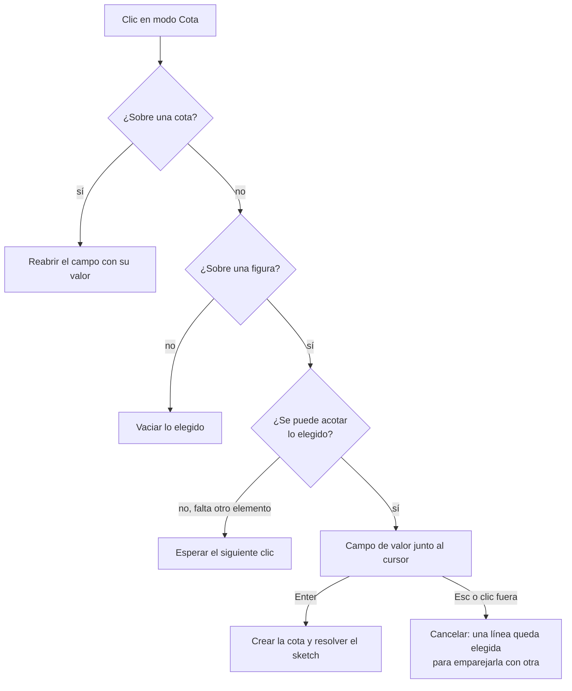

# Registro de cambios — NufioCAD

Qué cambió en cada entrega, en qué archivos y **cómo volver atrás** si algo sale mal. Las entregas nuevas van arriba. Para el detalle de lo pendiente, ver la [hoja de ruta](hoja-de-ruta-cad.md); para probarlas, la [guía de pruebas](guia-de-pruebas.md).

**Cómo se vuelve atrás, en general**
- **Si la rama aún no está fusionada** en `develop`: no se fusiona y listo (se puede borrar con `git branch -D feature/<nombre>`; `develop` no se entera).
- **Si ya está fusionada:** `git revert -m 1 <commit de la fusión>` en `develop` crea un commit que deshace toda la entrega sin reescribir la historia (y se puede volver a aplicar después con otro `revert` de ese revert).
- **Si solo hay que quitar una parte:** cada entrada dice qué funciones o bloques cambió cada parte, para deshacerla a mano en una rama `feature/` nueva.
- **Versiones publicadas:** la etiqueta `v0.1.0` (rama `main`) es la primera versión estable; `git switch --detach v0.1.0` la deja a mano para comparar.

---

## Cotas sobre el lienzo, estilo Onshape (entrega 1) — 10 nov. 2026

- **Rama:** `feature/cotas-en-el-lienzo` (sale de `develop` en `d7e3ffa`). **Sin fusionar** hasta que pase la prueba manual (guía C.1–C.16).
- **Commit:** `0463e70` (más el de esta documentación).
- **Pruebas:** 213 unitarias y 34 pasos de la prueba de interfaz, todo en verde en Windows (Debug). Sin probar aún a mano ni en Fedora.

| Parte | Antes | Ahora | Dónde (para deshacerla a mano) |
|---|---|---|---|
| Valor de una cota | Diálogo modal «Cota» con el valor y botones Aceptar/Cancelar | Campo pequeño junto al cursor (ventana emergente), con el valor seleccionado; Enter acepta, Esc o un clic fuera cancelan; mismas expresiones con parámetros | `SketchSession::askDimensionValue` (`src/app/src/SketchSession.cpp`): el `QDialog` se cambió por un `QFrame` con `Qt::Popup` y un `QEventLoop`; clase `InlineEditorKeys` y función `dimensionCaption` en el espacio anónimo del mismo archivo |
| Herramienta Cota | D (o el botón) acotaba lo seleccionado; sin selección daba un aviso | Sin selección entra en el **modo Cota**: clic en círculo, arco, elipse o línea crea la cota; dos clics para distancias y ángulos; clic en una cota la edita; Esc quita lo elegido y luego sale. Con selección, D hace lo de antes | `SketchSession::Tool::Dimension` (`SketchSession.hpp`), `SketchSession::dimensionClicked`, y los cambios en `setTool`, `cancel`, `clicked` y `addDimension` (que ahora devuelve `bool`) |
| Cotas de círculos concéntricos | Todas a 45°: con radios parecidos los textos se apilaban | Cada círculo con el mismo centro que otro anterior pone su cota 30° más allá | Bloque `rank` en el caso `Radius`/`Diameter` de `src/sketch/src/Annotations.cpp` |
| Pruebas | — | Prueba unitaria «Las cotas de círculos con el mismo centro van a ángulos distintos…» y paso de la prueba de interfaz «Cota de un clic con el valor escrito sobre el lienzo» | `tests/test_sketch_selection.cpp`, `src/app/src/InterfaceCheck.cpp` |

**Cómo decide el modo Cota qué hacer con cada clic:**

**Riesgos conocidos al volver atrás:** ninguno en archivos guardados: las cotas siguen siendo las mismas restricciones de siempre (no hay campos nuevos en el `.nuf`), así que un diseño hecho con esta entrega se abre igual en la versión anterior.

---

## Diagramas de la documentación a Mermaid — 10 nov. 2026

- **Rama:** `feature/cotas-en-el-lienzo` (solo documentación; no cambia código ni pruebas).
- **Qué cambió:** los dibujos hechos con caracteres de texto pasaron a [Mermaid](https://mermaid.js.org), que GitHub dibuja solo en cualquier archivo `.md`, y se añadieron los que ayudan a entender el flujo.

| Diagrama | Archivo | Antes | Ahora |
|---|---|---|---|
| Capas y dependencias de los módulos | `docs/arquitectura-cad.md` (sección 2) | Cuadro con caracteres de dibujo | `flowchart` con las capas (interfaz, núcleo, bibliotecas) y una flecha por cada dependencia de la tabla de debajo |
| Estados de una herramienta | `docs/arquitectura-cad.md` (sección 5) | Una línea con flechas de texto | `stateDiagram-v2` con Aceptar, Cancelar y Esc |
| Extruir un perfil | `docs/arquitectura-cad.md` (sección 8) | Solo la lista numerada | `sequenceDiagram` (usuario, herramienta, visor, comandos y documento); la lista se conserva debajo |
| Flujo de ramas | `docs/hoja-de-ruta-cad.md` (notas de planificación) | No existía | `gitGraph` con `main`, `develop` y las `feature/…` |
| Prioridad de las inferencias | `docs/hoja-de-ruta-cad.md` (plan I1) | No existía | `flowchart` con lo que gana cuando coinciden varias |
| Qué hace un clic en el modo Cota | `docs/registro-de-cambios.md` | No existía | `flowchart` de decisión |

- **Se dejó como está:** el árbol de carpetas del `README.md` (un árbol de archivos se lee mejor como texto que como diagrama) y los bloques de código y de comandos.
- **Comprobación:** los 6 diagramas se validaron con el propio analizador de Mermaid (versión 11), sin errores; el validador rechaza uno roto a propósito.
- **Volver atrás:** `git revert <commit>` de esta documentación, o `git checkout v0.1.0 -- docs/arquitectura-cad.md` para recuperar el dibujo de texto de ese archivo.

---

## Desde la v0.1.0 hasta esta entrega (ya en `develop`)

| Commit | Qué |
|---|---|
| `d7e3ffa` | Fusión de `feature/pruebas-flechas-robustas`: la prueba de las flechas cuenta el color exacto, reintenta el foco y el arco del ángulo de presión del engranaje es más grande |
| `896c86b` | Fusión de la extrusión hasta una cara curva (cilindro, esfera y toro) |
| `272404b` | Icono de la aplicación en el lanzador de Linux y en el `.exe` de Windows |
| `66ccf04`, `9d5f009`, `4dbe602` | Compatibilidad con Fedora y Ubuntu (OCCT 7.6 a 7.9, GCC) y el CI en `main`, `develop`, `feature/*` y pull requests |
| `b72757a` | Mediciones de rendimiento en Fedora ([`mediciones-rendimiento.md`](mediciones-rendimiento.md)) |
| `ab1fae7` | Marcadores `estable-windows` y `estable-fedora` en la hoja de ruta |
