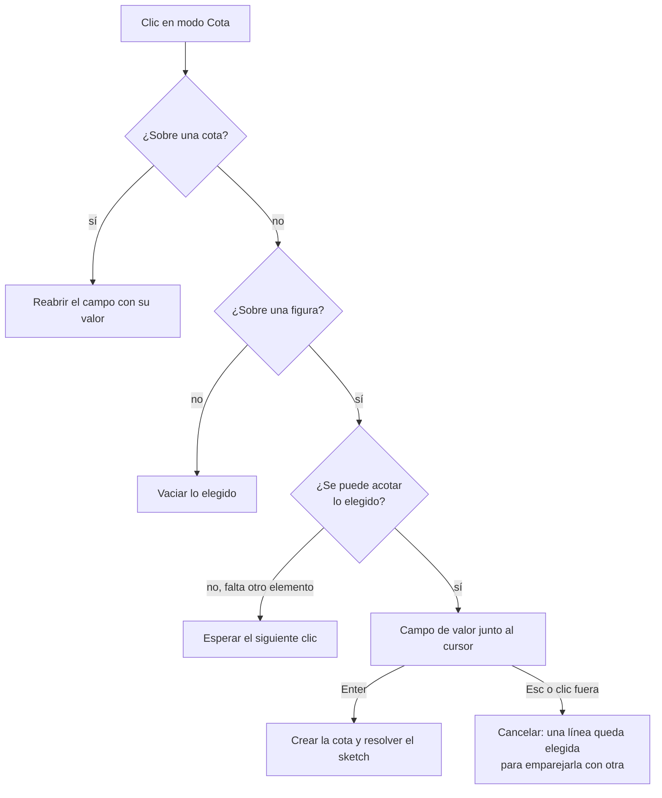

# Registro de cambios — NufioCAD

Qué cambió en cada entrega, en qué archivos y **cómo volver atrás** si algo sale mal. Las entregas nuevas van arriba. Para el detalle de lo pendiente, ver la [hoja de ruta](hoja-de-ruta.md); para probarlas, la [guía de pruebas](guia-de-pruebas.md).

**Cómo se vuelve atrás, en general**
- **Si la rama aún no está fusionada** en `develop`: no se fusiona y listo (se puede borrar con `git branch -D feature/<nombre>`; `develop` no se entera).
- **Si ya está fusionada:** `git revert -m 1 <commit de la fusión>` en `develop` crea un commit que deshace toda la entrega sin reescribir la historia (y se puede volver a aplicar después con otro `revert` de ese revert).
- **Si solo hay que quitar una parte:** cada entrada dice qué funciones o bloques cambió cada parte, para deshacerla a mano en una rama `feature/` nueva.
- **Versiones publicadas:** la etiqueta `v0.1.0` (rama `main`) es la primera versión estable; `git switch --detach v0.1.0` la deja a mano para comparar.

---

## Pendientes por categoría, S (sketch y cotas) — 23 nov. 2026

- **Qué:** herramienta **Punto**; recortar, extender y partir contra **elipses, arcos de elipse y splines**; extender un arco de elipse y una spline, y recortar una spline; las cotas y restricciones ligadas a las letras de un texto se vuelven a ligar al editar solo su altura; el clic que cierra el campo de una cota se atiende (ángulo con un solo clic más), **Mayús + clic** crea una cota de referencia y los arcos concéntricos reparten sus cotas. Además, `test_assembly.cpp` ya compila con Catch2 3.16 (aviso C4702 tras `FAIL`).
- **Dónde:** `ShapeTools.cpp` y `Tools.hpp` (`PointTool`, `makePointTool`), `SketchSession` (herramienta `Point`, `pendingClick_`, Mayús + clic, rehacer lo ligado al editar texto), `MainWindowMenus.cpp` y `resources.qrc` (familia y icono Punto), `Edit.cpp` y `Edit.hpp` (`isPolylineCurve`, `polylineIntersections`, `trimSpline`, `extendSpline`, `extendEllipseArc`, `constraintsOn`, `restoreConstraints`), `Annotations.cpp` (`concentricRank`), `Viewport` (`sketchPointAtGlobal`). Pruebas en `test_sketch_point_tool.cpp`, `test_sketch_edit_curves.cpp` y `test_annotations_overlap.cpp`; la prueba manual es `SKS.1` a `SKS.14`.
- **Volver atrás:** rama `feature/pendientes-s-sketch` sin fusionar: se borra con `git branch -D`; ya fusionada, `git revert` de la fusión. No cambia el formato de los archivos.

---

## Corrección: cotas de radio y diámetro ocultas, y capturas de casos del sketch — 23 nov. 2026

- **Qué:** las cotas de **radio y diámetro se ocultaban siempre** salvo con el cursor encima o seleccionadas: el visor medía «lo que acotan» con la tercera línea de la cota, que en un radio es el trazo de una flecha, y las daba por diminutas. Ahora cada cota trae `Annotation::extent` (lo que acota, en mm) y el visor usa ese. Los arcos concéntricos reparten además sus cotas dentro del propio arco antes de girarlas. Nuevo modo `NufioCAD --captura-sketch carpeta` que arma casos del sketch (punto, recortar y extender con elipse y spline, cota con ƒ, arcos concéntricos) y guarda una captura de cada uno, para mirarlos.
- **Dónde:** `Annotations.hpp`/`.cpp` (`extent`), `ViewportSketchDraw.cpp` (`extentPx`), `InterfaceCheck.cpp` (`captureSketchCases`), `SketchSession.hpp` (amiga de `InterfaceCheck`), `main.cpp`. Pruebas: `test_annotations_overlap.cpp`.
- **Volver atrás:** `git revert` del commit; no cambia el formato de los archivos.

---

## Pendientes por categoría, M (operaciones de modelado) — 23 nov. 2026

- **Qué:** en el patrón por trayectoria, la copia que cae justo en una esquina viva se orienta con la bisectriz de las dos curvas; en Combinar cuerpos, un clic en un cuerpo de la vista lo marca o desmarca como herramienta.
- **Dónde:** `Modeling.cpp` (`pathPoints`), `FeatureToolsMore.cpp` y `FeatureTools.hpp` (`CombineTool::selectionChanged`). Prueba en `test_edge_ops.cpp`; manual: `MOD.26` y `MOD.27`.
- **Volver atrás:** rama `feature/pendientes-m-modelado` sin fusionar: `git branch -D`; ya fusionada, `git revert` de la fusión. No cambia el formato de los archivos.

---

## Pendientes por categoría, E (engranajes) — 23 nov. 2026

- **Qué:** el **surco central** de la espina de pescado funciona también en la corona y en la cremallera, y los generadores del Par, la corona, la cremallera y el tren planetario lo ofrecen; el Par puede dejar las **ruedas separadas** para imprimirlas.
- **Dónde:** `Modeling.cpp` (`gear`: surco por tipo), `Generators.cpp` (`tuningFields`, `addTuningParameters`, `applyTuning`, `placementField`, `GearPair`). Pruebas en `test_gear_tuning.cpp`; manual: `PAR.44` a `PAR.46`.
- **Volver atrás:** rama `feature/pendientes-e-engranajes` sin fusionar: `git branch -D`; ya fusionada, `git revert` de la fusión. Los diseños anteriores (sin surco ni colocación) se rehacen igual.

---

## Pendientes por categoría, R (roscas y agujeros) — 23 nov. 2026

- **Qué:** la rosca tiene perfil **trapezoidal (Tr)** además del métrico/unificado, medidas **UNC** y **Tr** en la lista, y **chaflán de entrada** para tornillos; el cuadro del ángulo del cono del Agujero (avellanado) dibuja su arco en la vista.
- **Dónde:** `Modeling.hpp` y `Modeling.cpp` (`ThreadProfile`, `ThreadSpec::profile` y `entryChamfer`, `threadDepth`, `thread`, `threadOnCylinderTool`), `FeaturesMore.cpp` (campo `entryChamfer`), `DocumentFile.cpp` (`profile` y `entryChamfer`, opcionales), `FeatureToolsMore.cpp` y `FeatureTools.hpp` (`ThreadTool`), `FeatureToolsProfile.cpp` (`HoleTool::dimensionArc`). Prueba en `test_edge_ops.cpp` («Una rosca trapezoidal…»); manual: `GEN.20` a `GEN.24`.
- **Volver atrás:** rama `feature/pendientes-r-roscas` sin fusionar: `git branch -D`; ya fusionada, `git revert` de la fusión. Los archivos nuevos con perfil trapezoidal o chaflán se abren en versiones anteriores como roscas métricas sin chaflán.

---

## Pendientes por categoría, P (parámetros y unidades) — 23 nov. 2026

- **Qué:** la cota ligada lleva una «ƒ» y avisa si pierde su expresión; los nombres de parámetros se pueden intercambiar (a↔b); el valor de un parámetro da su longitud en la unidad elegida en el tooltip; las ayudas de los generadores y los mensajes de la geometría pasan los «mm» a la unidad elegida; el volumen de Interferencias sigue la unidad; el cuadro rápido de valor admite expresiones que empiecen por número. Antes, y ya en `develop`: el CI solo se ejecuta a mano (`workflow_dispatch`).
- **Dónde:** `Annotations.cpp` (`formatDimension`), `SketchSession.cpp` (`editDimension`), `ParametersDialog.cpp` (`followRename`), `Units.cpp` y `Units.hpp` (`localize`, `formatVolume`), `FeatureTools.cpp`, `GeneratorTool.cpp`, `ModelPanels.cpp`, `MainWindowView.cpp`, `MainWindowFiles.cpp`, `InterferenceDialog.cpp`, `ValueInput` y `MainWindow.cpp` (`applyToolValue`). Prueba en `test_annotations_overlap.cpp`; manual: `REF.25` a `REF.32`.
- **Volver atrás:** rama `feature/pendientes-p-parametros` sin fusionar: `git branch -D`; ya fusionada, `git revert` de la fusión. No cambia el formato de los archivos.

---

## Fase 15, pendientes menores — 20 nov. 2026

- **Qué:** secciones plegables en Lightbox, Caja con tapa y Letrero (`grouped` en `Generators.cpp`); el panel de comandos flotantes recuerda su posición y tamaño (`MainWindow.cpp`, ajuste `view/floatingCommandsGeometry`); el desfase del sketch admite una elipse, un arco de elipse o una spline sola (`offset` en `Edit.cpp`, con prueba en `test_sketch_edit.cpp`).
- **Volver atrás:** `git revert` de la fusión; no cambia el formato de los archivos.

---

## Patrón por trayectoria: las copias giran con la curva — 20 nov. 2026

- **Qué:** casilla «Girar las copias siguiendo la curva» en Patrón › «A lo largo de una trayectoria».
- **Dónde:** `Modeling.cpp` (`pathPoints` devuelve también las tangentes; `pattern` gira cada copia con `PatternSpec::tangents`), `FeaturesMore.cpp` (`patternSpec`), `Features.hpp` (`PatternFeature::followPath`), `DocumentFile.cpp` (campo `followPath`), `FeatureToolsMore.cpp` (casilla), `tests/test_edge_ops.cpp`.
- **Volver atrás:** `git revert` del commit; los archivos con la casilla marcada se abren igual, sin girar las copias.

---

## Fase 20, R2: paneles de herramienta con desplazamiento — 18 nov. 2026

- **Qué cambia:** `FeatureTool::start` (`FeatureTools.cpp`) pone el contenido del panel en un `QScrollArea` y deja Aceptar y Cancelar fijos abajo; `MainWindow::startTool` abre el panel del ancho que pide su contenido (hasta el 40 % de la ventana). El inventario deja de contar lo que está dentro de un área con desplazamiento como «fuera de la pantalla».
- **Efecto:** con una herramienta abierta, el mínimo de la ventana baja de hasta 927×927 a 872×544; a 125 % y 150 % de escala ya cabe todo.
- **Guía:** sección 1.8 (`RSP.1` a `RSP.7`).
- **Cómo volver atrás:** no fusionar `feature/interfaz-responsiva-r2`, o `git revert -m 1` de su fusión.

---
## Fase 20, R1: inventario de la interfaz a distintas pantallas — 18 nov. 2026

- **Qué cambia:** modo nuevo `--inventario <carpeta> [--tamano AnchoxAlto] [--escala N]` (`InterfaceCheck::captureInventory`, opciones en `main.cpp`): abre la ventana con ese tamaño y escala, recorre cinta, herramientas, generadores, diálogos y sketch, guarda capturas y escribe `inventario.txt`. No cambia el comportamiento normal del programa.
- **Documento:** `docs/interfaz-responsiva.md` (resultados de 9 pantallas y orden de trabajo de R2 a R6). La Fase 20 pasa a ir justo después de la 14.
- **Cómo volver atrás:** no fusionar `feature/interfaz-responsiva-r1`, o `git revert -m 1` de su fusión.

---

## Fase 20, R3 a R7: interfaz responsiva completa — 18 nov. 2026

- **R3 (cinta):** `Ribbon::adapt` — nombres fuera, luego grupos al botón «Más »»; `Ribbon.cpp/.hpp`.
- **R4 (paneles):** `MainWindow::adaptToSize` pliega el Navegador (< 1100 px de ancho) y la línea de tiempo (< 640 de alto) y compacta la cinta; al cerrar se guardan visibles; la línea de tiempo puede encoger.
- **R5 (escala):** `Viewport::paintGL` pone la resolución de OpenCASCADE a 72 × escala y reescala el cubo de vistas; la ventana inicial nunca excede la pantalla.
- **R2 (diálogos):** `DialogSize.hpp` (`fitDialogToScreen`) en Exportar, Parámetros y Cuerpos: máximo 90 % de la pantalla y tamaño recordado.
- **R6 (pruebas):** `--inventario` sale con 3 si algo no cabe; `--tamano` y `--escala` valen para todos los modos; paso «Prueba de tamaños de pantalla (Xvfb)» en el CI de Linux (con `continue-on-error`).
- **R7 (guía):** sección 1.8 con `RSP.1` a `RSP.14` y la matriz resolución × escala.
- **Resultado:** inventario con 0 problemas en 9 pantallas (960×540 a 3840×2160).
- **Cómo volver atrás:** `git revert -m 1` de la fusión de `feature/interfaz-responsiva-r2`; o solo la cinta (`Ribbon.*`), solo el plegado (`adaptToSize`) o solo la escala (bloque de `Resolution` en `paintGL`).

---
## Fase 16, E2 y E3: chaflán en la base y juego del diente — 17 nov. 2026

Dos campos nuevos del engranaje, ambos en 0 por defecto (los diseños anteriores no cambian).
- **Juego del diente** (`GearSpec::backlash`, `Modeling.cpp`): adelgaza el diente medio juego por lado sobre la primitiva; en la corona ensancha el hueco y en la cremallera adelgaza el diente. Rechaza juegos negativos o que dejan el diente sin cuerpo.
- **Chaflán de la base** (`GearSpec::baseChamfer`, función `chamferStart`): achaflana el contorno de la cara `inicio`, sin el agujero; con hélice se rechaza. El kernel falla de forma irregular con algunas medidas según los dientes (ver «Pendiente de E2» en la hoja de ruta); se reintenta con ±6 %.
- Se guardan en el archivo (`backlash`, `baseChamfer`), salen en `GearFeature::numericFields` (ligables a parámetros) y en el panel de Sólido › Engranaje.
- Pruebas: `tests/test_gear_tuning.cpp`. Guía: PAR.18 a PAR.20.
- **Generadores:** el Par, la Corona y la Cremallera traen «Adelgazar el diente» y «Chaflán de la base» (claves `adelgazar` y `chaflan_base`; los diseños anteriores, sin ellas, cuentan como 0).
- **Volver atrás:** no fusionar `feature/engranajes-e2-e3`, o `git revert -m 1` de su fusión.

---

## Fase 15: usabilidad e interfaz estilo Fusion 360 (U1 a U8) — 18 nov. 2026

- **U1:** selector de unidad en la barra de estado (`unitBox_`), atajos B, Mayús+C, G, Mayús+T y Alt+1… (`MainWindowMenus.cpp`).
- **U2:** pestaña HERRAMIENTAS oculta en el sketch (`MainWindowView.cpp`); `offerRecovery` pasa a una franja sobre el lienzo (`MainWindowFiles.cpp`).
- **U3:** `nuf/geometry/DisplayUnits.hpp` (unidad de visualización del núcleo) usada en `Measure.cpp`, `Printability.cpp` y los resúmenes de `Generators.cpp`; `ViewState::displayUnit` (unidad por documento, guardada en el archivo y fuera de `operator==`); prueba `tests/test_display_units.cpp`.
- **U4/U5:** paleta del sketch, barra de acceso rápido, raíz del Navegador (`ModelPanels.cpp`), controles de reproducción del historial y comandos flotantes (`MainWindow.cpp`, `MainWindowMenus.cpp`).
- **U6:** `RadialMenu` (nuevo, `RadialMenu.cpp/.hpp`), clic derecho en `MainWindow::eventFilter`, y `MainWindow::assignShortcuts` con las teclas de una letra.
- **U7:** `FeatureTool::primaryField` y `MainWindow::startToolTyping`/`applyToolValue`.
- **U8:** botón Cancelar en el recuadro «Calculando…», `GeneratorField::group` y secciones plegables en `GeneratorTool`, mover con Ctrl a la rejilla (`FeatureToolsMore.cpp`).
- **Pruebas:** un paso nuevo en la prueba de interfaz (menú radial y valor junto al cursor) y `test_display_units.cpp`; el inventario de pantallas sigue en 0 problemas en las 9 pantallas.
- **U9:** `trimToCurvedFace` admite conos (cuerpo auxiliar de la hoja del cono) y superficies libres (`extendedSurface` prolonga una B-spline con `GeomLib` y parte el prisma); `Entity::textOwner` y `TextInfo` para volver a editar el texto (`SketchSession::editSelectedText`, acción «Editar texto…»); `trimEllipse` en `Edit.cpp` (recorte de elipses y arcos de elipse contra cualquier curva). Pruebas: `[cone]`, `[freeface]`, `[ellipse]` y `test_sketch_text_info.cpp`.
- **U8 (resto):** vista previa translúcida con color según el tema (`Viewport::Impl::toolPreviewColor`) y `explainKernelError` (causa probable en español).
- **Cómo volver atrás:** no fusionar `feature/fase-15-usabilidad`, o `git revert -m 1` de su fusión; cada punto va en commits separados (U1–U3, U4–U5, U6–U7, U8).

---
## Fase 14, P3: partir el visor y prueba de interfaz en el CI — 17 nov. 2026

- **Rama:** `feature/partir-viewportimpl` (sale de `develop`). Sin cambios de comportamiento: lo único visible es la compilación.
- **Qué cambia:** (1) `src/render/src/ViewportImpl.hpp` pasa de 2375 a ~500 líneas; sus 86 métodos se mueven, sin tocar su cuerpo, a `ViewportBodies.cpp`, `ViewportHandles.cpp`, `ViewportSketch.cpp`, `ViewportSketchDraw.cpp` y `ViewportScene.cpp` (agregados en `src/render/CMakeLists.txt`); las funciones libres de `ViewportDrawing.hpp` pasan a `inline` para poder incluirlo en varios archivos. (2) `rebuildSketch` usa una tabla por id en vez de recorrer las restricciones por cada anotación. (3) `.github/workflows/ci.yml`: el job de Linux corre la prueba de interfaz con Xvfb (con `continue-on-error`) y sube el informe y las capturas. (4) El filtro `*.exe` del slicer solo en Windows.
- **Cómo volver atrás:** `git revert -m 1` de la fusión; o, solo el reparto, revertir el commit «Parte ViewportImpl.hpp…» (los demás cambios no dependen de él).
- **Riesgos:** una compilación existente con objetos viejos puede dar avisos de símbolos duplicados (LNK4006): borrar `build/<preset>/src/render` y recompilar (ya está en [`desarrollo.md`](desarrollo.md)).

---

## Fase 21: ensamblar y mover piezas — 19 nov. 2026

- **Piezas fijas** (`BodyInfo::fixed`, `ModelState::fixedBodies`): Alinear y Unión mueven siempre la pieza que no está fija; se guarda en el archivo (`cuerpos.<clave>.fixed`).
- **Alinear** (`AlignFeature`) y **Unión ampliada** (`JointFeature`): sobre caras planas, cilindros, conos, esferas y aristas circulares o rectas (`geometry::Frame`, `Shape::faceFrame` y `edgeFrame`); siete tipos de unión con límites; los componentes se mueven enteros. Una sola herramienta (`JointTool`) con el botón Alinear (`A`).
- **Enlace de movimiento** (`MotionLinkFeature`, `MotionLinkTool`) e **Interferencias** (`geometry::overlap`, `document::findInterferences` y `findInterferencesAlong`, diálogo con sombra roja).
- **Duplicar** (`commands::DuplicateBodies`, Mover con copia de varios cuerpos), clic derecho del Navegador (duplicar, fijar, crear componente, mover) con candado en los fijos, `Ctrl+D`, `Ctrl+C` y `Ctrl+V`.
- **Arrastrar piezas** (`Viewport::bodyDragged`, tecla `G`): libre sobre el plano de la pantalla (guarda un Mover) o según la unión (guarda el ángulo o el desplazamiento).
- **Tren planetario** (generador): sol, planetas, corona fija, portasatélites, ejes, uniones y enlace de movimiento; las recetas pueden ahora llevar uniones y enlaces (`@axis:#k`, `kRecipeFeatureBase`) y cuerpos que salen fijos (`Recipe::fixedBodies`).
- **Cómo volver atrás:** no fusionar `feature/fase-21-mover-piezas`.

## Pendientes de fases ya hechas — tanda 1 (20 nov. 2026)

- **O5:** el ángulo de voladizo de la revisión de impresión se elige en el diálogo (**Voladizo máximo**, `PrintSettings::overhangAngle`) y se acuerda.
- **O6:** color propio por cuerpo (`BodyInfo::color`, `Body::color`): columna Color en «Cuerpos y componentes», se dibuja en la vista y se guarda en el archivo (los archivos anteriores abren sin color).
- **Tanda 2 (20 nov. 2026):** O2 radio en el centro del redondeo variable (`filletVariable(…, middle)`); O3 agujero con un clic en una cara (`HoleFeature::onFace`, `Viewport::lastPickPoint`) y rosca sobre un agujero o cilindro existentes (`ThreadFeature::onCylinder`, `Shape::cylinderFace`, `threadOnCylinderTool`); O1 patrón y espejo de una operación (`sourceFeature`, `ModelState::operationTools`) y patrón a lo largo de una trayectoria (`PatternLayout::Path`, `pathPoints`); O4 dividir con una cara curva (`SplitFeature::byFace`, `splitBodyByFace`).
- **Cómo volver atrás:** no fusionar `feature/pendientes-fases`.

## Fase 19: distribución — 19 nov. 2026

- **Instalador y paquetes** (`cmake/Packaging.cmake`, reglas de instalación de `src/app/CMakeLists.txt`): Windows con NSIS y ZIP (DLL de Qt, OpenCASCADE y vcpkg, plugins con `windeployqt`, asociación de `.nuf`, avisos de licencias); Linux con `.tar.gz`, `.deb`, `.rpm` y AppImage (`packaging/linux/crear-appimage.sh`).
- **Firma:** `packaging/windows/firmar.ps1` y `cmake/FirmarPaquete.cmake`; sin certificado no firman y no fallan.
- **Flujo `publicar.yml`** (etiqueta `vX.Y.Z`): compila, empaqueta, firma si hay secretos, SHA-256 y versión en borrador. El CI de Linux ya genera el `.tar.gz`.
- **Avisos de terceros** (`packaging/AVISOS-DE-TERCEROS.txt`) y guía [`distribucion.md`](distribucion.md); plantillas de winget.
- La versión del programa sale de `project(NufioCAD VERSION …)` (`NUF_VERSION`).
- **Cómo volver atrás:** no fusionar `feature/fase-19-distribucion`.

## Fase 18 (parte): ampliaciones de modelado — 19 nov. 2026

- **Chaflán:** dos distancias o distancia y ángulo (`ChamferStyle`, `ChamferSpec`); un clic en una cara elige todas sus aristas (`Shape::faceEdges`).
- **Vaciado cerrado** (`shellClosed`): cavidad cerrada del espesor pedido, sin abrir caras.
- **Sección** por una cara plana o un plano de construcción; **Ctrl+C** copia la medida.
- **Espejo de varios cuerpos** a la vez (`MirrorFeature::alsoBodies`).
- **Segunda tanda (19 nov. 2026):** redondeo de radio variable (`filletVariable`), voladizos en la revisión de impresión (`analyzeOverhang`) y línea de la medida, **Dividir cuerpo** (`SplitFeature`, `splitBody`), escala al final del barrido, patrón de varios cuerpos, cámara guardada en el diseño, calidad de malla personalizada, actualizar una importación desde su archivo (`ImportFeature::sourcePath`) y aviso de las unidades del STEP.
- **Cómo volver atrás:** no fusionar `feature/fase-18-modelado`.

## Fase 17: generadores y salida — 19 nov. 2026

- **SVG como sketch** (`nuf/sketch/Svg.hpp`): lector sin dependencias (trazados, formas básicas, transformaciones, unidades) que da el mismo resultado que un DXF; la acción de Sketch lee DXF o SVG según la extensión.
- **3MF** (`writeThreeMf`): ZIP sin comprimir con un objeto por cuerpo, nombre y material de color por filamento; el diálogo de Exportar lo ofrece.
- **Letrero:** texto de varias líneas (`GeneratorField::multiline`, un `QPlainTextEdit`), alineación y espacio entre líneas.
- **Lightbox y Caja con tapa:** canal para tira LED; divisiones, patas, ranuras de ventilación y catálogo de tornillos M2 a M6.
- **Caja con tapa (ampliación del 19 nov. 2026):** forma redonda, bisagra de nudillos con pasador de filamento (tapa cerrada sobre la caja), ranuras de ventilación en las paredes y clips de cierre, todo opcional.
- **Inventario de pantallas:** con un tamaño pedido igual al de la pantalla, la ventana con su barra de título se salía por abajo (en una pantalla de 1280×720 con barra de tareas el hueco real es de 1280×641): ahora el inventario ajusta la ventana a ese hueco, y el resultado ya no dice «fuera de la pantalla» sin motivo.
- **Tarjeta de inicio** sobre el lienzo vacío y **revisión de la malla** (`analyzeMesh`) en el diálogo de Exportar.
- **Cómo volver atrás:** no fusionar `feature/fase-17-generadores`.

## Espina de pescado en corona y cremallera, y nombres de cuerpos y componentes — 19 nov. 2026

- **Corona y cremallera helicoidales y en espina de pescado:** la corona (tipo Interno) admite ángulo de hélice y espina de pescado (los lofts de las secciones giradas, con la tapa de aro y la pared exterior cosidas); la cremallera admite inclinación de los dientes y «V» (secciones corridas a lo largo de la barra). Con la corona y el piñón del mismo sentido, y con la cremallera con el mismo ángulo y signo que su rueda, engranan sin chocar (probado con la booleana). Los generadores Engranaje interno y Cremallera traen «Ángulo de hélice» y «Dientes helicoidales».
- **Nombres según lo que se hizo:** los cuerpos nuevos ya no son «Cuerpo1»: «Caja 1», «Cilindro 1», «Extrusión 2», «Engranaje 1», «Corona 1»… (`newBodyName`, con un contador por clase). Los generadores agrupan en componentes numerados («Par de engranajes 1», «Par de engranajes 2», «Lightbox 1»…; `numberedComponent`), con los cuerpos con su nombre propio («Engranaje 1» y «Engranaje 2», «Caja» y «Tapa»); al rehacer un generador conserva su componente.
- **Cómo volver atrás:** no fusionar `feature/espina-corona-nombres`.

## Mejoras de las pruebas de la Fase 16 — 18 nov. 2026

- **Cuadros del error marcados:** además del mensaje de abajo, el borde de los cuadros que el mensaje nombra se pone rojo (error) o naranja (aviso); se buscan por palabras clave de cada campo (`FieldMarks.hpp`), en las herramientas y en los generadores.
- **Avisos propios en naranja** (`FeatureTool::setNotice`): lo que la herramienta pone sola, con su cuadro marcado. La espina de pescado sin hélice pone 20° y lo avisa (herramienta Engranaje y Par de engranajes).
- **Valores por defecto por tipo** en el Engranaje, con el botón «Valores por defecto de este tipo»: al cambiar de tipo se parte de los valores de fábrica de ese tipo.
- **Clic derecho que bloqueaba la vista:** la pulsación sobre el menú radial subía a la vista (que empezaba a girar o desplazar) y la suelta se la quedaba el menú, así que la vista no veía nunca soltar el botón. Ahora el menú se queda con el clic entero, se cierra al pulsar fuera, no se abre si hay otro botón pulsado y la vista suelta los botones al perder el foco (`Viewport::resetNavigationInput`).

## Fase 16, E4 a E6: tornillo sin fin, cónicos y selector de tipo — 18 nov. 2026

- **Qué hace:** el **tornillo sin fin** (1 a 4 entradas) con su rueda helicoidal, los **engranajes cónicos** a 90° y el **surco central** de la espina de pescado; el panel del Engranaje elige el tipo y enseña solo sus campos. Dos generadores nuevos: «Tornillo sin fin y rueda» y «Engranajes cónicos».
- **Cómo:** `twistedRod` (la rosca generalizada: una sección que gira al avanzar, por tramos) sirve a la rosca y al tornillo; `GearType::Worm` y `GearType::Bevel` en `GearSpec` (campos `wormDiameter`, `leftHanded`, `mateTeeth`, `heightScale`, `herringboneGroove`, que viajan en el archivo y se ligan a parámetros); el cónico reutiliza el loft del engranaje helicoidal con una homotecia respecto al vértice del cono.
- **Pruebas:** `tests/test_worm.cpp` (tornillo, cónico y los dos generadores con la booleana: sin material compartido bien girados, choque mal girados) y el surco en `test_gear_tuning.cpp`.
- **Cómo volver atrás:** no fusionar `feature/fase-16-familias`.

## Fase 16, E1: engranaje de espina de pescado — 18 nov. 2026

- `GearSpec::herringbone` (`Modeling.cpp`, `gearSolid`): dos lofts (`Half`) con la hélice contraria que se cosen en el contorno de la mitad; volumen igual al del helicoidal; caras de la segunda mitad con «:m2». Se guarda como `herringbone` en el archivo.
- Panel del Engranaje (casilla) y pregunta «Dientes helicoidales» en el Par de engranajes (`espina`).
- Pruebas en `tests/test_gear_tuning.cpp` (`[herringbone]`). Guía: PAR.23 a PAR.25.
- **Volver atrás:** no fusionar `feature/engranajes-e1-espina`, o `git revert -m 1` de su fusión.

---
## Hoja de ruta ordenada por fases — 16 nov. 2026

- **Rama:** `feature/hoja-de-ruta-por-fases` (solo documentación y comentarios; no cambia el comportamiento).
- **Qué cambia:** la hoja de ruta deja de mezclar «fases» y «oleadas»: todo son **fases**. Las 0–13 están hechas (las antiguas Oleadas 1, 6 y el plan del sketch pasan a ser las Fases 11, 13 y 12) y las 14–19 son lo pendiente **en el orden en que se hará**: 14 cerrar lo hecho y publicar la v0.2.0, 15 usabilidad, 16 engranajes, 17 generadores y salida, 18 modelado, 19 distribución. Cada punto pendiente tiene un identificador (P1, U3, E2, G1, O4, D1…). Arriba van «Dónde estamos» (tabla de estado por fase y equivalencias con los nombres anteriores) y «Lo que sigue, en orden»; el historial y los fundamentos, al final.
- **Otros archivos:** las menciones a «Oleada N» en los demás documentos, en la guía de pruebas y en los comentarios de `InterfaceCheck.cpp` y de las pruebas pasan a su fase nueva; la sección 5.3 de la guía se llama «Pruebas transversales».
- **Riesgos al volver atrás:** ninguno (solo documentación y comentarios).

---

## Largo de la cremallera y herramientas por familia — 16 nov. 2026

- **Rama:** `feature/cremallera-largo` (sale de `develop`). Sin fusionar hasta la prueba manual (guía CRE.1–CRE.8).
- **Qué hace:** (1) **largo de la cremallera en milímetros**: una pregunta «Largo de la barra» con tres modos (por dientes, como antes; **largo exacto**, que corta el último diente; y **largo con dientes completos**) y el largo ligado al parámetro `largo`; los diseños anteriores se reabren por dientes; (2) **la pestaña y el menú Herramientas agrupan los generadores por familia**: Cajas (Lightbox, Caja con tapa), Letreros y Engranajes; (3) plan de las **familias de engranajes** (espina de pescado, chaflán de la base, holgura, tornillo sin fin, cónicos y selector de tipo en la herramienta) en la hoja de ruta (Fase 16).
- **Resultado (Release):** 269 casos de pruebas unitarias en verde (nuevas: cremallera cortada a varios largos, los tres modos del generador, guardar y reabrir con el largo, y las familias).

| Parte | Dónde (para deshacerla a mano) |
|---|---|
| Largo en la geometría | `GearSpec::length` (`Modeling.hpp`); `rackGear` (`Modeling.cpp`): segmentos de arriba recortados en `x = length` |
| Campo y archivo | `GearFeature::numericFields` (`FeaturesMore.cpp`); `"length"` en `DocumentFile.cpp` (los archivos anteriores no lo traen: 0 = barra entera) |
| Generador | `RackAndPinion` (`Generators.cpp`): `largo_modo`, `largo_exacto`, `largo_aprox`, `rackSize`, `summary`, `make` |
| Familias | `Generator::category` (`Generators.hpp`) y su override en cada generador; `MainWindowMenus.cpp` (menú con `addSection` y un grupo de la cinta por familia); `generatorGroups_` |
| Pruebas | casos «Una cremallera se puede cortar a un largo exacto», «El generador de cremallera da el largo…», «El largo de la cremallera se guarda…» y «Cada generador tiene su familia…» en `tests/test_edge_ops.cpp` |

- **Corregido de paso:** `tests/test_perf.cpp` estaba **roto en `develop`** (un literal con saltos de línea, de la prueba de memoria): se trae la versión corregida de `feature/fluidez-memoria`, idéntica, para que no haya conflicto al fusionarla.
- **Pendiente:** flecha de medida para el largo de la barra; el aviso del máximo de dientes solo sale al calcular; el resto de familias de engranajes (Fase 16).
- **Riesgos al volver atrás:** ninguno en archivos guardados (el campo `length` es nuevo y opcional).

---

## Fase 13, F6: exportar con menos memoria — 16 nov. 2026

- **Rama:** `feature/fluidez-memoria` (sale de `develop`, ya con F1 a F5 fusionadas). Sin fusionar hasta la prueba manual (guía FLU.29–FLU.30).
- **Qué hace:** contar triángulos, escribir STL y escribir OBJ ya no guardan todos los triángulos en un vector (72 bytes cada uno): cada forma se malla, se recorre y se suelta. El STL deja el número de triángulos para el final (lo corrige en la cabecera) y el OBJ escribe las caras al terminar. Una exportación que falla no deja un archivo a medias.
- **Resultado (Release, 2,16 millones de triángulos):** contar 245 → 194 MB; STL 297 → 209 MB; OBJ 257 → 205 MB de memoria de más. 265 casos de pruebas unitarias en verde.

| Parte | Dónde (para deshacerla a mano) |
|---|---|
| Recorrido en flujo | `forEachMeshedFace` y `forEachTriangle` en `src/geometry/src/Exchange.cpp` (antes `triangulate`); `countTriangles`, `meshVolume`, `writeStl` y `writeObj` |
| Medida de memoria | caso oculto «Memoria al exportar una malla grande» en `tests/test_perf.cpp` (`nuf_tests "[.memory]"`, Windows) |

- **Pendiente:** mallar por caras (arriesgado para que el STL salga hermético), Linux sin medir; B2 y B4 descartados con su motivo en la hoja de ruta.
- **Riesgos al volver atrás:** ninguno en archivos guardados; los STL, OBJ y STEP exportados son los mismos.

---

## Fase 13, F5: calcular menos, y primera medición en Release — 16 nov. 2026

- **Rama:** `feature/fluidez-hilos`. Sin fusionar hasta la prueba manual (guía FLU.24–FLU.28).
- **Qué hace:** (1) el patrón y «Unir» con varios cuerpos funden **en árbol** (`geometry::fuseBalanced`) en vez de uno a uno; (2) la forma guarda el índice de nombres de caras y aristas y su caja (`Shape::Impl`); (3) mientras el modelo se calcula, `refreshModel` solo actualiza el historial (los cuerpos y el navegador se rehacen una vez, al terminar); (4) al arrastrar en un sketch, el sombreado de regiones se rehace como mucho cada 100 ms y al soltar; (5) **fuentes de respaldo de Qt al abrir la ventana**: la primera vez que se dibuja un símbolo (⛔ ⚠ ℹ ✓) Qt tardaba de 0,5 a 1,5 s en buscar la fuente, y paraba la ventana al abrir el primer generador.
- **Resultado (Release, Windows, primera vez que se mide):** prueba de interfaz 44/44, **parada máxima 558 ms → 133 ms**; patrón lineal de 50 copias **2576 ms → 758 ms**; 265 casos de pruebas unitarias en verde en 16 s (en Debug, unos 130 s). Tabla completa en [`rendimiento/mediciones.md`](rendimiento/mediciones.md).

| Parte | Dónde (para deshacerla a mano) |
|---|---|
| Unión en árbol | `fuseBalanced` (`Modeling.hpp/.cpp`); usos en `PatternFeature::compute` (`FeaturesMore.cpp`) y la rama «Unir» (`Features.cpp`) |
| Índice de nombres y caja | `Shape::Impl::NameIndex`, `cacheMutex`, `boundsCache` (`Naming.hpp`); `sameName`, `refOf`, `find` y `Shape::bounds` (`Shape.cpp`) |
| Refresco | `MainWindow::refreshModel` (`MainWindowView.cpp`): salida temprana si `document_.computing()` |
| Arrastre del sketch | `ViewportImpl::showSketch`, `rebuildProfiles`, `profilesClock`, `profilesTimer` (`ViewportImpl.hpp`) |
| Fuentes de respaldo | final del constructor de `MainWindow` (`MainWindow.cpp`) |
| Pruebas | caso «Buscar caras y aristas por nombre…» en `tests/test_edge_ops.cpp` |

- **Pendiente:** M1 (aceptar sin recalcular la vista previa) y M6 (validez de la booleana una sola vez) sin hacer, con el motivo en la hoja de ruta; el navegador se rehace entero en cada refresco; el arrastre del sketch no se midió con un sketch grande; la cota de un clic en el sketch sigue en 133 ms.
- **Riesgos al volver atrás:** ninguno en archivos guardados (los resultados de las operaciones no cambian; las pruebas de nombres y de patrones lo comprueban).

---

## Fase 13, F4: banner ámbar con spinner, cancelación en el kernel y un solo grupo de hilos — 16 nov. 2026

- **Rama:** `feature/fluidez-hilos` (sale de `feature/fluidez-dibujo`). Sin fusionar hasta la prueba manual (guía FLU.18–FLU.23).
- **Qué hace:** (1) **a petición del usuario**, mientras algo carga la barra de estado se pone ámbar y gira un spinner (también dentro del distintivo «Calculando…»); no mide porcentaje; (2) el kernel abandona a media operación el loft, el redondeo, el chaflán, el vaciado, el barrido, la unión de partes, el engranaje helicoidal y la rosca cuando se pide cancelar, y al cerrar la ventana se oculta antes de esperar a los hilos; (3) un solo `geometry::TaskPool` sustituye a los tres mecanismos de hilos que había.
- **Resultado:** las pruebas unitarias en verde (nuevas: 6 del grupo de hilos y la de cancelación de construcciones largas; 263 casos con los ocultos de medida) y la prueba de interfaz completa (44 pasos, 0 fallidos, parada máxima 955 ms: las mismas cifras que tras F3); la de la rosca comprueba ahora que el banner se pone ámbar con spinner y vuelve a azul.

| Parte | Dónde (para deshacerla a mano) |
|---|---|
| Banner y spinner | `BusySpinner.cpp/.hpp` y `StatusBanner.cpp/.hpp` (nuevos: la barra de estado propia dibuja el mensaje a mano para dejar el spinner **lo más a la izquierda posible**, con el texto a su derecha; QStatusBar no permite correr el mensaje); `MainWindow::anythingBusy`, `paintBanner`, `setBannerBusy`, `updateBusyBadge` (`MainWindow.cpp`); `viewBusy_`, `statusSpinner_`, `badgeSpinner_`, `bannerBlink_` en `MainWindow.hpp`; llamadas en `updateMeasure` (`MainWindowView.cpp`) |
| Cancelación en el kernel | `ProgressCanceller`, `throwIfCancelled`, `buildCancellable` en `Modeling.cpp` (antes `BooleanCanceller`) y sus llamadas en `fuseAll`, `unify`, `edgeOperation`, el engranaje helicoidal, la rosca, el barrido, el loft y el vaciado |
| Grupo de hilos | `geometry/TaskPool.hpp` y `src/TaskPool.cpp` (nuevos); `currentCancelFlag()` en `Cancel.hpp`; `BackgroundRun.cpp` reescrito; `Document::Job` y `stopBackground`/`reapRetired`/`finishBackground` (`Document.cpp`); `MeshTask` y `cancelMeshTasks` (`ViewportImpl.hpp`) |
| Cierre | `MainWindow::closeEvent`: `hide()` antes de salir |
| Pruebas | `tests/test_task_pool.cpp` (nuevo), caso nuevo en `tests/test_edge_ops.cpp`, pasos de la rosca en `InterfaceCheck.cpp` |

- **Pendiente:** sin barra de progreso ni botón «Cancelar»; `UnifySameDomain`, el cosido y el ajuste de curvas no admiten progreso (solo se interrumpen entre pasos); el grupo no crece si todos sus hilos están ocupados por tareas canceladas que aún no notan la bandera; OCCT 7.6 (CI de Ubuntu) sin probar; solo Debug en Windows.
- **Riesgos al volver atrás:** ninguno en archivos guardados.

---

## Fase 13, F3: dibujar sin parar la ventana (mallas, vista previa y generadores) — 16 nov. 2026

- **Rama:** `feature/fluidez-dibujo` (sale de `feature/fluidez-llamadas`). Sin fusionar hasta la prueba manual (guía FLU.12–FLU.17).
- **Qué hace:** (1) todos los cuerpos nuevos se mallan en un hilo de trabajo antes de mostrarse (antes solo las roscas), con los mismos parámetros que usa el visor; (2) el sólido rojo de «lo que se quita» se construye y se malla aparte; (3) el generador arma su receta en el hilo de trabajo y al aceptar reutiliza la de la última vista previa; (4) `fitAll` espera a que estén los cuerpos (sin esto, la vista quedaba mal encuadrada: lo encontró la prueba de la vista previa translúcida).
- **Resultado (Debug):** generadores de engranajes de 1,3–1,4 s a 0,5–0,9 s de parada; la parada más larga de toda la prueba, de 1475 ms a 856–904 ms; 44/44 pasos y 251 pruebas unitarias en verde. Lo que queda es sobre todo el candado del montón de depuración de MSVC (ver [`rendimiento/mediciones.md`](rendimiento/mediciones.md)); falta medir en Release.

| Parte | Dónde (para deshacerla a mano) |
|---|---|
| Malla de todos los cuerpos | `ViewportImpl::showBodies`, `startMeshTask`, `meshingFor`, `needsMesh`, `setWaiting` y el bloque de atributos de `AIS_Shape` (`ViewportImpl.hpp`); `Viewport::preparingDrawing` |
| Encuadre aplazado | `Viewport::fitAll` y `ViewportImpl::fitWhenReady` (se aplica en `meshTaskFinished`) |
| Sólido que se quita | `FeatureTool::updatePreview` / `showPreview` (`FeatureTools.cpp`); `ViewportImpl::showToolPreview` y `showPendingTool` |
| Receta del generador | `GeneratorTool::updatePreview`, `recipe()`, `lastRecipe_`, `lastKey_` (`GeneratorTool.cpp/.hpp`); candado en `Viewport::textOutline` |
| Pruebas y herramientas | `InterfaceCheck.cpp`: espera con `preparingDrawing()`, comprobación de borde de la vista previa, variables `NUF_PRUEBA_*` |

- **Corregido después de la prueba manual (16 nov. 2026):** con la malla preparada aparte, los cuerpos se dibujaban **sin el borde entre caras** (las caras del mismo color se fundían). `applyMesh` pasaba la malla de las caras pero no los polígonos de las aristas sobre ella, que son los que el visor usa para dibujar ese borde; ahora los pasa (también las costuras de los cilindros) y `hasBoundaryPolygons` lo comprueba (prueba unitaria nueva y comprobación en el paso de la caja de la prueba de interfaz).
- **Pendiente:** selección de caras al mostrar cada cuerpo, precalentar las fuentes, medir en Release y en Linux. Un fallo intermitente de foco en la flecha «Mover cuerpo (giro en X)» apareció una vez en la prueba completa y no se repite (pasa sola y en grupo).
- **Riesgos al volver atrás:** ninguno en archivos guardados (solo cambia cómo se dibuja).

---

## Fase 13, F2: exportar, importar, medir y recuperar sin parar la ventana — 16 nov. 2026

- **Rama:** `feature/fluidez-llamadas` (sale de `feature/fluidez-medir`). Sin fusionar hasta la prueba manual (guía FLU.1–FLU.11).
- **Qué hace:** pasa a hilos de trabajo lo que hasta ahora corría en el hilo de la interfaz: escribir STL/OBJ/STEP y preparar el STL del slicer; el conteo de triángulos y la revisión para imprimir del diálogo de Exportar (con caché por cuerpo y calidad); leer y reparar un STEP; medir; escribir la copia de recuperación; leer las miniaturas de los recientes (sin abrir los archivos que solo están en la nube de OneDrive).
- **Resultado (Debug):** 44 pasos, 0 fallidos y 251 pruebas unitarias en verde. Exportar pasó de 797 ms de parada a 75 ms; el diálogo de Exportar, de 2200 ms (y 260–300 ms por clic) a menos de 160 ms; importar un STEP, de 2381 ms a 769 ms. Tabla en [`rendimiento/mediciones.md`](rendimiento/mediciones.md).

| Parte | Dónde (para deshacerla a mano) |
|---|---|
| Exportar e Imprimir | `MainWindow::startExport`, `exportBodies`, `printBodies` (`MainWindowView.cpp`); `exportRun_` y `ExportJob` en `MainWindow.hpp` |
| Diálogo de Exportar | `ExportDialog::refreshTriangleCount`, `showTriangleCount`, `runReview`, `showReview` y los miembros `reviewRun_`, `countRun_`, `triangles_` |
| Importar STEP | `MainWindow::importStepFile` (`MainWindowFiles.cpp`), `importRun_` y `documentGeneration_` (sube en `newDocument` y `openPath`) |
| Medir | `MainWindow::updateMeasure` (`MainWindowView.cpp`), `measureRun_` |
| Guardado en dos tiempos | `io::prepareSave`, `io::SavePlan` y `io::writeSave` (`DocumentFile.cpp/.hpp`); `saveDocument` ahora los llama seguidos; `Recovery::writeAsync` y `discard()` (`Recovery.cpp`) |
| Pantalla de inicio | `StartScreen::reload` y `isCloudOnly` (`StartScreen.cpp`), `thumbnailsRun_` |
| Pruebas | `tests/test_document_file.cpp` (caso «Guardar en dos tiempos»); pasos de exportar, diálogo, importar y recientes en `InterfaceCheck.cpp`; `waitIdle` espera también a esos trabajos |

- **Pendiente:** Guardar a mano (Ctrl+S) sigue síncrono; no se reutiliza la malla del conteo al exportar; exportar no se cancela a mitad; la prueba de interfaz no puede elegir caras para Medir (llama a `geometry::measure`); solo Debug en Windows. Lo que queda de parada en esos pasos es el mallado de los cuerpos nuevos en el visor (A1, rama F3).
- **Riesgos al volver atrás:** ninguno en archivos guardados (el formato `.nuf` no cambia: `saveDocument` escribe lo mismo, comprobado por la prueba nueva).

---

## Fase 13, F1: vigilante de paradas y línea base de fluidez — 16 nov. 2026

- **Rama:** `feature/fluidez-medir` (sale de `feature/engranajes-interno-cremallera`, que lleva el plan). Sin fusionar hasta la prueba manual (guía VIG.1–VIG.5).
- **Qué hace:** (1) `NUF_VIGILANTE=1` (o un número de ms) activa un hilo que vigila el latido del bucle de eventos y, si la interfaz se para más del umbral (200 ms por defecto), anota en `cierres/paradas.txt` la hora, la duración y la pila de llamadas (Windows). (2) Seis pasos nuevos en `--prueba-interfaz` reproducen lo que hoy ocupa el hilo de la interfaz: exportar, diálogo de Exportar con 5 cuerpos, importar STEP, medir una rosca, pantalla de inicio con 10 recientes y patrón de 50. (3) Primera línea base en [`rendimiento/mediciones.md`](rendimiento/mediciones.md).
- **Resultado:** 44 pasos, 0 fallidos; parada máxima 2381 ms (importar un STEP, Debug). La pila confirmó A1 (mallado de OCCT en el hilo de la interfaz), A3 (`countTriangles` en cada clic del diálogo de Exportar) y A4 (reparación `ShapeFix_Solid` al importar).

| Parte | Dónde (para deshacerla a mano) |
|---|---|
| Vigilante | `src/app/src/StallWatch.cpp/.hpp` (nuevo), arranque en `main.cpp` (bloque `NUF_VIGILANTE`), fuente en `src/app/CMakeLists.txt` |
| Captura de pila compartida | `sampleThreadStack`, `currentThreadHandle`, `releaseThreadHandle` en `StallWatch.cpp`; `InterfaceCheck::startWatchdog` y `stopWatchdog` ahora las usan (antes llevaban el código de Windows dentro) |
| Pasos nuevos | bloque «Pasos de la auditoría de fluidez (F1)» en `InterfaceCheck::run` (`src/app/src/InterfaceCheck.cpp`) |

- **Pendiente:** medir los diálogos modales reales de Exportar y Medir (la prueba llama a las mismas funciones de geometría); las pilas de Qt salen con nombres aproximados (sin símbolos), las de OpenCASCADE son legibles; en Linux el vigilante anota la duración pero no la pila; medir en Release.
- **Riesgos al volver atrás:** ninguno en archivos guardados; sin la variable `NUF_VIGILANTE` el vigilante no existe y el coste es cero.

---

## Documentación reorganizada — 16 nov. 2026

- **Rama:** `feature/engranajes-interno-cremallera` (solo documentación; no cambia código).
- **Qué cambia:** índice nuevo [`README.md`](README.md) en `docs/`; [`arquitectura.md`](arquitectura.md) reescrita según el código actual (9 diagramas Mermaid: contexto, módulos y dependencias, modelo del documento, generadores, estados de una herramienta, flujo de extruir, nombrado topológico, hilos y esquema del `.nuf`); nuevos [`decisiones.md`](decisiones.md) (qué se usó, por qué y qué se descartó) y [`desarrollo.md`](desarrollo.md) (compilar, pruebas, opciones de línea de comandos, variables `NUF_*`, ramas). README raíz al día. Tercera auditoría (fluidez) y Fase 13 en la hoja de ruta.
- **Archivos movidos:** `arquitectura-cad.md` → `arquitectura.md`, `hoja-de-ruta-cad.md` → `hoja-de-ruta.md`, `mediciones-rendimiento.md` → `rendimiento/mediciones.md`, `auditoria-2.md` → `auditorias/auditoria-2.md`. Las entradas antiguas de este registro que citan los nombres viejos se dejan como estaban.
- **Borrado:** `aqtinstall.log` (registro de instalación de Qt), capturas temporales de `build/capturas` y la entrada `graphify-out/` de `.gitignore`.
- **Corregido:** la arquitectura antigua decía que `sketch` dependía de `geometry` (es al revés) y que el recálculo en segundo plano estaba por decidir. Una entrada anterior decía que el build ya fuerza `VSLANG=1033`; no está en los presets: se documenta como paso manual en `desarrollo.md`.
- **Riesgos al volver atrás:** ninguno (solo documentación).

---

## Engranaje interno y cremallera — 12 nov. 2026

- **Rama:** `feature/engranajes-interno-cremallera` (desde `develop`). **Sin fusionar** hasta la prueba manual (guía PAR.7–PAR.17).
- **Qué hace:** el Engranaje gana un **Tipo**: Exterior (como siempre), **Interno (corona)** (aro con los dientes hacia dentro) y **Cremallera** (barra dentada de flancos rectos). Dos generadores nuevos: **Engranaje interno** (corona + piñón) y **Cremallera** (barra + rueda), con parámetros con nombre, cuerpos con nombre (Corona/Piñón, Rueda/Cremallera), componente, reapertura del formulario y deshacer de una vez, como el Par de engranajes. Los archivos anteriores abren igual (tipo exterior, aro 5).
- **Dónde:**

| Parte | Dónde (para deshacerla a mano) |
|---|---|
| Geometría | `GearType` y `GearSpec::type/rim` en `src/geometry/include/nuf/geometry/Modeling.hpp`; `rackGear` y los cambios de `gear` (cabeza/raíz del hueco, aro exterior) en `src/geometry/src/Modeling.cpp` |
| Operación | `GearFeature::numericFields` (campo `rim`) en `src/document/src/FeaturesMore.cpp` |
| Archivo | `gearType` y `rim` en la fila `gear` de `src/io/src/DocumentFile.cpp` (opcionales al leer) |
| Interfaz | `GearTool` (combo «Tipo» y campo «Aro o base») en `src/app/src/FeatureToolsConstruct.cpp` y `FeatureTools.hpp`; los generadores salen solos en Herramientas |
| Generadores | `InternalGear` y `RackAndPinion` en `src/document/src/Generators.cpp` |
| Pruebas | `tests/test_edge_ops.cpp` (5 casos: corona, piñón engranado, cremallera, rueda con cremallera, guardado); la prueba de interfaz suma un paso por generador nuevo (38 en vez de 36) |
| Docs | `generadores.md`, `guia-de-pruebas.md`, `hoja-de-ruta.md` |

---

## Tapa en un solo cuerpo (Lightbox y Letrero) — 12 nov. 2026

- **Rama:** `feature/tapa-un-solo-cuerpo` (desde `develop`). **Sin fusionar** hasta la prueba manual (guía LIG.12–14, CAJ.6, LET.7–10).
- **Qué hace:** la tapa del **Lightbox** pasa de tres cuerpos sueltos (Marco, Labio, Cara) a uno, **Tapa** (placa más labio unido): los cuerpos son ahora **Caja** y **Tapa**. En el **Letrero/Llavero**, el texto en relieve se une a la placa (y a la anilla) en un solo cuerpo; para no perder el texto en otro color (LET.7) hay una opción nueva en «Texto»: **En relieve (un solo cuerpo)**, que es la de fábrica, junto a «En relieve (otro cuerpo)» de siempre. La **Caja con tapa** ya tenía la tapa en un solo cuerpo (solo se añadió una comprobación en la guía).
- **Dónde:**

| Parte | Dónde (para deshacerla a mano) |
|---|---|
| Lightbox | `Lightbox::make` y `arrows` en `src/document/src/Generators.cpp`: el marco, su hueco y la cara central se sustituyen por «Lightbox: tapa»; el labio pasa de Cuerpo nuevo a Unir (empieza 0,01 mm dentro de la placa); las flechas de frente, labio y grosor del labio miran al cuerpo 1 |
| Letrero | `Sign::fields/make` en el mismo archivo: opción 3 «En relieve (un solo cuerpo)» (por defecto), extrusión «Unir» desde `grosor − 0,01` |
| Pruebas | `tests/test_edge_ops.cpp` (lightbox, lightbox redondo, cable, reabrir generador, letreros); `InterfaceCheck.cpp/.hpp`: el paso «Mover los dos cuerpos» elige «En relieve (otro cuerpo)» en el letrero |
| Docs | `generadores.md`, `guia-de-pruebas.md`, `hoja-de-ruta.md` |

- **Pruebas:** 250 unitarias y 36/36 pasos de la prueba de interfaz en verde (Windows, Debug). Al principio fallaba «Cota de un clic»: el paso «Mover los dos cuerpos» usaba un Lightbox y dejaba la vista muy alejada, y el sketch siguiente (con las tolerancias de captura en unidades de pantalla) no creaba los círculos. Se arregló volviendo a usar el letrero, eligiendo «En relieve (otro cuerpo)» (`openChangeAccept` gana un parámetro `choice`).
- **Riesgos:** los diseños de Lightbox guardados antes conservan sus cuatro cuerpos hasta que se reabra el generador (al reabrir se rehacen con la tapa unida); el Lightbox ya no permite otro filamento solo para la cara central.
- **Volver atrás:** no fusionar la rama o `git revert` de la fusión; ningún cambio de formato de archivo.

---

## Perpendicular y paralela al dibujar líneas (entrega 2, segunda parte) — 11 nov. 2026

- **Rama:** `feature/inferencias-sketch` (sobre la parte anterior). **Sin fusionar** hasta la prueba manual (guía I.12–I.16).
- **Qué hace:** en la herramienta **Línea**, si el tramo nuevo queda a menos de 3° de la **perpendicular** o de la **paralela** al tramo anterior de la cadena (o a la línea de cuyo extremo se parte), se endereza, se resalta la línea de referencia en naranja discontinuo y sale el símbolo **⊥** o **∥**; al clic se crea la restricción Perpendicular o Paralela (solo si `canAdd`). La horizontal/vertical, las alineaciones con puntos y los puntos existentes tienen prioridad; Mayús y Ctrl las suprimen (el endereza a H/V de siempre no cambia).

| Parte | Dónde (para deshacerla a mano) |
|---|---|
| Cálculo | `detail::relate` y `enum class Relation` en `src/sketch/src/ToolSupport.cpp/.hpp` |
| Herramienta Línea | `LineTool` en `src/sketch/src/Tools.cpp`: miembro `reference_`, parámetro `relation` de `commit`, `preview()` y `currentValues()` |
| Vista previa | `Preview` gana `guides`, `badge` y `badgeAt` (`Tools.hpp`); `Viewport::showSketchPreview` gana `badge` y `badgeAt` (`Viewport.hpp/.cpp`, `ViewportImpl.hpp`); `SketchSession::showPreview` |
| Pruebas | 3 casos nuevos en `tests/test_sketch_inference.cpp` |

- **Pruebas:** 224 unitarias y 34 pasos de la prueba de interfaz en verde en Windows (Debug).
- **Pendiente:** solo la herramienta Línea (no el rectángulo ni el arco); no usa una línea «despierta» lejana como referencia; el símbolo es un texto, no un icono dibujado; la prueba de interfaz no cuenta aún los píxeles.
- **Riesgos al volver atrás:** ninguno en archivos guardados: son las restricciones Perpendicular y Paralela de siempre.

---

## Alineaciones con línea naranja, estilo Onshape (entrega 2, primera parte) — 11 nov. 2026

- **Rama:** `feature/inferencias-sketch` (sale de `develop` en `7ae4c23`). **Sin fusionar** hasta la prueba manual (guía I.1–I.11).
- **Qué hace:** con una herramienta de dibujo, el cursor se **pega** (≈6 px) a la recta horizontal o vertical del origen o de los dos últimos puntos sobre los que pasó el cursor («despiertos»), y se dibuja esa recta **discontinua y naranja**. Con dos rectas, se pega al cruce. Al hacer clic se crea la restricción horizontal/vertical entre el punto nuevo y el de referencia. **Mayús** las suprime; **Ctrl** sigue dibujando libre; un punto existente cerca gana a la alineación.

| Parte | Dónde (para deshacerla a mano) |
|---|---|
| Motor | `Snap` gana `alignX`, `alignY` y `guides`; `SnapOptions` gana `alignPoints` y `alignTolerance`; bloque «Alineación» antes de la rejilla en `snap()` (`src/sketch/include/nuf/sketch/Snap.hpp`, `src/sketch/src/Snap.cpp`) |
| Restricción al clic | final de `detail::attach` y primer bloque de `detail::straighten` (`src/sketch/src/ToolSupport.cpp`): la restricción solo se añade si `canAdd`; no se duplica si la recta es la del propio inicio de la línea |
| Puntos despiertos y Mayús | `SketchSession::snapAt`, `cursorMoved`, `awake_` y `setTool` (`src/app/src/SketchSession.cpp/.hpp`) |
| Dibujo de la guía | `Viewport::showSketchPreview` gana el parámetro `guides` (`Viewport.hpp/.cpp`, `ViewportImpl.hpp`): usa el trazo discontinuo naranja que ya tenía la geometría de construcción |
| Pruebas | `tests/test_sketch_inference.cpp` (7 casos, añadido a `tests/CMakeLists.txt`) |

- **Pruebas:** 221 unitarias y 34 pasos de la prueba de interfaz, en verde en Windows (Debug). La prueba de interfaz **aún no cuenta los píxeles naranjas** de la guía (pendiente I8).
- **Riesgos al volver atrás:** ninguno en archivos guardados: las restricciones creadas son las horizontal/vertical de siempre.
## Pulido final: diálogos, sketch claro, avisos, referencia despierta y llamada de cotas — 12 nov. 2026

- **Rama:** `feature/pulido-final` (sale de `develop`). Sin fusionar hasta la prueba manual (guía TEM.7–TEM.9, SKI y SKC nuevas).
- **Colores de aviso por tema:** `toneColor(Tone::Error/Warning/Success/Muted)` y `isDarkTheme()` (`Theme.cpp`). Los rojos, ámbares y verdes fijos no llegaban a 4,5:1 sobre el gris claro (el ámbar, 1,8:1); ahora el claro usa `#B42318`, `#8A5300`, `#1E7B34` y `#55606C`, y el oscuro sus colores de siempre (algo aclarado el rojo: `#F2777A`). Cambiados en el diálogo de Exportar (revisión de impresión), los paneles de herramientas y generadores («Calculando…», errores y avisos), el diálogo de Parámetros, el navegador (sketches con aviso) y el texto de ayuda de los cuerpos. Los textos ya puestos conservan el color hasta que se refrescan; los diálogos se crean cada vez.
- **Sketch en tema claro:** (1) las medidas automáticas y los iconos usan un gris más oscuro (`#3E4854`, 7:1; en el oscuro `#B0B8C2`); (2) **corregido un fallo real:** al cambiar de tema con un sketch abierto, el dibujo (trazos, medidas, iconos) se quedaba con los colores del tema anterior; `applyTheme` ahora rehace el sketch mostrado.
- **Diálogos:** revisados con capturas en ambos temas (Exportar, Parámetros, Configuración, Cuerpos): coherentes con el tema; sin más cambios que los colores de aviso. Visto: los tres cuadros de la «Cama X × Y × Z» del diálogo de Exportar quedan estrechos y cortan el número («6.00mm»), pendiente.
- **Referencia «despierta» lejana:** quedarse 0,3 s sobre una **línea** (con una herramienta de dibujo) la deja como referencia (se recuerdan las dos últimas; anillo amarillo en su punto medio). Con **Línea** y **Rectángulo de 3 puntos**, si el tramo nuevo queda a ≤3° de su paralela o perpendicular se endereza, se resalta esa línea y sale ⊥/∥, y al clic se crea la restricción con ella (la línea de la que se parte o el tramo anterior mandan sobre la despierta). Dónde: `SketchTool::setAwakeLines` y `AwakeLine` (`Tools.hpp`), `LineTool::relateEnd` (`Tools.cpp`), `ThreePointRectangleTool::relateFirst` (`ShapeTools.cpp`), y la espera en `SketchSession::cursorMoved`. Los ejes no cuentan.
- **Línea de llamada de las cotas:** si ningún renglón queda libre, el texto de una cota alineada sale de su línea a un hueco libre (a uno u otro lado, algo desplazado) y una línea de llamada lo une con la cota (`placeAnnotation`, `Annotations.cpp`). Las radiales siguen girando.
- **Pruebas:** 250 unitarias (nuevas: referencia despierta para ⊥ y ∥, y llamada con veinte paralelas a 0,3 mm) y 36/36 de interfaz. `--captura-temas` ahora también guarda los diálogos y un sketch en ambos temas.
- **Pendiente:** cuadros estrechos de la cama en Exportar; ⊥/∥ para el arco y la referencia lejana con el Arco (la tangente lejana); prioridad de lo que está bajo el cursor al colocar cotas (descartado a propósito: haría saltar las cotas al pasar el ratón); fondo del icono sobre líneas.
- **Riesgos al volver atrás:** ninguno en archivos guardados.

---

## Temas claro y oscuro: más capas y más contraste — 12 nov. 2026

- **Rama:** `feature/temas-interfaz` (sale de `develop`). Sin fusionar hasta la prueba manual (guía TEM).
- **Qué cambia (solo color y dibujo de unos controles; sin coste de rendimiento):** (1) **Claro:** antes casi todo era blanco. Ahora hay capas: marco de la ventana `#E4E8EE` (gris azulado), cinta y botones `#F6F7F9`, contenido y campos blancos, bordes `#B6BEC9` y bordes de control `#8A94A1` (3:1 sobre blanco, WCAG para componentes), texto `#1B2027`, texto apagado `#555F6B` (≥4,5:1 sobre el marco). (2) **Oscuro:** bordes algo más claros (`#434952`) y borde de control `#6E7782`. (3) **Casillas y botones de opción** con estilo propio (`NufioStyle`, un `QProxyStyle` de Fusion): Fusion los dibujaba con un borde casi negro sobre casi negro en el oscuro y desaparecían; ahora llevan borde visible y, marcados, relleno azul con marca blanca (también estado intermedio y desactivado). (4) **Barras de título de los paneles** (Navegador, Propiedades, Timeline) en negrita, sobre un tono elevado y con filete inferior. (5) El rótulo de unidad («mm») de los cuadros numéricos seguía el color del texto apagado mediante una hoja de estilo que en el claro salía casi invisible; ahora usa el rol de la paleta y sigue al tema.
- **Descartado por rendimiento o riesgo:** sombras y degradados en los paneles y transparencias en el marco (repintan más); una hoja de estilo global para todos los controles (re-pulir cada widget). Solo se usa una regla para la barra de título de los paneles.
- **Herramienta nueva:** `NufioCAD --captura-temas <carpeta>` guarda capturas de la ventana y de los menús con ambos temas (`src/app/src/InterfaceCheck.cpp`), para revisar los cambios de color sin abrir la app a mano.
- **Pendiente:** ver a ojo los cuadros de diálogo (Exportar, Parámetros, Configuración), el sketch con restricciones y la vista previa translúcida en el tema claro; los colores de avisos (rojo, ámbar, verde) de los paneles son fijos y se leen bien sobre ambos fondos pero no se han ajustado por tema; el fondo de la vista 3D del tema claro es un degradado gris casi igual que el marco.
- **Riesgos al volver atrás:** ninguno en archivos guardados (el tema es un ajuste del usuario).

---

## Banner de la barra de estado siempre presente — 12 nov. 2026

- **Rama:** `feature/iconos-restricciones`. Pedido tras probar: el banner azul ya no se quita y se pone según haya mensaje; **está siempre** (con la barra vacía solo sin texto) y, al **cambiar el mensaje, parpadea** (se aclara a #4C9BEA, vuelve a #0B5CAD, se aclara y vuelve; 0,9 s) para llamar la atención sin saltos. Un mensaje repetido igual no parpadea. Dónde: conexión a `QStatusBar::messageChanged` en `MainWindow.cpp`. Paso de la prueba de interfaz actualizado (banner presente sin mensaje, vuelve al azul base). Prueba manual AYU.3.

---

## Iconos de restricciones dibujados con líneas — 11 nov. 2026

- **Rama:** `feature/iconos-restricciones` (sale de `develop`, ya con `feature/cotas-e-inferencias` fusionada). Sin fusionar hasta la prueba manual (guía R).
- **Qué hace:** las restricciones geométricas dejan de mostrarse como letras («H», «//», «L», «T»…) y se dibujan como **iconos de líneas**: horizontal (barra), vertical, paralelas, perpendicular (⊥), tangente (círculo sobre una recta), igual (=), colineal, concéntricos, punto medio, simetría, fija (candado) y punto sobre objeto. También la insignia ∥ ⊥ T junto al cursor al dibujar, en naranja y algo más grande. Así no dependen de la fuente (OCCT no busca en otras fuentes). La curvatura (G2) sigue con texto. El tamaño de la caja de colocación y el clic para seleccionar no cambian.
- **Dónde:** `glyphGeometry` y `Annotation::icon` en `src/sketch/{include/nuf/sketch,src}/Annotations.*`; el dibujo en `ViewportImpl.hpp` (bucle de anotaciones y `showSketchPreview`).
- **Pruebas:** 248 unitarias (nueva: cada icono cabe en su caja y la curvatura usa texto) y 36/36 pasos de interfaz. No se revisó a ojo cómo se ven.
- **Iconos que se quedan (a petición tras la prueba):** el icono de cada restricción que el usuario **aplica** (menú Restricciones o atajo) queda siempre a la vista, aunque no se mire su línea ni esté activado «mostrar todas», para saber cuáles puso y cuáles no; desaparece si se deshace o se borra. Dónde: `SketchHighlight::pinnedConstraints` (`Viewport.hpp`), `SketchSession::pinnedConstraints_` (se llena en `applyConstraint`) y el filtro `relevant` de `ViewportImpl.hpp`. Las restricciones que crean solas las herramientas (inferencias) no se fijan. Prueba manual SKR.1.
- **Guía de pruebas reorganizada:** `docs/guia-de-pruebas.md` pasa a ir por secciones del programa (1 General, 2 Sketch, 3 Sólido, 4 Herramientas), con un código por subsección y todos los IDs únicos (`SKC.12`, `ACA.6`…); las 311 pruebas anteriores siguen, y una tabla al final da la equivalencia con los IDs viejos (que siguen citados en la hoja de ruta y en este registro; por ejemplo «guía L» = `SKI` tangente, «M» = `SKF`, «O» = `AYU`, «P» = `SKP`, «Q» = `SKC`/`SKI`).
- **Pendiente:** fondo del icono para leerse sobre líneas; ver los iconos a ojo y retocar tamaños.
- **Riesgos al volver atrás:** ninguno en archivos guardados.

---

## Cotas que no saltan y la seleccionada gana el hueco — 11 nov. 2026

- **Rama:** `feature/cotas-e-inferencias` (sale de `develop`). Sin fusionar hasta la prueba manual (guía Q).
- **Qué hace:** (1) cada cota **recuerda su posición** (el nivel que la apartó de otras) entre repintados y al resolver el sketch: ya no salta al mover un punto; se olvida al hacer zoom. (2) La cota **seleccionada** se coloca primero y toma su sitio natural; las demás ceden. Lo que se dibuja y lo que se pica comparten la misma memoria (`Viewport::sketchAnnotations`).
- **Dónde:** `LayoutMemory` y `layoutAnnotations(…, memory)` en `src/sketch/{include/nuf/sketch,src}/Annotations.*`; la memoria vive en `ViewportImpl::layoutMemory`.
- **Pruebas:** 245 unitarias (nueva: repintar no mueve nada y la prioridad cambia el reparto) y 36 pasos de interfaz.
- **Rectángulo de 3 puntos con ⊥/∥:** si el primer lado parte del extremo de una línea y queda a ≤3° de su paralela o perpendicular, se endereza, se resalta la línea y sale «∥»/«⊥»; al clic se crea la restricción (si cabe). Dónde: `ThreePointRectangleTool` en `src/sketch/src/ShapeTools.cpp`. Prueba nueva en `tests/test_sketch_inference.cpp` (246 unitarias).
- **Arco de 3 puntos tangente:** si empieza en el extremo de una línea o un arco y el arco por los tres puntos sale a ≤3° de la tangente (hacia delante), se sustituye por el arco exactamente tangente, sale «T» y al clic se crea Tangente (si no cabe, coincidencia). Dónde: `ArcTool::inferTangent` en `src/sketch/src/Tools.cpp`. Prueba nueva (247 unitarias).
- **Prueba de interfaz:** 35 de 36 pasos con el juego Warframe abierto (falla por tiempo «Mover y girar arrastrando», que no usa el sketch); sin juego pasaba 36/36.
- **Pendiente:** línea de llamada cuando no queda sitio, referencia «despierta» lejana, arco tangente a una línea, y símbolos como iconos dibujados.
- **Riesgos al volver atrás:** ninguno en archivos guardados.

---

## Auditoría del sketch: eficiencia con sketches grandes — 11 nov. 2026

- **Rama:** `feature/auditoria-sketch` (sale de `develop`). **Sin fusionar**: los cambios son internos (mismos resultados, los 244 casos unitarios y los 36 pasos de interfaz siguen en verde), pero se prueban a mano con un sketch grande (guía P.1–P.3).
- **Cómo se midió:** banco `tests/bench_sketch.cpp` (oculto; se ejecuta con `nuf_tests "[.bench]"`) con una rejilla de 30 × 30 casillas (1 863 entidades), otra de 20 × 20 con 421 cotas y cadenas de líneas con restricciones. **Solo en Debug**: no hay compilación Release en esta máquina (pide recompilar todo vcpkg), así que las cifras absolutas son pesimistas; lo que vale es la comparación.
- **Qué se arregló:**
  1. `Sketch::entity(id)` buscaba recorriendo todas las entidades (y lo llaman `point`, `pick`, el snap y el solver por cada referencia): ahora las entidades se guardan **ordenadas por id** y se busca por **bisección** (`restore` las ordena y comprueba duplicados sin doble bucle).
  2. `findProfiles`: los vértices se buscaban uno a uno (**rejilla de celdas**), cada curva se comparaba con todas las demás (**se descartan por la caja**) y los tramos repetidos se comparaban de dos en dos (**mapa** por pareja de vértices).
  3. Colocación de cotas: la consulta de solapes llevaba la lista de cajas ya vistas con búsqueda lineal; ahora se marcan con el número de consulta.

| Operación (1 863 entidades, Debug) | Antes | Después |
|---|---|---|
| `pick` (resaltar al pasar el cursor sin herramienta) | 30,8 ms | 4,1 ms |
| Perfiles (`findProfiles`) | 4 598 ms | 120 ms |
| Colocar 421 cotas, zoom 0,05 | 52 ms | 31 ms |
| Colocar 421 cotas, zoom muy alejado (1) | 688 ms | 94 ms |
| `snap` por movimiento | 0,61 ms | 0,62 ms |
| Copiar el sketch (un paso de Deshacer) | 0,47 ms | 0,28 ms |

- **Solver medido en Release (11 nov. 2026):** compilando el sketch y PlaneGCS aparte con `/O2` (cadena de líneas unidas con coincidencias y longitud, un solo grupo): 25 líneas 1,6 ms, 50 → 6,2 ms, 100 → 31 ms, 150 → 107 ms, 300 → 1,67 s; un caso pequeño tarda 0,1 ms. Release es unas 30 veces más rápido que Debug; `pick` baja a 0,4 ms, perfiles de 1 863 entidades a 17 ms y colocar 421 cotas a 6 ms. **Conclusión:** el crecimiento sigue siendo cúbico, pero un grupo conectado de hasta ~100 entidades se resuelve en menos de un cuadro (≈30 ms); solo un grupo de 150 o más entidades notaría tirones al arrastrar. No se cambia el solver; se retoma si aparecen sketches reales con grupos así de grandes.
- **Riesgos al volver atrás:** ninguno en archivos guardados; las entidades siempre salen del archivo ordenadas por id.

---

## Ayuda en todas las herramientas y banner de la barra de estado — 11 nov. 2026

- **Rama:** `feature/ayudas-y-barra` (sobre `feature/pendientes-sketch`). Fusionada a `develop` a petición del usuario tras sus pruebas.
- **Qué hace:** (1) **todas** las herramientas de dibujo (líneas, rectángulos, círculos, arcos, polígonos, ranuras, elipses, splines, cónica, recortar/extender/partir, empalme/chaflán, desfase, simetría, mover/copiar/girar/escalar, patrones, proyectar, texto, imagen), las restricciones, la cota y las acciones de Archivo y Editar muestran al dejar el ratón encima el nombre, su tecla y **una línea de ayuda**; los menús también enseñan el tooltip (por defecto no lo hacen) y el botón «Restricciones» de la barra lleva el suyo. (2) La **barra de estado** pasa a un **banner azul** (#0B5CAD, texto blanco en negrita, filete claro arriba, 26 px de alto) **solo mientras hay un mensaje** (la indicación de la herramienta, avisos); sin mensaje vuelve a su aspecto neutro. El azul es el de la selección (como en Fusion 360), con contraste AA (6,6:1), y no usa rojo ni ámbar, que se reservan para errores.

| Parte | Dónde (para deshacerla a mano) |
|---|---|
| Textos de ayuda | tabla `help` en `MainWindow::createMenus` (`src/app/src/MainWindowMenus.cpp`) y `addHint` en `MainWindowCommon.hpp` |
| Menús con tooltip | último bucle de `createMenus` (`setToolTipsVisible`) |
| Banner | conexión a `QStatusBar::messageChanged` en el constructor de `MainWindow` (`src/app/src/MainWindow.cpp`) |
| Prueba | paso «Cada herramienta tiene su ayuda y la barra de estado destaca el mensaje» en `src/app/src/InterfaceCheck.cpp` |

- **Pruebas:** 244 unitarias y 36 pasos de la prueba de interfaz. Con otro programa pesado abierto (un juego) el paso «Mover y girar arrastrando» y el de la cota de un clic fallan por tiempo, sin relación con estos cambios; con la máquina libre pasan.
- **Pendiente:** las acciones de los diálogos, el árbol del modelo y las barras de vista no tienen tooltip nuevo; los avisos de error siguen con el mismo banner azul (se podría darles otro color si hace falta).
- **Riesgos al volver atrás:** ninguno en archivos guardados.

---

## Pendientes del sketch: cotas sobre el dibujo, puntos despiertos con espera y anillo, prueba de la guía — 11 nov. 2026

- **Rama:** `feature/pendientes-sketch` (junta `feature/figuras-abiertas` y `feature/inferencias-sketch-2`). **Sin fusionar** hasta la prueba manual (guía N.1–N.4).
- **Qué hace:** (1) los textos de las cotas y los iconos **se apartan de las líneas y puntos del dibujo** (pesa menos que chocar con otro texto: si no hay hueco, se queda donde menos tapa). (2) Un punto solo se **despierta** (referencia de las alineaciones) tras **0,3 s** de espera del cursor encima: pasar de largo ya no despierta nada. (3) Los puntos despiertos llevan un **anillo amarillo**. (4) La prueba de interfaz tiene un paso nuevo que **cuenta los píxeles naranjas** de la guía de alineación y comprueba que desaparece al alejar el cursor.

| Parte | Dónde (para deshacerla a mano) |
|---|---|
| Cotas sobre el dibujo | `addGeometryBoxes`, `kGeometryWeight` y el parámetro `geometry` de `placeAnnotation` en `src/sketch/src/Annotations.cpp` |
| Espera y anillo | `kAwakeDwellMs`, `dwellRef_` y `cursorMoved`/`showPreview` en `src/app/src/SketchSession.cpp/.hpp`; parámetro `awake` de `showSketchPreview` (`Viewport.hpp/.cpp`, `ViewportImpl.hpp`) |
| Prueba de la guía | paso «Guía naranja de alineación al dibujar» en `src/app/src/InterfaceCheck.cpp` |
| Pruebas | 1 caso nuevo en `tests/test_annotations_overlap.cpp` |

- **Pruebas:** 244 unitarias (2068 aserciones) y 35 pasos de la prueba de interfaz, en verde en Windows (Debug). Además, el build ya fuerza los mensajes del compilador en inglés (`VSLANG=1033`) para que ninja rastree las cabeceras.
- **Pendiente (decidido dejar):** recordar la posición de cada cota entre repintados (hace falta estado en el visor y que el picking use el mismo cálculo), prioridad a lo seleccionado o bajo el cursor, línea de llamada si nada queda libre, ⊥/∥ para rectángulo y arco, referencia «despierta» lejana para ⊥/∥, arco tangente a una línea desde la herramienta Arco, y dibujar el símbolo ⊥/∥/T como icono en vez de texto.
- **Riesgos al volver atrás:** ninguno en archivos guardados.

---

## Figuras abiertas — 11 nov. 2026

- **Rama:** `feature/figuras-abiertas` (sale de `develop`). **Sin fusionar** hasta la prueba manual (guía M.1–M.9).
- **Qué hace:** tras el **último clic** de un **polígono** (los tres modos), un **círculo** (centro y radio, por 2 y por 3 puntos), un **rectángulo** (por esquinas, por centro y por 3 puntos) y una **ranura**, la figura ya queda creada pero **abierta**: el recuadro junto al cursor sigue enseñando sus campos (lados y tamaño, diámetro, ancho y alto, longitud y alto, ancho de ranura) con su valor actual. Escribiendo y pulsando Enter se **rehace** con los nuevos valores (se fijan con cotas solo los que escribes; los demás se conservan). Se cierra con un **clic nuevo** (que ya empieza otra figura), con **Esc** (la figura se queda; otro Esc sale de la herramienta) o con **Enter sin escribir**.

| Parte | Dónde (para deshacerla a mano) |
|---|---|
| Estado común | `OpenFigure`, `entitiesSince` y `discardEntities` en `src/sketch/src/ToolSupport.hpp/.cpp` |
| Rectángulo y círculo | `RectangleTool` y `CircleTool` en `src/sketch/src/Tools.cpp` (`open_`, `reopen`) |
| Rectángulo por centro, por 3 puntos, polígono y ranura | `CenterRectangleTool`, `ThreePointRectangleTool`, `PolygonTool` y `SlotTool` en `src/sketch/src/ShapeTools.cpp` |
| Círculo por 2 y 3 puntos | `TwoPointCircleTool` y `ThreePointCircleTool` en `src/sketch/src/CircleTools.cpp` |
| Un solo paso en Deshacer | `SketchTool::amendedLast()` (`Tools.hpp`) y `SketchSession::applyTypedValues` |
| Pruebas | `tests/test_sketch_open_figures.cpp` (6 casos, añadido a `tests/CMakeLists.txt`) |

- **Pruebas:** 241 unitarias (2060 aserciones) y 34 pasos de la prueba de interfaz, en verde en Windows (Debug). Nota: el compilador sale en español y ninja no rastrea las cabeceras; tras cambiar un `.hpp` o de rama hay que limpiar `nuf_sketch` y `nuf_tests` (con objetos viejos salían «Stack around the variable corrupted» y SIGSEGV falsos).
- **Un solo paso en Deshacer:** corregir la figura recién creada no añade otro paso: Deshacer vuelve a antes de crearla.
- **Pendiente:** la elipse y el arco de ranura no tienen campos que editar (no cambia nada); al redimensionar se pierden las uniones del segundo clic con puntos existentes (las del primero se conservan).
## Tangente desde un arco e histéresis de la guía — 11 nov. 2026

- **Rama:** `feature/inferencias-sketch-2` (sale de `develop`). **Sin fusionar** hasta la prueba manual (guía L.1–L.3).
- **Qué hace:** (1) con **Línea**, si el primer tramo sale del extremo de un **arco** y queda a ≤3° de su tangente (hacia delante), se endereza, sale «T» y al clic se crea la restricción Tangente (que ya une los extremos, así que no se añade además la coincidencia). (2) La guía naranja de alineación se **mantiene hasta ~10 px** una vez pegada (se pega a 6 px), para que no tiemble al borde.

| Parte | Dónde (para deshacerla a mano) |
|---|---|
| Tangente | `arcExit_`, `relateEnd` y parámetro `tangent` de `commit` en `LineTool` (`src/sketch/src/Tools.cpp`) |
| Histéresis | `stickyX`, `stickyY`, `alignRelease` en `SnapOptions` (`Snap.hpp`), bucle de alineación de `snap` (`Snap.cpp`) y `SketchSession::snapAt` |
| Pruebas | 2 casos nuevos en `tests/test_sketch_inference.cpp` |

- **Pruebas:** 235 unitarias en verde en Windows (Debug).
- **Pendiente:** arco tangente a una línea desde la herramienta Arco; tangente con referencia lejana; la histéresis no cubre aún la alineación sobre curvas.
- **Riesgos al volver atrás:** ninguno en archivos guardados.

---

## Ajustes tras la primera prueba manual — 11 nov. 2026

- **Rama:** `feature/ajustes-sketch` (sale de la rama local de prueba que junta `feature/inferencias-sketch` y `feature/cotas-sin-solaparse`; esas dos deben fusionarse antes). **Sin fusionar** hasta la prueba manual (guía J.1–J.7).
- **Qué cambia:**
  1. **Cursor visible:** la cruz del sketch es ahora blanca con contorno oscuro y un hueco en el centro (la del sistema era negra y se perdía en el gris).
  2. **Guía naranja sobre líneas y ejes:** al llevar el cursor a una recta o circunferencia (ejes incluidos) el punto se desliza hasta donde esa curva corta la horizontal o la vertical de un punto de referencia, con su guía; al clic, restricción de punto sobre la curva y horizontal/vertical.
  3. **Punto medio:** además del punto amarillo, un **cuadrado naranja discontinuo** alrededor.
  4. **Título de la ventana:** muestra el nombre del archivo al abrir o guardar (antes el nombre interno del documento).
  5. **Cotas de radio/diámetro:** prueban hasta 12 posiciones (vuelta entera) y cuentan también sus líneas de cota, no solo el texto, para no pasar por encima de otros textos ni de otras cotas radiales.
  6. **Cotas de ángulo:** el arco se dibuja en la esquina de los segmentos dibujados (el vértice), y no en el cuadrante opuesto o complementario cuando las líneas se dibujaron «de cara» o «de espaldas».

| Parte | Dónde (para deshacerla a mano) |
|---|---|
| Cursor | `crossCursor()` y `Viewport::setSketchToolActive` en `src/render/src/Viewport.cpp` |
| Guía sobre curvas | `alignOnCurve` y rama «Sobre la curva más cercana» de `snap` en `src/sketch/src/Snap.cpp` |
| Cuadrado del punto medio | parámetro `markerSquare` de `showSketchPreview` (`Viewport.hpp/.cpp`, `ViewportImpl.hpp`) y `SketchSession::showPreview` |
| Título | `MainWindow::updateTitle` en `src/app/src/MainWindow.cpp` |
| Cotas radiales | `lineBoxes` y parámetro `radial` de `placeAnnotation` en `src/sketch/src/Annotations.cpp` |
| Cotas de ángulo | caso `ConstraintType::Angle` de `dimensionAnnotation` en el mismo archivo |
| Pruebas | 4 casos nuevos: 2 en `tests/test_sketch_inference.cpp`, 2 en `tests/test_annotations_overlap.cpp` |

- **Pruebas:** 233 unitarias (1969 aserciones) y 34 pasos de la prueba de interfaz, en verde en Windows (Debug).
- **Pendiente:** el cursor y el cuadrado solo se han comprobado por código, no a la vista; las cotas radiales aún no evitan las líneas del dibujo; el ángulo usa el valor de la restricción (no se «corrige» si el valor es el suplementario de la esquina visible).
- **Riesgos al volver atrás:** ninguno en archivos guardados.

---

## Cotas que no se pisan — 11 nov. 2026

- **Rama:** `feature/cotas-sin-solaparse` (sale de `develop`, independiente de las inferencias). **Sin fusionar** hasta la prueba manual (guía K.1–K.8).
- **Qué hace:** cada cota o icono de restricción se coloca después de calcular su sitio natural y, si su texto pisaría a otro ya colocado, se prueba otra posición (hasta 8): la cota lineal se aleja un renglón de la geometría, la de radio o diámetro gira 30°, la de ángulo usa un arco mayor, el icono pasa al hueco siguiente. Se colocan antes las cotas y luego los iconos.

| Parte | Dónde (para deshacerla a mano) |
|---|---|
| Colocación | `layoutAnnotations`, `placeAnnotation`, `Placed` y `textBox` en `src/sketch/src/Annotations.cpp` (el resultado conserva el orden de las restricciones) |
| Grado de libertad | parámetro `level` de `dimensionAnnotation` y de `alignedDimension` en el mismo archivo (con `level = 0` queda el dibujo de antes) |
| Pruebas | `tests/test_annotations_overlap.cpp` (5 casos, añadido a `tests/CMakeLists.txt`) |

- **Pruebas:** 219 unitarias (incluidas las nuevas) y 34 pasos de la prueba de interfaz, en verde en Windows (Debug). Colocar las anotaciones de un sketch de 1960 restricciones tarda unos 44 ms (Debug), antes unos 20 ms: el coste sube un poco por la comprobación.
- **Pendiente:** evitar también las líneas y puntos del sketch y las líneas de cota; dar prioridad a lo seleccionado o bajo el cursor; recordar la posición por cota; línea de llamada si nada queda libre.
- **Riesgos al volver atrás:** ninguno en archivos guardados (solo cambia dónde se dibujan los textos).

---

## Cotas sobre el lienzo, estilo Onshape (entrega 1) — 10 nov. 2026

- **Rama:** `feature/cotas-en-el-lienzo` (sale de `develop` en `d7e3ffa`). **Sin fusionar** hasta que pase la prueba manual (guía C.1–C.16).
- **Commit:** `0463e70` (más el de esta documentación).
- **Pruebas:** 213 unitarias y 34 pasos de la prueba de interfaz, todo en verde en Windows (Debug). Sin probar aún a mano ni en Fedora.

| Parte | Antes | Ahora | Dónde (para deshacerla a mano) |
|---|---|---|---|
| Valor de una cota | Diálogo modal «Cota» con el valor y botones Aceptar/Cancelar | Campo pequeño junto al cursor (ventana emergente), con el valor seleccionado; Enter acepta, Esc o un clic fuera cancelan; mismas expresiones con parámetros | `SketchSession::askDimensionValue` (`src/app/src/SketchSession.cpp`): el `QDialog` se cambió por un `QFrame` con `Qt::Popup` y un `QEventLoop`; clase `InlineEditorKeys` y función `dimensionCaption` en el espacio anónimo del mismo archivo |
| Herramienta Cota | D (o el botón) acotaba lo seleccionado; sin selección daba un aviso | Sin selección entra en el **modo Cota**: clic en círculo, arco, elipse o línea crea la cota; dos clics para distancias y ángulos; clic en una cota la edita; Esc quita lo elegido y luego sale. Con selección, D hace lo de antes | `SketchSession::Tool::Dimension` (`SketchSession.hpp`), `SketchSession::dimensionClicked`, y los cambios en `setTool`, `cancel`, `clicked` y `addDimension` (que ahora devuelve `bool`) |
| Cotas de círculos concéntricos | Todas a 45°: con radios parecidos los textos se apilaban | Cada círculo con el mismo centro que otro anterior pone su cota 30° más allá | Bloque `rank` en el caso `Radius`/`Diameter` de `src/sketch/src/Annotations.cpp` |
| Pruebas | — | Prueba unitaria «Las cotas de círculos con el mismo centro van a ángulos distintos…» y paso de la prueba de interfaz «Cota de un clic con el valor escrito sobre el lienzo» | `tests/test_sketch_selection.cpp`, `src/app/src/InterfaceCheck.cpp` |

**Cómo decide el modo Cota qué hacer con cada clic:**

**Riesgos conocidos al volver atrás:** ninguno en archivos guardados: las cotas siguen siendo las mismas restricciones de siempre (no hay campos nuevos en el `.nuf`), así que un diseño hecho con esta entrega se abre igual en la versión anterior.

---

## Arreglo: rectas encimadas en el sketch — 11 nov. 2026

- **Rama:** `feature/cotas-en-el-lienzo`.
- **Qué pasaba:** en el sketch de `Prueba.nuf` había una recta larga con otras dos encima (que sumaban lo mismo) y un rectángulo colgando de la unión. Dos rectas sobre el mismo eje no «se cruzan», así que no se partían en la unión y el buscador de perfiles dejaba tramos duplicados y púas: salían 3 perfiles raros (25, 11 y 8 aristas, con un mismo tramo recorrido de ida y vuelta) en vez de las 9 regiones reales.
- **Qué cambió:** en `findProfiles` (`src/sketch/src/Profiles.cpp`) cada extremo de una recta que cae dentro de otra recta colineal la parte ahí, y los tramos de recta repetidos entre los mismos vértices se reducen a uno; el conteo de grados ignora los tramos descartados.
- **Prueba:** «Perfiles: rectas encimadas sobre el mismo eje no repiten tramos ni dejan púas» (`tests/test_sketch_profiles.cpp`). 214 pruebas unitarias en verde.
- **Volver atrás:** `git revert` del commit; no cambia el formato `.nuf`.

---

## Diagramas de la documentación a Mermaid — 10 nov. 2026

- **Rama:** `feature/cotas-en-el-lienzo` (solo documentación; no cambia código ni pruebas).
- **Qué cambió:** los dibujos hechos con caracteres de texto pasaron a [Mermaid](https://mermaid.js.org), que GitHub dibuja solo en cualquier archivo `.md`, y se añadieron los que ayudan a entender el flujo.

| Diagrama | Archivo | Antes | Ahora |
|---|---|---|---|
| Capas y dependencias de los módulos | `docs/arquitectura-cad.md` (sección 2) | Cuadro con caracteres de dibujo | `flowchart` con las capas (interfaz, núcleo, bibliotecas) y una flecha por cada dependencia de la tabla de debajo |
| Estados de una herramienta | `docs/arquitectura-cad.md` (sección 5) | Una línea con flechas de texto | `stateDiagram-v2` con Aceptar, Cancelar y Esc |
| Extruir un perfil | `docs/arquitectura-cad.md` (sección 8) | Solo la lista numerada | `sequenceDiagram` (usuario, herramienta, visor, comandos y documento); la lista se conserva debajo |
| Flujo de ramas | `docs/hoja-de-ruta-cad.md` (notas de planificación) | No existía | `gitGraph` con `main`, `develop` y las `feature/…` |
| Prioridad de las inferencias | `docs/hoja-de-ruta-cad.md` (plan I1) | No existía | `flowchart` con lo que gana cuando coinciden varias |
| Qué hace un clic en el modo Cota | `docs/registro-de-cambios.md` | No existía | `flowchart` de decisión |

- **Se dejó como está:** el árbol de carpetas del `README.md` (un árbol de archivos se lee mejor como texto que como diagrama) y los bloques de código y de comandos.
- **Comprobación:** los 6 diagramas se validaron con el propio analizador de Mermaid (versión 11), sin errores; el validador rechaza uno roto a propósito.
- **Volver atrás:** `git revert <commit>` de esta documentación, o `git checkout v0.1.0 -- docs/arquitectura-cad.md` para recuperar el dibujo de texto de ese archivo.

---

## Desde la v0.1.0 hasta esta entrega (ya en `develop`)

| Commit | Qué |
|---|---|
| `d7e3ffa` | Fusión de `feature/pruebas-flechas-robustas`: la prueba de las flechas cuenta el color exacto, reintenta el foco y el arco del ángulo de presión del engranaje es más grande |
| `896c86b` | Fusión de la extrusión hasta una cara curva (cilindro, esfera y toro) |
| `272404b` | Icono de la aplicación en el lanzador de Linux y en el `.exe` de Windows |
| `66ccf04`, `9d5f009`, `4dbe602` | Compatibilidad con Fedora y Ubuntu (OCCT 7.6 a 7.9, GCC) y el CI en `main`, `develop`, `feature/*` y pull requests |
| `b72757a` | Mediciones de rendimiento en Fedora ([`rendimiento/mediciones.md`](rendimiento/mediciones.md)) |
| `ab1fae7` | Marcadores `estable-windows` y `estable-fedora` en la hoja de ruta |
